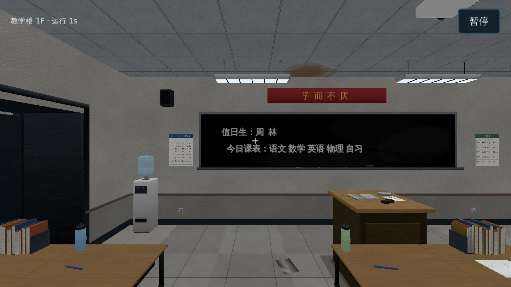

# 武大附中 · 里世界 — Godot 移植版

后续开发在本仓库进行。[旧 Web 版仓库](https://github.com/wd-fz/wd-fz.github.io)已停止维护，仅作为移植参考。

**当前交付：移植框架 + 正式校园 + 楼层通行与校园日程。** 旧版全部 42 个室内场景和室外校园由旧版自己的建模函数导出（建筑不变），碰撞取旧版自己的碰撞数据。新局 11:40 坐在教学楼一楼本人座位上；可以开关房门、走楼梯井上下楼、走连廊、爬钟楼旋梯、乘电梯，穿过连续校园的门进出楼；课表、熄灯与跨日、SAN／违规／同化／体力的结算、校园压力、12:50、17:50 的学生会检查，以及背包、翻找与常用物品照旧版运行。灯光按旧版的天色与灯表近似还原。巡察者（巡逻、追逐、躲柜、挡门、永久追踪）已移植。异象的调度与 26 种规则已移植，21 种有占位几何表现（其余以声音、文字表现）。新游戏先选天赋（七选一或随机）。主菜单有成就列表（33 条）与档案馆（死亡与结局记录）。死亡演出是占位的屏幕效果（没有旧版 CG 场景），其余随系统移植。声音有合成占位音（脚步、心跳、巡察者脚步、环境与事件音，`M` 键静音），真实音效尚未移植。五条公开结局路线（《白名单》、开车《闸门》、传送门《门》、广播《放学》、手机与机房终端《网安仙人》）与车库黑影、结局卡已移植；八种恢复 SAN 的活动、实验楼设施、撞钟考试、请假条与地图列表已移植。声音、死亡演出、菜单系统尚待迁移，进度见[计划目录](docs/plan/README.md)。



## 运行

1. 安装 **Godot 4.6.3 标准版**，不需要 .NET。引擎版本固定在 [.godot-version](.godot-version)。
2. 克隆本仓库，在 Godot 项目管理器导入根目录的 [project.godot](project.godot)。
3. 等待首次资源导入，按 **F6** 运行 `scenes/app.tscn`，或直接按 **F5** 运行项目。
4. 点「进入测试场景」（现在进入正式校园：坐在教学楼一楼的座位上），移动即起身；朝门按 **E** 开门，走廊南端正门直接走出去就到室外；走廊两端的楼梯口直接走进去上下楼；电梯门口按 **E** 呼梯，轿厢里按 **E** 选层、**V** 关门；**Tab** 背包、**1/2** 快捷栏、**F** 手电；按 **Esc** 打开暂停页，验证保存、读取和返回菜单。框架示例房间仍保留为 `migration_lab`，测试用。

也可通过命令行运行：

```bash
godot --editor --path .
godot --path .
```

键鼠：WASD／方向键移动、鼠标环视、Shift 奔跑、E 交互、Esc 暂停；失去鼠标捕获后点击场景重新捕获。触屏：左侧摇杆移动、右侧上方滑动环视、右下角交互与奔跑；主菜单可以手动启用控件。切出应用会暂停，切回来后主动继续。

默认使用 **Compatibility / OpenGL**，便于普通设备打开框架。渲染器属于表现层，可以在 Godot 项目设置中切换；当前没有做 Vulkan、移动设备或不同渲染器的性能与效果承诺。

界面使用系统字体回退，Linux 无中文字体时安装 Noto Sans CJK；正式发行前再确定可再分发的字体与资源包。本框架没有联网、账号或在线资源依赖。

## 给接手者的入口

| 要做什么 | 从哪里开始 |
| --- | --- |
| 了解分层和状态归属 | [架构与模块接口](docs/架构与模块接口.md) |
| 迁移一个玩法、房间或模型 | [移植接入指南](docs/移植接入指南.md) |
| 选择下一项工作 | [计划目录](docs/plan/README.md) |
| 参考完整的小模块 | [告示牌示例](features/demo/demo_module.gd)与[功能目录说明](features/README.md) |
| 运行检查或提交修改 | [贡献指南](CONTRIBUTING.md) |
| 导入外部资源 | [资源约定](assets/README.md) |
| 重新导出旧版建筑 | [旧版建筑导出](tools/export_scenes/README.md)与[正式校园资源](assets/campus/README.md) |

项目没有全局游戏状态 Autoload。`GameApp` 是组合入口，每局新建 `GameSession`；规则对象不读场景树或文件，场景与 UI 通过信号接入。新增功能有独立模块 ID、交互 ID、状态版本与保存域。

## 验证

安装 Python 3.10+，确保 `godot` 在 PATH 中：

```bash
python tools/check.py
```

若引擎不在 PATH，设置 `GODOT_BIN` 为 Godot 可执行文件的路径。检查会核对版本、规则层边界、执行真实 Godot 导入和无窗口回归；脚本报错即使 Godot 返回 0，也判为失败。有显示环境时加 `--windowed` 同时检查窗口输入。GitHub Actions 使用 Xvfb 运行两种模式。

有显示环境时可生成实际渲染预览：

```bash
godot --path . --script res://tools/capture_preview.gd
```

图片输出到 `build/previews/`，不会覆盖正式存档。正式校园的预览用 `--script res://tools/capture_campus.gd`。当前自动验证与限制见[框架验证记录](docs/框架验证记录.md)与[正式校园验证记录](docs/正式校园验证记录.md)。

## 存档与范围

本机测试存档为 `user://saves/slot_1.json`，应用数据目录名为 `wdfz-godot`。保存先写临时文件，保留前一份 `.bak` 后替换；读取先完成格式、场景 ID 和模块状态校验，再替换会话。未启用模块的 JSON 数据会保留。

这是独立的 `wdfz-godot` 格式 v1，**不能直接读取 Web 版存档**。示例时钟采用完整自然日 20 分钟的四段预算，但尚未移植正式开局时刻、剧情慢速窗口、课表、跨日压力和相关事件，不能拿演示场景判断游戏平衡。

许可证沿用仓库已有的 [GNU AGPL v3](LICENSE)。`assets/campus/` 的模型与贴图由旧版本项目自有的建模与贴图脚本生成，来源记录见[正式校园资源](assets/campus/README.md)；旧版音频尚未搬入。
