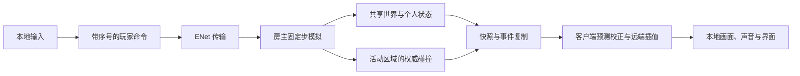

# 局域网联机模式

以 Godot 仓库 [`947d35c`](https://github.com/wd-fz/wdfz/commit/947d35c1ed0e58fbae1a958d4ee991af705640c5) 为代码基线，在 `plan/lan-coop` 分支规划并实施。整体状态统一见[计划目录](README.md)。本文描述目标、改造边界和验收要求，不代表旧 Web 版的多人能力已经迁移。

## 1. 目标与范围

沿用此前确定的 **2–4 人好友合作通关**：共享校园、日程与剧情推进，每人保留自己的 SAN、违规、同化、体力、天赋和背包。玩家可以分头探索不同房间、楼层和建筑，合作寻找线索、搬运材料、操作设施并逃离校园。

由其中一名玩家的设备同时运行房主服务和本地游戏，其他玩家通过局域网 IP 加入，无需云服务器或账号。Windows、Linux 和 Android 使用同一玩法协议；Android 保持横屏全屏，桌面保持默认窗口化及 Linux Wayland 支持，个人画质和帧率设置互不影响。竖屏仍不受维护。

首个可验证切片是两名玩家从教室出发，分别进入教室和实验楼，看到一致的共享门、唯一物品和巡察者状态，并完成一次合作存档与原成员重连。完整模式的交付标准还包括四人、三个平台和公开结局适配，不能以“能看到另一个玩家”作为完成依据。

首版范围：

- 创建房间、直接输入 IP 与端口加入、准备、开始、退出、原成员断线重连；局域网发现提供便利，发现失败时仍可直接加入。
- 开局需要 2–4 人；开局后不接纳陌生的新成员，保留原成员重连资格。只剩一名存活玩家时允许继续本局。
- 共享世界状态与个人状态分别同步；合作存档、结算和调试记录与单人模式隔离。
- 不包含公网匹配、账号、自动 NAT 穿透、云中继、语音、PvP、独立专用服务器和房主迁移。虚拟组网工具提供可达 IP 时可尝试直接加入，但不承诺跨虚拟网络广播发现。

## 2. 规划时核实的基线

| 当前入口 | 实际约束 | 联机改造方向 |
| --- | --- | --- |
| `game/core/session/game_session.gd` | 一个 `world_id`、一套模块与一个玩家姿态；时钟、模块统一推进 | 增加房间会话和稳定成员表，区分共享状态与各玩家状态；共享时钟每个模拟步只推进一次 |
| `game/app/session_factory.gd` | 每局各功能模块各实例化一次 | 显式装配共享模块与个人模块实例，继续保留单人装配入口 |
| `game/features/school/school_module.gd` | 日期、检查日程和个人 SAN、违规、座位、外出登记混合 | 分离共享校园日历和个人学生状态，保留现有 20 分钟自然日及逐日压力规则 |
| `game/features/items/inventory_module.gd` | 背包、容器搜索与地面物品混合；地面拾取使用数组下标 | 共享容器和地面实体使用稳定 ID，背包按成员归属；拾取、使用、交付由房主原子结算 |
| `game/features/patrol/patrol_module.gd` | 全校唯一巡察者，但当前上下文、躲藏与追踪围绕一个玩家 | 保留唯一实体，维护候选玩家、当前目标及按成员区分的目击证据 |
| `game/features/story/story_module.gd`、`game/app/game_app.gd` | 单个死亡／结束状态、个人救助、输入与镜头上下文参与全局驱动；暂停会停整个场景树 | 拆出独立房主模拟入口，个人死亡、菜单、读书和演出不能停止其他玩家 |
| `game/presentation/world/world_router.gd` | 切换时卸载上一场景，不同房间使用各自局部坐标 | 客户端保留本地表现，房主另外维护有人或有活动任务的区域与碰撞空间 |
| `game/presentation/actors/player_controller.gd` | 设备输入、镜头和物理移动在同一控制器 | 分离输入采集、角色运动与远端表现，支持房主权威移动及本地预测 |
| `game/core/domain/save_schema.gd`、`game/infrastructure/persistence/save_store.gd` | 单人格式只有一个世界和一个玩家，已有校验、临时文件和备份替换 | 新建合作格式与目录，复用安全写入原则，不把合作数据塞进单人槽位 |
| `export_presets.cfg` | Android Debug 与 Release 均为 `permissions/internet=false` | 实施阶段同时开启并验证最终 APK 权限；保留 Vulkan、横屏与全屏要求 |
| `game/`、`tests/` | 没有现成的 ENet／RPC 房间传输层；手机内的“网络”属于游戏剧情 | 新增真实传输、连接生命周期与多进程测试，不能复用剧情状态冒充联机连接 |

[架构与模块接口](../架构与模块接口.md)可用于理解分层，但其中部分早期迁移说明已经滞后。实现与验收以当前源码、[项目结构与持续集成](../项目结构与持续集成.md)及[迁移一致性验证](../迁移一致性验证.md)为准。

## 3. 房间与玩家体验

### 建房、加入与开始

房主设置房间名、人数上限和房间难度，选择新游戏或合作存档。界面展示可复制的实际局域网地址和端口；多网卡时允许选地址，不把 `127.0.0.1` 当成朋友可以连接的地址。

加入页支持房间发现、手动输入 `IP:端口`、粘贴和最近地址。发现条目显示版本、人数和房间阶段；列表与地址输入适配横屏触控、软键盘和返回操作。昵称可以重复，但不能作为玩家身份。

进入大厅后，各自选择天赋并准备。开始流程依次为：房主建立基线、成员加载对应世界、全员确认加载完成、按共同模拟时刻进入开场与游戏。加载中不提前推进日程；超时提供重试、移除未就绪成员或返回大厅，移除后不足两人则不能开始。

错误提示区分地址无效、端口占用、版本不兼容、人数已满、游戏已开始、无响应和房主离开。连接、加载及重连均可取消；旧连接回调不得覆盖新房间。

### 菜单、暂停与时间

- 背包、手机、设置、个人答题与普通暂停菜单只改变自己的输入和界面，世界继续运行；显示“联机中世界继续运行”，并在打开、关闭和失焦时清除残留移动、奔跑输入。
- 桌面房主切出窗口或打开设置仍继续服务。Android 房主进入后台可能被系统暂停或终止，不能承诺后台常驻；其他玩家应看到连接中断和恢复结果。
- 建议增加明确的“全队暂停”：房主发起，任一在线成员可恢复，最多 120 秒后自动恢复。游戏时钟和规则冻结，网络心跳、退出与恢复命令仍运行。
- 睡觉、课堂等待等跳时行为需所有存活且在线的玩家同意，并满足无追逐、无未结算交互等条件；不能由一人的休息跳过队友所在时段。不推进日历的普通个人活动保持世界连续运行；会跳时的休息与设施操作统一进入全队确认。
- 特殊空间、个人剧情和死亡演出只暂停对应玩家的操作或个人计时；任何需要冻结全局时间的旧机制都必须逐项适配，不沿用整个 `SceneTree.paused`。

## 4. 玩法状态的所有权

| 归属 | 内容 | 约束 |
| --- | --- | --- |
| 共享世界 | 日期、课表、逐日压力、检查触发、门、电梯、容器、地面物品、设施冷却、共享调查线索和路线进度 | 房主唯一写入，共享随机结果只抽取一次；玩家数量不应使规则运行次数翻倍 |
| 个人 | SAN、违规、同化、体力、伤病、保护、天赋、背包、装备、手机电量、请假与外出登记、座位、躲藏、生死 | 以稳定成员 ID 索引，不能因为队友移动、死亡或读档互相覆盖 |
| 事件参与者 | 个人异象选择、注视、课堂任务、搜索者、设施操作者、结局参与状态 | 显式记录对象与参与集合；是否受影响由房主依据位置和规则判定 |
| 本地表现 | 画质、帧率、音量、字幕、触控布局、镜头和非伤害性幻觉表现 | 不改变权威规则；有伤害或物品效果的事件不能只在本地随机决定 |
| 合作记录 | 成员名单、个人结果、全队结果、合作成就与调试标记 | 与单人记录隔离；影响世界的调试操作使整局带调试标记 |

建议从共享校园日历与个人学生状态的拆分入手，通过单人适配器保留现有存档字段及回归结果，再装配多人会话。不是简单复制四套完整单人模块，否则课表、容器和巡察者都会出现多个互相冲突的版本。

每人分配独立且有效的本人座位，处理原座位 NPC 占用。学生会检查逐人判断位置、移动和注视；每人独立承担处罚或奖励。夜间进入宿舍楼不增加通常的场所违规，其他独立事件处罚继续按原规则结算。

### 物品与交互一致性

1. 区分物品种类 ID、唯一实例 ID、容器 ID 和所有者；网络请求不能引用易变的地面数组下标。
2. 两人同时拾取唯一物品时只允许一人成功；背包已满时物品仍在原地，失败者收到明确原因。
3. 搜索容器只生成一次内容。长时间搜索记录当前操作者与租约，移动、死亡或离线后取消或释放，不能因另一玩家打开容器重复抽取。
4. 丢弃、拾取、交易和剧情材料交付使用请求 ID 与实体版本，重复包返回相同结果，不重复扣除或发放。先校验整个交易，再一次性结算。
5. 关键物品不得因地面容量上限、成员死亡或离线而消失；建立可恢复的掉落／保管规则及归属记录，避免同时存在于背包和地面。
6. 读到的调查知识可同步到全队笔记，但钥匙和材料不因此复制四份。
7. 电梯共享一个门状态、运行时钟与乘客集合；只移动实际进入轿厢的玩家，不把同楼层队友一起带走。
8. 终端、广播、驾驶位等单操作席位使用明确占用与释放规则。接手可以继承已提交的公共进度，不能继承上一玩家未确认的个人选择。

## 5. 巡察者与异象的多人规则

以刚完成的[巡察者强化](巡察者.md)为基础，保持全校唯一实体、普通移动、遮挡、有限证据搜查和最高增加 8% 的追速。多人玩法不能退化为“每个客户端生成自己的巡察者”。

- 每个候选玩家用自己的违规值计算可见距离与锁定时间；追逐使用当前目标的档位，不采用全队最高值，也不被低违规队友覆盖。
- 本人座位、请假、伪装、夜间归寝等资格逐人判定。通常发现目标必须经过实际视线、距离与遮挡检查，不能读取未被发现成员的位置来选择最近猎物。
- 有效追逐期间优先保持目标，避免两人交替露头使其每帧改向。目标死亡、获得适用豁免或搜查结束后再选择；候选按现有追踪责任、可达性、距离和违规排序，同分以稳定 ID 决定。
- 目击证据记录对象 ID、冻结的位置、离开方向、当时档位、搜查路线与剩余时间。另一人的移动不刷新旧证据，也不使旧目标的锁定计时转移给新目标。
- 柜子占用属于共享世界；看到某人躲柜才获得该柜的证据，走到柜前才能确认当前占用者。未暴露的藏身位置仍受保护，高违规不获得隔墙定位能力。
- 无线破解每 15 秒按破解者记录当时的静态位置；区域报警按成员与进入事件去重。多个报点按有界队列调度，不能用后续实时坐标覆盖报告。
- 缺席导致的永久追踪归属于责任成员，不能扩散到全队；正常夜间归寝也不能清除其独立触发的永久追踪或无线报警。
- 抓捕与保护只结算目标本人；能照退或击退共享巡察者的道具，则对唯一实体生效并同步。个人梦醒、救助不能重置全队巡察进度和其他成员的责任。
- 客户端从同一巡察状态驱动模型与声音，按本地观察者计算可听范围。脚步字幕保持 5 米内的“脚步声”，不恢复方位描述。

异象分成共享环境事件和指定参与者事件。暴雨、停电等由共享调度器产生；目标所在区域决定实际受影响者。拍肩、注视、回答选择等使用对应玩家的输入与姿态，由房主校验，不能读取房主自己的镜头代替队友视线。四人不能让异象抽取频率变成四倍。

本地幻觉可独立表现，但凡涉及损伤、违规、门禁、材料和结局的效果，都必须有权威事件 ID 和明确对象。重发事件不能再次扣 SAN 或再次授予奖励。

## 6. 生死、个人演出与合作通关

本节是首版建议默认值，尚未逐项产品确认。实现基础连接和状态拆分无需等待这些扩展规则；进入对应阶段前固定具体规则与验收。

个人死亡先按现有天赋、道具和救助机制结算；最终死亡后播放本人的死亡演出并转为观战，所有成员死亡才结束房间。首版不额外增加倒地扶起或无限队友复活，以免把现有风险体系一起重写。观战默认仅跟随存活队友的已授权视角，不能自由穿墙侦察、交互或触发事件。

房主死亡或观看原地死亡演出时，房主模拟仍继续工作。演出临时借用模型、修改姿态和镜头的变化仅用于本地表现，不能作为巡察者或共享世界的新状态广播。

建议一局完成一个共同结局。在不可逆的最终操作前，明确列出参与者、集合条件与未完成事项，由存活成员确认；取消不消耗材料。暂时掉线的成员在保留期内阻止最终确认，超时离队后不再阻止；房主可提前明确移除该成员，按离队规则回收关键物品并失效其本局重连资格，不能静默丢人。已死亡成员记录全队结果，同时保留本人死亡结果。

| 路线 | 合作适配重点 |
| --- | --- |
| 《白名单》 | 作为首条完整验收路线；共享调查和解谜，按实际持有人原子交付材料，最终确认与参与者记录一致 |
| 《闸门》驾驶路线 | 共用车辆、钥匙和追逐障碍，一人驾驶、其他人乘车；司机掉线时安全减速并允许接管，不能把未上车玩家直接算作逃离 |
| 《门》传送门路线 | 共享图纸、材料与建造进度，按实际进入者记录参与；不因一人进入而无提示地传送所有队友 |
| 《放学》 | 广播、铃声与人群状态共享，允许操作者与跟随者分工；掉队判定针对具体成员，不把一人的遮掩状态套用全队 |
| 《网安仙人》 | 终端和服务器阶段共享，手机电量、破解者与报点分别归属；操作接管不重置计时，明确最终存活与在场条件 |
| 《外国语学生》 | 共享预约、访客和队伍进度，按语言操作人及各自跟随距离结算；一人走到终点不自动替所有人达成 |

逐条登记隐藏结局、特殊空间和 DLC 的个人／共享规则。在完成适配前，合作入口明确列出尚不可用的路线，单人玩法保留；首轮公开验收先覆盖上述六条路线，再扩展隐藏内容，不能用“单人能运行”代替合作验收。

## 7. 网络与模拟架构

采用 Godot 原生高层多人 API 与 `ENetMultiplayerPeer`，房主设备执行权威模拟。房主自己的操作也走同一命令入口，客户端不能直接写 SAN、物品、巡察者或剧情状态。不同平台不要求物理结果逐位一致，不采用跨平台确定性锁步。

建议职责落位如下，实际文件名在实施阶段按既有结构确定：

| 层 | 职责 |
| --- | --- |
| `game/core/session/`、`game/core/domain/` | 共享／个人状态值、稳定实体 ID、命令与结果、合作存档协议；不依赖网络节点 |
| `game/features/cooperation/` | 准备、参与者、交易、共同结局等纯规则；原玩法模块通过明确上下文接入 |
| `game/infrastructure/network/` | ENet 适配、连接、发现、协议校验、流量预算、断开与重连 |
| `game/app/` | 合作装配、房主模拟、命令路由、场景生命周期；移出当前依赖单个本地镜头的驱动逻辑 |
| `game/presentation/actors/` | 输入采集、可复用运动器、本地预测与校正、远端模型／动画／脚步 |
| `game/presentation/world/` | 客户端当前场景表现，以及房主不依赖渲染的碰撞空间适配 |
| `game/presentation/ui/` | 建房、加入、大厅、连接状态、队友状态和合作结算 |
| `tests/suites/`、`tests/network/` | 纯规则、协议及真正的多进程联机回归 |

`MultiplayerSpawner`／`MultiplayerSynchronizer` 可辅助表现节点生命周期，但不直接广播整套模块 `capture()`，也不让节点树自动复制代替业务权限与事务。

### 移动、同步与场景

实现采用房主物理 60 Hz、输入打包 30 Hz、运动快照 20 Hz、压缩规则基线 5 Hz，均独立于画面帧率；Android 房主仍需实测这些参数。客户端发送移动意图，房主校验输入并执行运动、碰撞和体力消耗。

本地玩家做预测，按房主确认的输入序号回放未确认输入；远端玩家以约 100 毫秒缓冲插值，并限制短时外推。连续输入过期后归零，不能因最后一包是奔跑就无限向前。校正必须包含影响速度的体力、伤病和交互状态。

所有消息携带必要的会话代次、成员 ID、个人场景版本、输入序号或实体版本。个人跨场景、救助时递增本人的场景版本并丢弃旧输入，不更换全队会话代次；整局恢复才切换会话代次。不可用旧位置快照把玩家拉回上一楼层。远端玩家显示名字、当前动作和必要队友状态，不默认显示隐藏 SAN 数字或隔墙位置。

每位玩家拥有自己的 `world_id`。房主至少保留有人、巡察者或活动任务的区域模拟；无人区域按规则休眠，但不能因此暂停全局日程、共享计时或抹掉掉落物。

不同房间局部坐标会重叠，房主必须为活动区域提供互相隔离的物理空间，并从同一校园几何来源建立碰撞。M0 先验证不渲染的 `World3D`／物理空间能否正确运行运动与射线；不能简单把四个房间叠在同一物理世界。客户端只渲染自己所在区域及必要邻区，避免四名玩家等于四套完整高画质校园。

首版建议玩家彼此不进行实体推挤，避免堵门和跨网络抖动；座位、柜子、电梯和驾驶位的占用仍由规则检查，不能用“无玩家碰撞”绕过人数限制。

## 8. 协议、发现与连接生命周期

### 地址与握手

建议项目默认使用 UDP `24560` 游戏端口、`24561` 发现端口，可配置；这不是 Godot 的保留默认端口。四人房间为房主加最多三个远端连接。

发现使用有频率上限的局域网请求／响应，只公开房间名、协议版本、人数、游戏端口和房间标识，设置过期时间并支持取消，不广播存档、重连令牌或个人资料。直接 IPv4 加入是必要能力；热点隔离、访客网络或防火墙阻断时提供对应检查提示。短房间码若采用，也仅标识当前可发现局域网内的房间，不暗示存在公网房间目录。

握手校验协议版本、玩法规则版本与内容清单摘要。摘要基于影响规则的源内容，不能因为平台纹理压缩格式或 GPU 不同就判为不兼容。稳定成员 ID 与 Godot 的临时 peer ID 分开，重连换 peer 不等于创建新角色。

### 通道与消息边界

| 信息 | 传输方式 | 一致性要求 |
| --- | --- | --- |
| 房间控制、准备、退出、恢复 | 可靠通道 | 校验房间阶段、身份和代次；幂等执行 |
| 连续输入与位置快照 | 有序不可靠通道，按用途隔离 | 序号、确认和有界历史；最近输入冗余发送、房主去重，过期输入不得重放 |
| 物品、门、设施与剧情请求／结果 | 可靠通道 | 请求 ID、实体版本、距离、视线、占用和参与条件由房主验证 |
| 死亡、广播、异象和结局事件 | 可靠通道 | 事件 ID、发生时刻及参与者明确，重复收到不重复执行 |
| 加入／重连基线 | 独立可靠通道，分块 | 完整性、大小、基线时刻验证后原子替换；之后接续增量，避免大包阻塞输入 |

不同通道不保证互相先后顺序。基线和增量必须有明确应用边界；收到引用未知实体或尚未完成切换场景的消息时，按版本等待或请求重同步，不能盲目执行。

RPC 使用实际发送者绑定玩家，拒绝伪造成员 ID、错误阶段、过期版本、非有限数字、越界输入和超频请求。客户端不得指定任意资源路径、节点路径、函数名或对象反序列化内容。房主是受信任的玩家设备，不声称提供防房主作弊能力。

初始包预算：移动与快照单包净负载尽量控制在约 1200 字节以内；基线按约 16 KiB 逻辑块传输、限制整体组装体积为 2 MiB，采用单独流量预算并测量 ENet 分片与 RPC 开销。最终阈值依据实际最大合作存档确定，超限必须明确拒绝或重同步，不能无限积压。

### 生命周期与重连

房间阶段为大厅、建立基线、等待就绪、进行中、结算、关闭；成员阶段为加载、存活、死亡观战、断线保留、离队。每次新局或恢复存档产生新的会话代次。

建议断线保留 60 秒：角色继续由房主模拟、输入归零，仍可能受到正常伤害；断线不能回血、刷保护或复制背包。超时后按离队处理，释放操作席位、保存角色结果并回收关键物品；后续恢复角色必须从这份结果继续，不能重新领一套初始物品。

房主签发成员重连凭据，客户端仅私下保存；不写进普通日志或广播。昵称相同不构成认领角色的依据。重连恢复完整个人和共享基线，不重放奖励回调；同一成员不得同时拥有两个活动连接。

房主退出或进程消失后，其他端停止推进预测，显示重连或返回入口，不各自继续生成可合并进度。首版没有自动房主迁移；可由原房主重新建立房间并恢复合作检查点，队友按原身份认领角色。

## 9. 合作存档与记录

建议使用独立 `wdfz-godot-coop` 格式与存档目录，保存房间规则、共享世界、稳定成员表、各自位置与状态、进行中的任务、共享随机状态、巡察目标与证据。现有单人格式、槽位和大小限制保持原兼容性，合作存档另外制定边界。

- 只有房主生成权威检查点；客户端保存个人设置和重连信息，不能把局部可见快照当成完整世界自动保存。
- 在事务已完成的模拟步边界捕获一致快照，避免保存“物品已从地面移走、尚未进入背包”的中间状态。
- 不持久化临时 peer ID、网络包、界面回调和旧请求队列。恢复后使用稳定 ID 与新会话代次，旧重试不能再次扣材料。
- 校验成员与世界引用、实体唯一性、物品归属、数据深度和文件大小，采用临时写入、验证与备份替换。基线预算和合作存档上限一起评估，不能直接放宽单人安全校验。
- 恢复房间按原成员认领角色；替换队友、中途新增角色、单人档转合作档和客机接管房主存档不作为首版自动行为。
- 合作结算记录全队路线、实际参与时段、个人生死和调试标记。正式单人成就与成绩不因合作共享知识直接解锁。

## 10. 实施阶段与验收

| 阶段 | 交付 | 完成条件 |
| --- | --- | --- |
| M0：状态与模拟边界 | 共享日历／个人状态、稳定 ID、输入／运动分离、房主驱动原型、隔离物理空间与协议／存档样例 | 单人存档与玩法回归继续通过；无 UI 的两名角色可在不同楼层正确碰撞，共享时间只推进一次 |
| M1：连接与移动切片 | ENet、大厅、直接 IP、版本检查、加载屏障、移动预测／复制、正常退出 | 两个独立进程可分处两楼层，互相靠近时看到一致位置；房主打开设置不冻结队友，断开和取消不会残留连接 |
| M2：共享交互与持久化 | 门、电梯、座位、唯一物品、容器、调查知识、个人背包、合作存档与重连 | 同时拾取只成功一次，重复请求无重复收益，满背包和离队不吞关键物品；跨楼层存取档与原成员重连一致 |
| M3：多人威胁与日程 | 巡察目标与证据、无线／区域报告、学生会检查、共享及个人异象、全队暂停和时间跳转 | 四人仍只有一套日程和巡察状态；豁免、违规及搜查不串人，多个报告有序结算，个人演出不冻结其他玩家 |
| M4：完整合作路线 | 本人死亡、观战、共同结算；先完整打通《白名单》，再逐条适配其余公开路线 | 从大厅到结局的真实双进程整局，包括分头调查、材料协作和一次断线；房主死亡仍可继续服务，六条路线各有合作验收 |
| M5：四人与平台交付 | 发现、三平台权限与界面、网络故障测试、Android 房主评估、CI、用户与维护文档 | 四人自然完整游玩、三平台互通和全部公开路线验证；有实测性能及明确设备范围，不能只凭回环连接宣布可发布 |

依赖顺序为 M0 → M1 → M2 → M3 → M4 → M5。发现功能可在 M1 后独立推进，但不能阻塞直接 IP 切片。每阶段保留可用单人入口，不以关闭原回归来通过联机改造。

实施时同步更新架构、操作说明、存档说明、测试入口及计划目录，记录具体证据。实现已落在本分支，入口、边界、测试命令和证据见[局域网合作](../局域网合作.md)及[局域网联机验证](../局域网联机验证.md)。真机和自然完整游玩验收仍按本计划执行，自动夹具不替代这些要求。

## 11. 测试、性能与持续集成

### 自动验证

1. 纯规则：多玩家时间只走一次、逐人资格、共享抽取一次、同时拾取、重复交易、关键物品归属、存档完整性与过期命令拒绝。
2. 巡察：同场景不同违规目标、不隔墙选择未知玩家、目标切换不继承锁定进度、静态报告不变成实时坐标、柜子证据归属、夜间归寝与永久责任边界。
3. 多进程：独立启动一个房主加一个或三个客机，使用临时端口和隔离存档目录；真正通过 ENet 通信，不能用同一场景树内四个对象代替网络测试。
4. 故障：至少覆盖 80 毫秒往返延迟、20 毫秒抖动、3% 丢包的可重复配置，以及乱序、重复、加载超时、断线、房主退出、恢复后旧代次消息。
5. 非法请求：伪造身份、超大数据、NaN、越界速度、隔墙拾取、重复领取、伪造结局和未经授权的调试命令均被拒绝。
6. 长时间：四人分处不同楼层运行至少 30 分钟，观察物理空间、消息队列、实体与内存是否持续累积；日志按事件 ID 关联，不输出重连凭据。
7. 窗口：现有 Vulkan Forward+ 与 Mobile 下验证远端动画／插值、原地死亡演出期间队友行动、触控移动与软键盘不串输入。

### 真机矩阵与性能预算

| 房主 | 客机与场景 |
| --- | --- |
| Windows | Linux、Android 混合加入；窗口切换、暂停与退出 |
| Linux | Windows、Android；Wayland 与 X11、失焦后服务持续运行 |
| Android | Android 与桌面混合；横屏触控、前台长局、后台中断与恢复、热点网络和热降频 |

同一路由器、手机热点、禁止广播但允许直接 IP 的网络分别验收。Android 房主需列出参考设备与实际可承载人数，不以桌面模拟器结果替代；操作系统杀进程后明确走房主重连／恢复流程。

初始性能预算是**待验证目标，不是已测成绩**：在登记过的参考设备上，四人相对单人增加的房主模拟 P95 尽量不超过 4 毫秒；每名客机稳定阶段平均下行不超过 100 KiB/s、上行不超过 30 KiB/s；正常局域网中常见交互确认以 100 毫秒内为目标。基线传输单独记录峰值和加载时间，测量 GPU／CPU／网络分别的开销，避免再次以全场景渲染换取联机方便。

现有 `.github/workflows/godot.yml` 保留结构、单人无窗口／两种 Vulkan 窗口回归和导出检查。实施阶段新增隔离的回环多进程网络与可重复故障测试，失败保留房主／客机日志、协议版本、随机种子与状态摘要；不依赖 GitHub 托管机器提供局域网广播，也不能因广播不可用跳过核心联机测试。

Android Debug 与 Release 都需验证最终 APK 的网络权限，扩展 `tools/export_android.py` 的清单检查。根据发布时目标 SDK 与真机验证是否需要额外局域网访问声明，不能默认添加与方案无关的位置权限。用户文档给出防火墙、热点隔离及房主后台限制的可操作说明。

开发工具增加房主／客机身份、成员状态、RTT／抖动、输入确认、快照频率、队列长度、活动区域和巡察目标查看。影响玩法的操作只允许房主执行并广播权威结果，暂停与传送按同一生命周期处理；客机本地表现预览不得修改共享世界。

## 12. 后续产品对齐点

以下按本文默认方案推进原型，在进入相应阶段前固定最终规则，不阻塞基础网络与状态边界的工作。

| 问题 | 建议默认 | 需要观察的体验 |
| --- | --- | --- |
| 死亡后能否被队友复活 | 沿用现有个人救助；最终死亡转观战 | 过早死亡后等待过长，再评估有限次数救援，而非先加入无限复活 |
| 全队是否必须一起逃离 | 一局一个共同结局，存活成员确认与集合；明确掉线保留／移除 | 分头探索不能导致最后无提示地遗漏队友，也不能被永远离线的成员卡死 |
| 中途是否允许新玩家加入 | 仅原成员重连 | 先解决身份和存档一致性，再设计补位角色、进度与物品归属 |
| Android 是否可作房主 | 以可运行前台房主为目标，明确后台中断 | 根据四人实测决定支持设备与人数；不承诺系统后台保活 |
| 隐藏路线和 DLC 的发布顺序 | 六条公开路线先完整验收，再逐项扩展 | 不把未适配入口伪装为可用合作内容，保留单人完整体验 |

技术参考：Godot 4.6 的[高层多人 API](https://docs.godotengine.org/en/4.6/tutorials/networking/high_level_multiplayer.html)与 [`ENetMultiplayerPeer`](https://docs.godotengine.org/en/4.6/classes/class_enetmultiplayerpeer.html)。具体参数以项目锁定的 Godot 版本验证，不在玩法模块中直接绑定传输实现。
