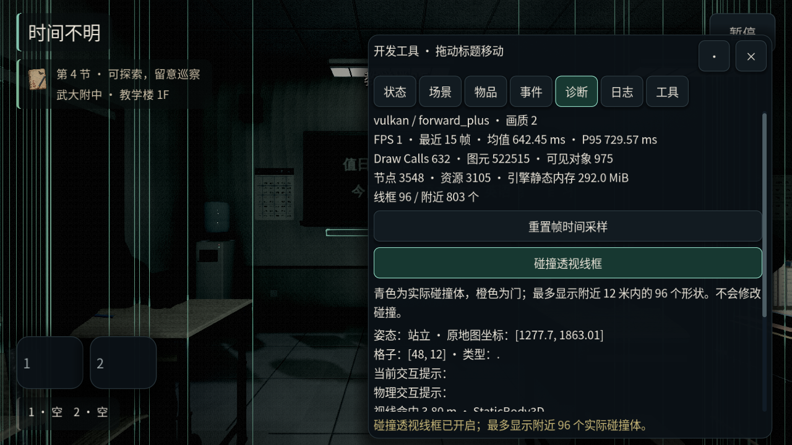
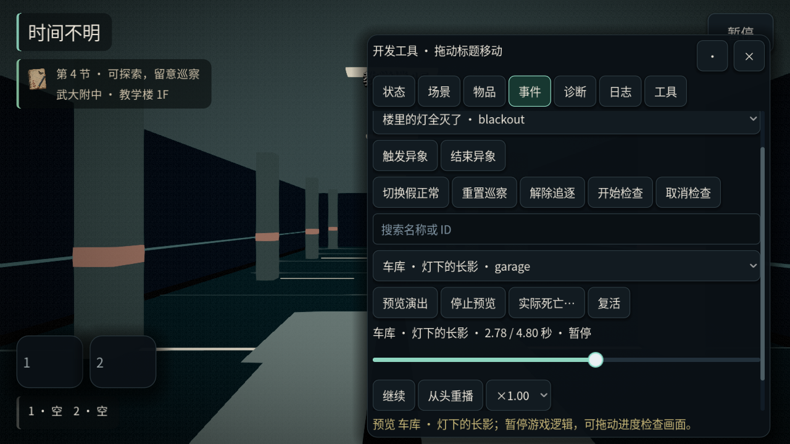
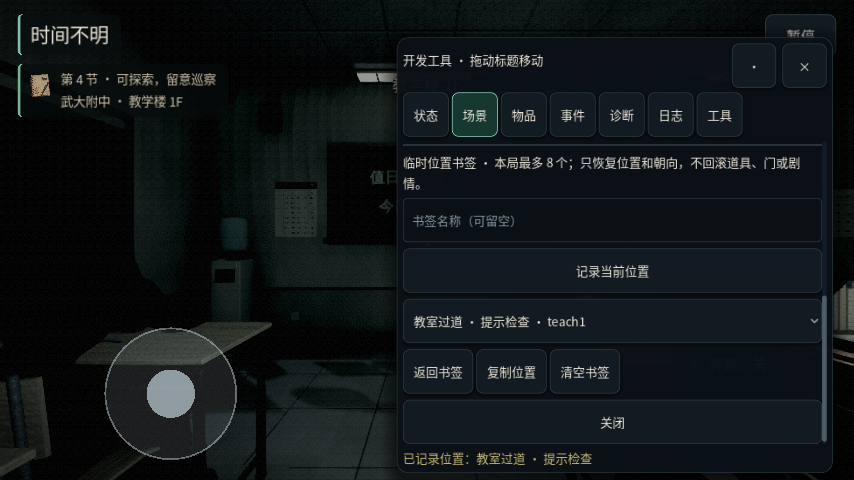
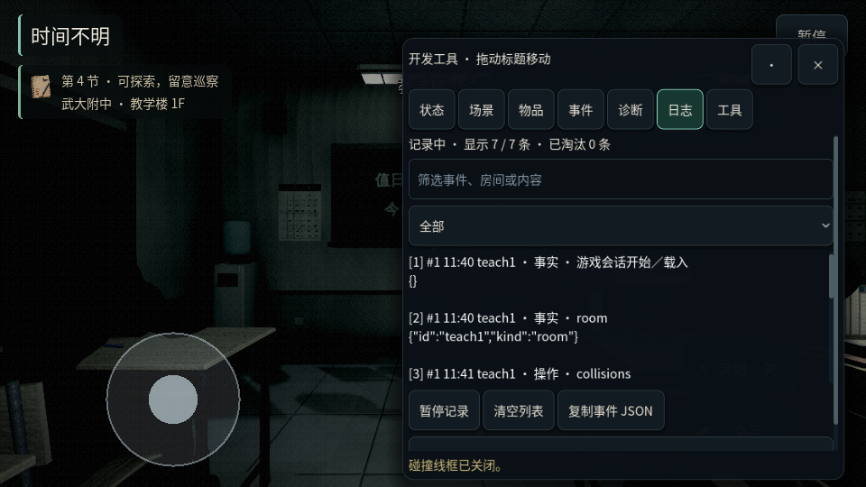
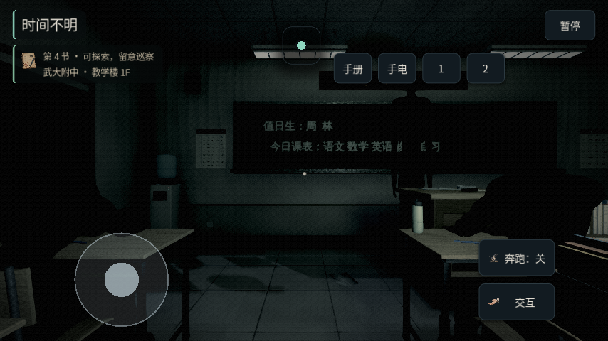

# 开发工具

入口与计划状态见[计划目录](README.md)，运行证据见[迁移一致性验证](../迁移一致性验证.md)。调试构建或以 `--dev` 启动时，可按 F2／F9 或菜单按钮打开。窗口可拖动，小横屏自动缩放，仍可收起为一个很小的悬浮球。横屏是维护目标，竖屏不受维护。

## 七个页面

| 页面 | 用途 |
| --- | --- |
| 状态 | SAN／体力／违规／同化、游戏时刻、巡察／检查、本局可信状态；数值编辑、恢复、时间前后调整、无敌、快跑、立即翻找、冻结及逻辑步进 |
| 场景 | 按名称／ID 搜索室内与室外地点；本局临时位置书签、返回与复制位置 |
| 物品 | 按名称／ID 搜索，遵守容量给予／移除，设置快捷栏 |
| 事件 | 触发／结束异象、巡察／检查／假正常；真实死亡确认、复活及死亡演出时间轴 |
| 诊断 | 实时帧时间、渲染统计、内存与节点；碰撞线框、视线命中、地图格与交互提示来源 |
| 日志 | 自动收集游戏事实与调试命令，按内容和类别筛选、暂停、清空或复制 JSON |
| 工具 | 诊断复制／报告导出、声音试听与整类连放、试玩记录与观察者笔记、清除调试记录 |

窗口外继续保留游戏交互；冻结、演出预览与文本编辑各有自己的输入边界。缩小窗口后的按钮、下拉选择与时间轴点击高度按实际屏幕缩放保持至少 44 像素，不靠放大悬浮球来容纳新功能。操作反馈固定在窗口底部，完整文字也保留在提示与诊断信息中，不必滚动到底才能知道操作结果。

## 冻结与逻辑步进

显式冻结与菜单暂停分开。冻结后可推进单帧逻辑（1/60 秒）、0.1 秒或 1 秒，内部每步最多 1/60 秒。它推进正常的游戏逻辑与 AI，角色物理移动保持冻结，不修改 `Engine.time_scale`。范围外数值、未冻结、菜单暂停、死亡预览、选择界面、乘梯或驾驶期间拒绝步进；出现选择、死亡或会话切换即停止剩余步数。

冻结与其他会改变玩法的工具继续使本局标记为调试局。关闭工具取消冻结，避免留下不能移动的玩家。

## 死亡预览

预览使用独立相机、独立声音和与真实死亡一致的分镜时长。可以暂停／继续、从头重播、以 0.25／0.5／1／2 倍速播放，以及直接拖动进度检查任意时刻。拖动会暂停，跨过的声音节拍静音；恢复播放后只播放后续节拍。倍速调整表现时间轴，音效保持原音高。

预览借用玩法与角色输入冻结，避免画面被隐藏时游戏仍在扣 SAN 或移动。它不修改实际玩家姿态、正式相机、存档数据或玩法声音随机序列；停止后归还借用的冻结，保留此前已启用的显式冻结。可以停在最后一帧检查，继续时从头播放。关闭、传送、读档、新局、菜单与真正死亡都清理预览和相关声音。

真实死亡按钮仍需要在游戏内确认，因为它会触发保护道具并可能删除本局存档。复活恢复死亡前姿态，取消旧演出与结果卡回调；不恢复已删除的存档。

## 性能、碰撞与交互检查

- 性能保留最近 180 个实际帧间隔，显示均值、P95、FPS、Draw Calls、图元／可见对象、节点／资源数和引擎静态内存。帧间隔来自单调墙钟，不受逻辑步进或命令行固定游戏步长伪装。它不是 GPU 单独耗时或整机内存测量；数值包含开发工具本身的开销。无窗口时明确显示没有真实 GPU 数据。
- 碰撞透视线框来自当前物理 `Shape3D` 的线段，而非重画一份猜测的地图。青色为碰撞体，橙色为门；最多显示距玩家 12 米范围内的 96 个形状，按距离优先，跳过已禁用形状和碰撞层。线段按两种颜色合成两批绘制，并限制总顶点数，避免每个碰撞体增加一个绘制调用。每秒重查动态形状，切场景、关闭工具和过场立即清理，既不编辑碰撞也不修改正式模型材质。
- 视线探测显示 30 米内最近的物理命中、距离、节点路径、形状及用途、碰撞层、位置和法线；排除玩家自身。另显示原地图坐标、格子与类型、站立／坐姿／躲藏，以及最终 HUD 交互提示和射线交互提示，便于定位座位与附近物品的提示冲突。

## 位置书签

本局最多保留 8 个位置及朝向，可命名。记录时需要站立并退出当前特殊互动，防止把座椅中的坐姿当作可站立落点。只记录位置，不回滚背包、数值、门、剧情或成就。新局与读档清空书签。

返回书签复用开发传送的清理流程：结束异象、选择回调、检查队列、乘梯、驾驶、翻找、躲藏和预览。下一物理帧检查落点；位置已被障碍占用时回到该场景默认落点。过期的异步检查不能在另一次传送或会话切换后修改玩家。

## 事件与报告

事件日志只在开发工具启用的构建中捕获，最近 120 条保留在本机内存。每条带序号、会话序号、房间、游戏时刻、类型与有长度／层数／总值预算的内容，不保留 Node 或回调引用。新局／读档保留之前的事件并记录会话边界，便于追踪跨读档问题；列表满后淘汰最旧条目并显示数量。筛选支持名称、房间、内容与事实／调试操作类型；拖动时间轴不会刷满日志。

「复制诊断信息」复制当前状态；「导出本机诊断报告」写入当前存档目录旁的 `debug-report.json`，包含引擎信息、诊断快照、事件与已有试玩记录。写出结果显示实际路径。不上传网络、不写正式存档、不改变成就／分数。声音试听、预览和玩法音频仍分别清理自己的声音。

## 既有规则边界

数值限制 0–100，体力遵守 SAN 上限；时钟调整复用正常规则，回拨不能降低累计压力，检查与乘梯期间禁止跳时。背包保持八格、去重与快捷栏清理。异象正常初始化／结束；解除普通追逐不会删除常驻实体或永久追踪。

快跑 ×2.6、无敌、立即翻找跨新局保留，但持续标记为调试局；开始速通时清除，速通中启用会使成绩失效。打开面板本身继续使 `RunScoreModule.trusted` 失效，关闭、保存与读档不能撤回标记。只读探测、位置记录和报告本身不另改玩法进度；用于修改玩法的返回书签、步进等仍走统一的调试标记。

## 代码与验证入口

- `game/app/debug_flow.gd`：命令、预览、步进、书签、诊断接线与生命周期；临时工具状态不属于存档模块。
- `game/presentation/ui/debug_panel.gd`：七页界面、筛选、时间轴与触摸尺寸；`FloatingPanel` 保留拖动和悬浮球。
- `game/infrastructure/diagnostics/debug_telemetry.gd`、`debug_trace.gd`：有界性能采样与事件内容。
- `game/presentation/world/debug_world_probe.gd`：真实碰撞形状和视线的只读适配器。
- `tests/suites/debug_workbench.gd`：有界数据、非法输入、预览／步进隔离、书签及障碍回退、过期回调、只读报告、碰撞／射线、筛选、横屏和真实触摸事件。
- `tests/suites/debug_tools.gd`：原时钟样本、操作、成绩隔离、全部死亡预览、复活；`touch_ui.gd`：拖动、悬浮球、文本输入与试听取消。
- `tools/capture/capture_debug_tools.gd`：原生 Vulkan 下捕获桌面诊断、演出时间轴、横屏日志、书签与悬浮球。

原 `.js` 模组仍不能直接在 Godot 中执行；旧存档及规则 DLC 的转换由兼容模块负责，不由开发工具绕过校验。原生扩展管理及人耳试听不以本次自动验证替代。

## 原生窗口画面

这些是游戏内 Vulkan 运行截图，横屏尺寸为 1280×720、960×540 和 854×480。图中的软件渲染帧率不代表真实手机性能。

| 性能／碰撞诊断 | 预览时间轴 |
| --- | --- |
|  |  |

| 小横屏书签 | 事件日志 |
| --- | --- |
|  |  |

