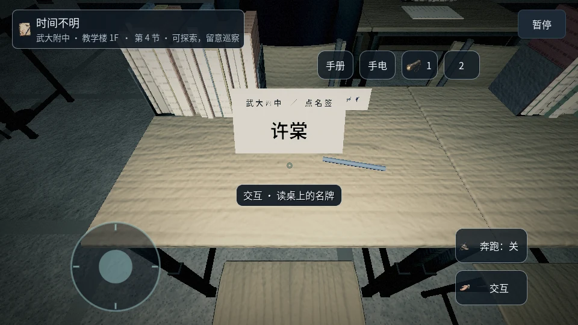
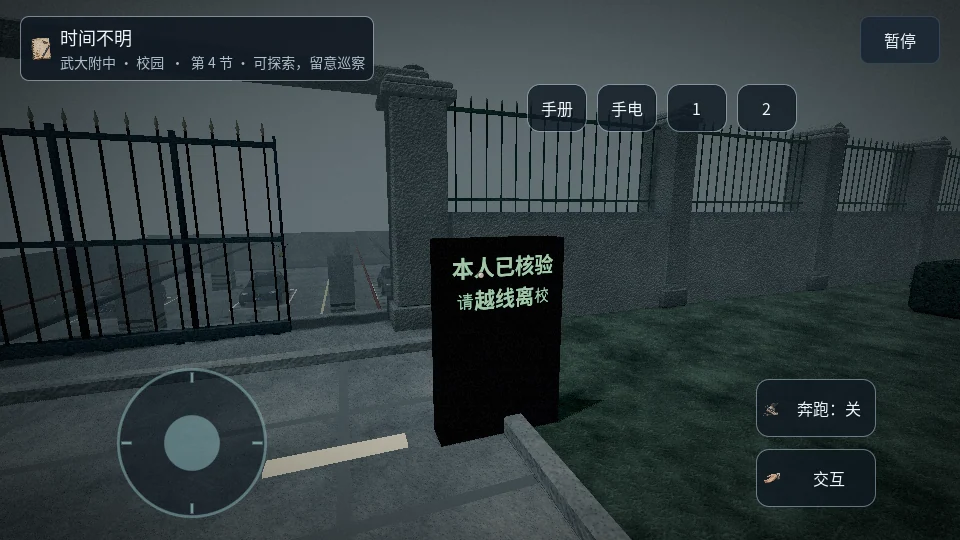
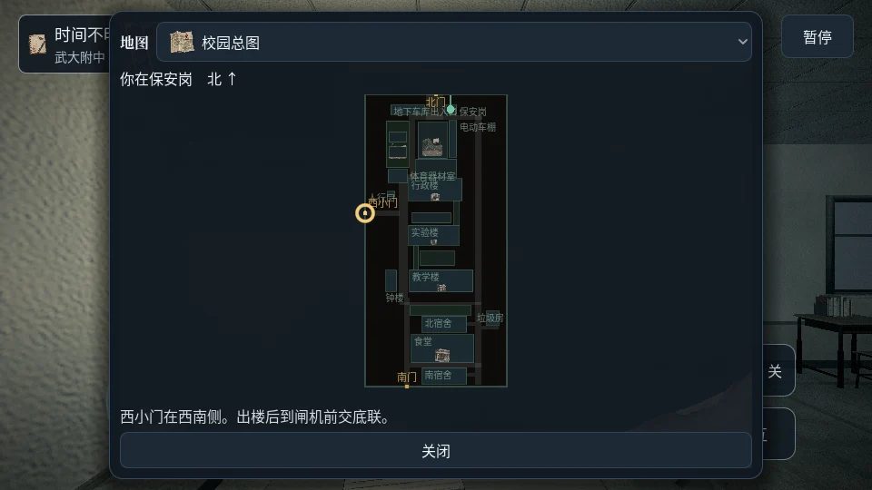

# 替我答到

单人开场里，我是这学期转到武大附中高二（二）班的学生。头一回在楼梯上找不到班里，是同桌带我回去的。今天放学我答应陪他去北门接妹妹，家里也留了我的晚饭。合作开场里，几位同班同学原本约好下课一起走北门，每个人都收到写着自己名字的停车单。

第四节语文课前，同桌往我书底下塞了一张停车单。上联四边都是齐的，右上角印着「17 号工单」。签名最后一笔往回勾，和我写的一模一样。我记得今天只在班里的签到册上签过字。纸背有一行同桌的字。

> 「底联在北门旁的保安岗。你去看一眼，点到你，我替你应一声。」

语文老师把同一句话念了两遍，我趴到桌上。再抬头时，已经到了里世界。课本和桌椅还在原处，身边那个像同桌的人盯着讲台，胸口一动不动。下课铃没有响，纸条还在我手边。我得去北门旁的保安岗看看底联，再找一条能回家的路。

过一会儿，如果玩家把名牌留在教室，人在外面，喇叭里就会响起一声「到」。是自己的声音。学校接着上课。此刻最可怕的事，是这个小忙居然真的帮上了。

完整版开场交代身份、约定和停车单，短版在醒来时给出签名与底联的线索。跳过演出后，提示仍指向北门旁的保安岗。手册笔记的「醒来以前」可以重读选定角色的经历，四名学生各有一段对日常的记忆。岗亭的底联确认签名笔迹一致，离校栏空着。西小门的核验章指向纸质离校手续，停车记录和钥匙移交则指向车库。玩家在总图上选择愿意追查的方向。

## 里世界和现实是什么关系

**现实里只有一座学校。里世界存在于 AnthroPrank（安抄派智能）的实验中，是几个活人的意识可以同时进入的人工世界。** 第四节语文，主角趴在书上。里面的他能跑到北门，和同学碰面，记得两个人刚刚说了什么。现实中有人守着这间教室，看见他的身体一直伏在原座。模型按课表过自己的昼夜，外面的钟照常走。

安抄派在研究一件事。原因能不能发生在模型里，结果却落在现实的一件东西上？最早一次成功只有两张纸。值班员把它们封进玻璃盒，研究员只给甲纸建立了对应关系。一个试员进入模型，临时挑了右边，在模型里的纸样上咬掉半圆。现实中的值班员看见甲纸右边掉下一小片，旁边的乙纸四边仍齐。两个人各自写下孔位，等停机才核对。值班员拆开封条，捡出那片纸，边缘的纸毛恰好能拼回去。

研究组想从这个小孔再往前一步。他们想在人工世界中试几种可能，只让选中的结果留在现实。纸样是他们已经做成的那部分。要验证活人临时作出的选择也能传出去，他们挑了一群熟悉同一所学校、会各自行动的学生。安抄派交给校方的是疏散演练说明。研究组留下的 17 号工单上才写着，第四节要把二班选定学生的意识接进校园模型。两组观察员分开记，现实侧事前不知道谁会走哪条路。

停车单是这次试验的实物样本。同桌上课前递来的上联用了玩家早晨在签到册上留下的签名，四条纸边完好。模型内的保安岗存着和它配对的底联。在西小门用底联核验，闸机依这局出示的证据打孔，只核过签名打左边，本人到场打上边，空座代答打右边。跨线后，玩家在现实课桌上醒过来，能从书底下抽出上联，摸到同一处半圆缺口。里面有人挪动普通课桌，现实教室里的桌子照旧摆着。能在外面找到的物理痕迹，限于研究开始前配对过的实物。停机可以结束实验，已经掉下来的纸屑还要有人去捡。

模型用校园平面、课堂录音和巡查记录拼出了学生熟悉的地方。它有同桌坐在座位上听课的模样，也有他一贯望着讲台的动作。至于他担心妹妹在北门等久了，是他自己记着的。纸条是他接入前亲手写的。他的意识和玩家一起被困，在二楼找路。楼梯间缺了一段可用的路径，走到底又接回二楼。巡察者照巡查表找人。把名牌留在座位上，点名就会调出玩家以前的那声「到」。这些事都发生在实验里面。

西小门核验和开车冲出北门都能让自己醒来。先醒来的人能在现实中替同桌给妹妹捎话。广播站的长铃是给所有接入者的唤醒信号，《放学》里，两个人都从课桌上抬起头，放学后一起跑去接她。《网安仙人》关停这次运行。玩家在现实岗亭再见到那片纸屑时，才有机会把值班员的手记和实物对上。

## 在学校里能亲手查到什么

学生熟悉的学校给研究组留下了许多不同日期的材料。一楼有人申请换座，座次表用的还是申请前的照片。球场边记着重画过的起跑线，车棚旧照里还锁着一辆早被推走的车。旧考场钟在取景时就停了，模型里的预备铃照自己的课表响。楼里贴的钟、铃声和现实观察员的手表各有来处。

录音留下声音，也会留下不经意的杂音。弹琴的人停手了，琴凳的吱呀声还会照原样响起。宿管听得出夜间水管和碰床架的区别。窗边那位同学一直坐着，西楼梯二楼却能有人接话。玩家临时约定敲击次数，楼下会按要求回应。问他妹妹书包上挂着什么，他会说是一颗掉漆的星星。放学后碰见她，才有机会亲眼认出那颗星星。同桌把记忆和牵挂带进了实验，课前的坐姿只留下一个朝向讲台的身影。

行政楼一楼有校方收到的借教室回执，五楼留着对收走签到原件的疑问。体检表上那个零和表格的线用的是同一层油墨。巡察值班表记得每一站，表头的巡查员姓名已经被裁掉。校内的违规、追逐和同化仍会让接入者失去行动机会。没有哪一张表可以替教室里的人给学生量脉搏。

两个人用的是同一次实验，仍可能落在不同的平台。西楼梯主图接着一楼，补拍的二楼少了一段下行路，出口又接回它自己的入口。同桌落在补拍件里。它和主图共用同一楼梯间的声道，所以两个人能敲扶手问答。机房值守交接还记着，等长的走廊曾因相同的末帧接成循环，全班同时转头则源自一次整班播放。研究组在比对人会不会照往常行动，连续符合课表就会有更多应答被旧记录接管。模型里一个名字永远在场，现实里需要有人另外记录这个人究竟醒了没有。

物理实验室墙上另有一组「四·二」号纸样，专供这一节课。甲、乙起初都完整，玩家可以任选一张在上边打孔，也可以走开。压杆落锁，缺口留在所选的模型纸上。同一次实验中的同学能看到这个缺口。配对表在课前就封存在现实北门，当事人一直到醒来后才读到表上圈的是甲。选甲，两边的甲纸都留下缺口。选乙，只有里面的乙纸缺一块，现实盒里两张仍然完整。八月旧纸样、第四节的新纸样、每位学生自己的停车单各有编号和用途。

平日从两部电梯去别的楼层，面板上的旧楼层表能帮人认路。电梯上忽然亮出的 67 和 89 在表上无处可查。白墙迷宫的门把人送回校内，宿舍陀螺带出的卧室只能看见床沿、阳光和还在转的陀螺。纸样的现实观察留给能在真正的教室里睁眼的结局。

## 原来的第一天教会了玩家什么

以 Godot 主分支提交 `a7f98d4` 为对照。从新周目选人、进入教室、跳过开场后，一直安静坐着，第一次集合预告约在第 24 个活动秒出现，约第 84 秒开始检查，8 秒后算本人到场。第一条叙事通知会被「第四节」成就占掉。接着状态栏回到「午饭 · 自由」，笔记里一条证据也没有。一个认真遵守指示的人很容易得出合理的结论——这游戏是听铃、坐牢、等下一次通知。

另两条走法暴露了同一个问题。先到保安岗，停车记录、避险便签、手电都已到手，笔记仍让人回教室翻停车单。先在行政楼二楼实际翻开播音记录本，书上写明了散页和保险丝，当前调查却也指回课桌。穿插调查的玩家学到的是「我看见的东西不算数」。此后再精细的怪物，也很可能只被当成打断找路的障碍。

这些观察来自引擎运行。地点对照直接把角色放到对应柜台，再使用游戏里的交互按钮。它能回答游戏如何回应这几种做法。真实走路花多久、玩家是否注意到了某张纸、哪一刻感到害怕，都还属于体验判断。

地图本身也在教人留下。按校园地面平面图，教学楼和保安岗占地边缘之间的最短直线约 154 米。以普通步速每秒 2.33 米计算，仅这段室外往返的下限就约 132 秒，尚未计入教室、楼门和柜台。第一次检查约在第 84 个活动秒开始。如果开场同时要求新手步行往返和按时坐好，这两件事在空间上就互相打架。因此，两条都应有合理结果——要么点名后出发，要么主动借名换时间。跑图加成和其他出口仍可由熟手自行研究。

## 让三个地方讲完第一件事

| 地点 | 玩家带着什么问题来 | 能亲自做什么 | 离开时知道什么 |
| --- | --- | --- | --- |
| 教学楼一楼，本人的课桌 | 我还在教室，怎么已经签过出校单了？ | 低头看写着所选角色姓名的名牌。可以留下、再拿回，也可以抬头直接起身。看过纸条的人找得到保安岗。 | 北门旁有原件。我有一个赶在点名时仍能外出的办法。 |
| 北门旁，保安岗柜台 | 那张单子到底存不存在？ | 自己翻底联，认出签名最后一笔，拿走手电。先来的玩家直接获得这份证据。即使从未代答，也能继续向下查。 | 签名是真的，离校栏是空的。钥匙移交行政楼五楼。若空座替我答过，这份底联可以解除同化自然回落的限制。 |
| 西小门，离校闸机 | 哪份记录算我本人？ | 在主线重写中，闸机核对一次这局实际发生的矛盾。例如我在保安岗拿底联时，点名册却说我本人在教室。亲自应到的玩家举证的矛盾来自签收单。 | 用真实经历取回自己的离校资格。闸机只响一次，走出去才算结束。 |

开场首先给一个具体的去处。一楼讲台的移交单是另一条获知钥匙去向的路。漏读一张纸，或者由北门往回调查，均能推进。玩家查到什么，下一句提示就从那里开始。第一次点名后始终没起身的人，在午饭、午休期间还能看到「去北门旁保安岗查签名」。主动跟踪其他案件的玩家保留自己的选择。

西小门的建议改动会替换首通路线里与本局无关的通用问答。答错一次，闸机吐回一张盖错时间的回执，指出可以复查的地点。避免同一条路上反复刷题，也保证从没借过名字的人可以完整通关。高中知识题适合保留在校内竞赛和自选挑战中。

## 第一次点名允许三种答案

| 选择 | 当场获得什么 | 代价与补救 |
| --- | --- | --- |
| 自己应到 | 同样的第一声铃，人在自己的椅子上，照原有规则结算。第一次听见老师把自己的名字念了两遍。 | 探索要绕回教室。点名结束即可起身，午休给出去北门查签名的提示。 |
| 让空座答到 | 留下名牌并在铃响时离开本人座位，可以继续走，八秒检查不再按移动和注视结罚。对局履历记「空座替我答到」，本次检查计 0 分。在铃响前回来坐好，仍算本人到场。 | 借名一次立即增加 18 点同化，未亲自核对底联期间暂停自然回落。每天最多一次，不能替代外出登记承诺的本人到场。确认前写清代价，普通同化满值判定照常生效。 |
| 既不回座，也不留下名字 | 省去绕路和借名，可以选择承担被记名的风险，继续跑自己的路线。 | 使用已有缺席规则。玩家可以从点名结果读懂自己为什么被记下，一次普通错过仍能继续玩。 |

这组选择占用原有的两个检查时段和同化系统。每日约二十分钟、持久存档、第二天更危险的节奏都有用武之地。**违规**回答「学校有没有盯上我的行踪」，主要改变巡察和过危险区域的代价。**同化**回答「学校替我决定了多少事」，同时保留原有久坐、晚间长期留宿的来源。**SAN**影响我在危险环境里的感知和耐力。签名只动同化，走动只按当时的检查规则结罚。第一次接触时用人物能感觉到的动作来解释，当场做决定时允许看清后果。

## 恐怖从熟悉的人开始

1. **先给玩家一个愿意相信的同学。** 正常教室里，同桌用手挡着纸条，怕老师看见。整个开场只需要这一个亲切动作。第一次异常也从这里来。愿意替我应声的人，为什么需要我本人的名牌？
2. **用重复制造怀疑。** 同一句「到」先由别处正常的学生说一次，再由空座在我自己的名字后面说一次。建议录两份距离和空间感都不同的短音，把原声和广播里的回声留给玩家辨认。静音时，字幕能区分「我没有开口」和「喇叭里传出答到声」。现有样段使用学校音效、文字和翻起的实体名牌。
3. **让异常留下一个可以查证的东西。** 离开再回来，折起的名牌还在，保安岗的签名也在。剧情扩展中，同桌或队友可以从教室后门看见那个替人上课的背影。走到门口，椅子已经空了。背影不必追人，也无须长期运行第二个玩家模型。
4. **把追逐留给一个明确动作。** 例如私自去校长室取走钥匙，玩家先听见身后记录夹合上的声音，在到楼梯前有机会决定是藏、绕、还是跑。翻阅底联这类重要证据时给一小段能读完的安静时间。教学阶段避免随机异象与第一次重复点名争夺注意力。
5. **允许平常的东西一直平常。** 食堂大姐递过来一碗热的饭，身后灯管嗡嗡响，没有反转。玩家要有能信任的人、地点和声音，下次一件小事出错时才听得见。校门外保留普通的车声，把片尾音乐留到角色走出几步以后。

每个强制惊吓都要交代前兆、玩家能采取的行动、事后留在校园里的痕迹。单靠随机贴脸、加音量、压黑画面，第一次碰巧有效，之后会训练玩家关声音、开亮度。低画质、静音和关闪光时，应当仍能从名字、空椅、纸面盖章读懂同一件事。

## 给现有内容排座次

| 内容 | 在整局中的位置 | 具体取舍 |
| --- | --- | --- |
| 点名、同桌、签收单、保安岗、西小门 | 第一次游玩的主线 | 目标从「弄清是谁签的」推进到「亲自办一次离校」。结尾承认玩家选过的做法。角色可保留一件只属于自己的小物件，取回名字有生活上的分量。 |
| 车库、手电、钥匙、开车 | 首日可见的另一个真出口 | 在保安岗自然分叉。害怕再回教室、想马上离开的人可以按停车记录走人。片尾副驾上的点名册仍有我的名字，肉身确已脱险，保留原来的通关。 |
| 放学广播 | 自愿熬到第二天的合作或高风险路线 | 第一天下午即可搜集和修设备，第二天选择等铃，是为了让别人也能走。入口来自记录本，只在读到或拿到通知残页时追踪。 |
| 巡察者、值班教师、同学、水杯、停电等 | 围绕调查制造阻碍、误导或证言 | 巡察响应玩家引发的动静。首段选一个能猜到规则的异象，有意识地留安静段。停电先改变玩家已经走过的路，同学先改变一句熟悉的回答。 |
| 造门、网安仙人、交流团、彩蛋及规则怪谈 DLC | 自由调查与重玩 | 保留入口和旧存档。发现后允许立即改追它，不在首屏并排列出所有结局。网安路线的整套操作留给想研究机房的玩家。 |
| 正门、翻墙、垃圾房等假出口 | 有前兆的致命捷径 | 去北门旁查单子的人会经过真正的北门。岗亭柜台和闸机要从建筑入口就能分辨。越过已显示「查无此人」的门、主动翻过围墙，仍可付出原有代价。 |
| 六种天赋、评分、速通、机房小游戏、收集 | 熟悉校园后的选择 | 首次主按钮建议用「走进教室」，给一个可以直接开局的普通预选；旁边保留自选角色与配置。首次拿到的成就入册，关键剧情先播完。暂停页优先放「刚才发生了什么」「我在查哪件事」。 |

多人一起玩时，共享事实，各人承担自己的选择。队友可以把「北门的底联上签着你的名字」告诉远处的本人，不能替他消掉代价。一个人在岗亭，另一个在教室，两人听到同一声答到而能互相作证，给合作一个超出分头找道具的理由。未来的见证演出只需同步一次谁、哪间教室、哪次点名；不需要持续串流额外角色的姿态。

## 离校回执怎样记住这一局

「走进教室」直接以林澈、普通难度和无天赋开始。想挑同学或能力，可以进「自选开局与玩法」。已经有单人存档时，继续游戏排在最前。读纸角或在西楼梯和同桌应声，都能亲自接下给妹妹捎话的嘱托。走车库路线能亲口把话带到，留到放学广播则能看见兄妹一起回家。

| 自己经历过什么 | 西小门拿什么核验 |
| --- | --- |
| 先去岗亭，尚未亲自应到 | 底联的离校栏是空的。哪怕尚未经历集合，也可以凭亲手拿到的底联接受核验。 |
| 亲自在座位上完成过检查 | 闸机读出这局的点名时段，请本人说明当时在哪里应声。 |
| 空座替自己应过声 | 闸机问铃响时本人所在的地方。后来翻底联的地点与当时的位置分别记录。已有旧底联但没记下地点的存档，会询问是谁应声。 |

答错会收到红章退件，原件留在笔记里。答对后读卡器亮绿，玩家穿过西小门人行缺口前的白线，才进入《取回名字》的离校演出。电子白名单手续办齐后，同一台闸机也接受电子核验。两条走法的档案和速通成绩分别记录。《取回名字》有自己的结算和档案插画，画的是手中有签名的底联和门外那段普通的路。[查看通关后的游戏画面](../../pictures/替我答到/取回名字结局卡.webp)

同桌的邀请和底联都能从调查笔记重新找回。跟踪这件事时，笔记可以直接打开标着保安岗或西小门的校园图。校园图会写出自己所在的位置和目标的方位。在岗亭核对完，抬头能读到「你在保安岗」，图下会提示西小门在西南侧。走近目标时，提示会改成找柜台、交底联或跨过白线。第一次亲手核对一份底联后，玩家在岗亭里有八个活动秒读清它，再次翻同一份底联沿用原先的时间。已经发生的异象继续发展。露天赶路遇到暴雨时，雨前八个活动秒内会看见地砖先湿、屋檐下仍干的提示。雨开始后才走出室内的人会立刻得知可以去连廊或车棚避雨。

岗亭的窗也可能飞进一架纸飞机。两下拍窗时，角色会提醒自己还能出门。手没碰过纸，走出屋就能拒收。选了留下，读信、折纸、送回原窗都有时限。这样查完签名的人可以自己决定要不要接下另一桩事。

合作局里，留在同一间教室的同学能听到空座应声，看到借名角色的背影。走近会发现座位已经空了。证词署上见证人的名字，所有人可以翻看。每个人亲自领取、核验自己的底联，只要有一人走过白线，存活的队友就可以在西小门集合并逐人确认离校。

## 我对实际玩法的预判

| 容易出现的走法 | 我预计玩家会怎样理解它 | 能反驳这项判断的现象与调整 |
| --- | --- | --- |
| 小心地坐满第一次检查 | 明白可以按规则求稳，但看到第二次叫名后会想去北门看看。 | 点名结束仍然等在座位，或起身却找不到北门。先补教室出口和教学楼外能看懂的北门路标，再考虑多一句话。 |
| 跳过片头，直接出楼 | 随手碰到柜台就能验证签名，第一次绕路也值得。 | 已经拿到底联，提示却叫人回来从头读纸。应修证据和目标之间的关系。 |
| 把借名当成最优解 | 第一次值得试，重复使用会权衡要不要专程回岗亭、同化能否承受。 | 若既定路线本来就必经岗亭，借名的成本可能只剩几步路。先调整底联的领取时机和放弃本人到场的收益，再动 18 这个数。反过来，若高同化玩家在确认前没人知道会死，先补清楚临界提示。 |
| 两个熟人开黑，一个找车一个留校 | 会交换自己看见和听见的矛盾，重复点名成为一句可以复述的队内对话。 | 若唯一合理选择是全员挤在一处刷材料，就把不同位置获得的证词写进团队笔记，各人的代价仍要本人处理。 |
| 熟手拿手机直奔网络中心 | 能沿熟悉路线继续走，不会为首章倒走回教室。 | 玩家主动跟踪过的事件被队友读纸或开柜台覆盖，应判为引导缺陷。 |

平衡上，我最担心的是从「没人敢离开」摆到「所有人都永远留名牌」。谨慎路线必须有它的好处，冒险路线也必须真的节省时间。自动脚本适合对比路程、结算、信息是否矛盾。它不能代替一个人说「刚才那声答到让我想回头」。方向的取舍可以先做，无需先组织十个人。

一个具体预测是，知道地图的人会在快到柜台时等铃，再顺手抽底联。在满足普通自然回落条件时，每秒可减约 0.6，同化增加的 18 点约半分钟便能消退。我会允许首日这样占一次便宜，让玩家先信任这个办法。闸机仍应记得当时是谁替他答的。把那次便利写进结尾，比盲目把 18 提到 30 更能兑现这个游戏的设定。

## 制作顺序与验收

1. **先跑通一次纸条、一次点名、一次查证。** 同座、离座、反悔、无签缺席、读档和次日到场承诺分别结算。跳过片头或关闭声音，仍有可重读的目的地。先去岗亭、先碰广播、先用手机都给得出下一步。在横屏手机上，平视的交互键始终能站起，低头才读名牌。
2. **再把闸机和结尾重写。** 每项证明都必须由这一局实际发生或亲手查到的事实生成。跑「一直本人到场」和「借过名」各一遍，起点能对应片尾，任一路线都不需要猜编剧心里的答案。原有开车出口仍可提前离开。先保住整条首日可解的路线，再动初始天赋和菜单。
3. **最后给第二天和合作写自己的回报。** 一局第一天下午去修广播，另一局直接开车，所得结局区别要能用一句具体的话说出来。安静、征兆、异常、余波四段里，查证的安静期不能被无关追逐吞掉。联机中复核一人借名另一人在场、断线重连、队友代查、一起撤离；安卓低画质复用已有资源，避免为一声应答付出每帧开销。

以后有人提一个新异象，先写清「它发生在玩家正准备做哪件事时」「玩家因此会改变什么选择」「第二次遇到能不能利用它」。三个问题都没有具体答案，就把点子留在怪谈集里。首章值得反复打磨的是玩家抬头看一眼教室，明明知道自己刚才在别处，却忽然想确认椅子上坐的是谁。
