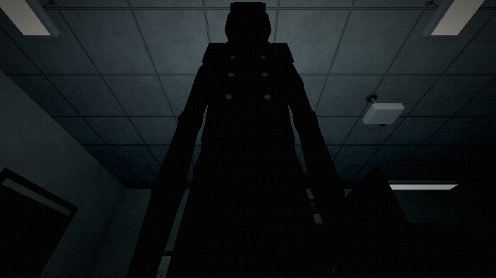
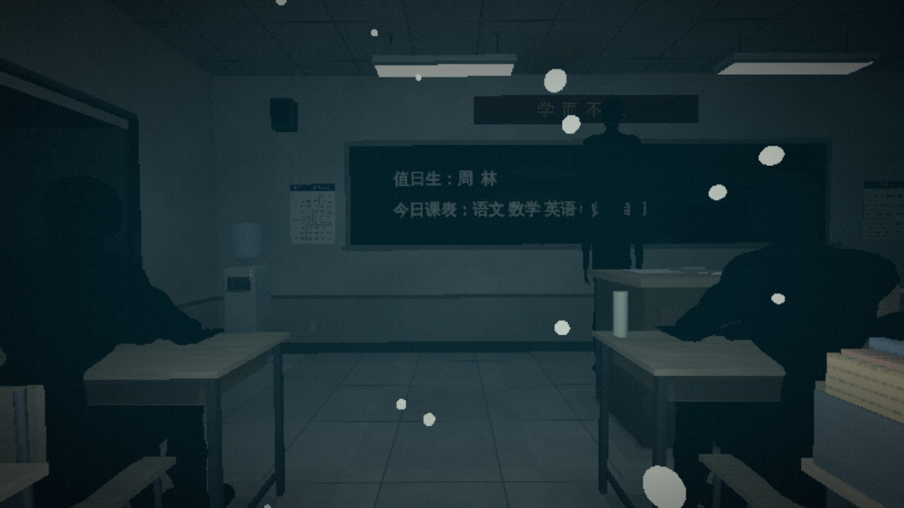
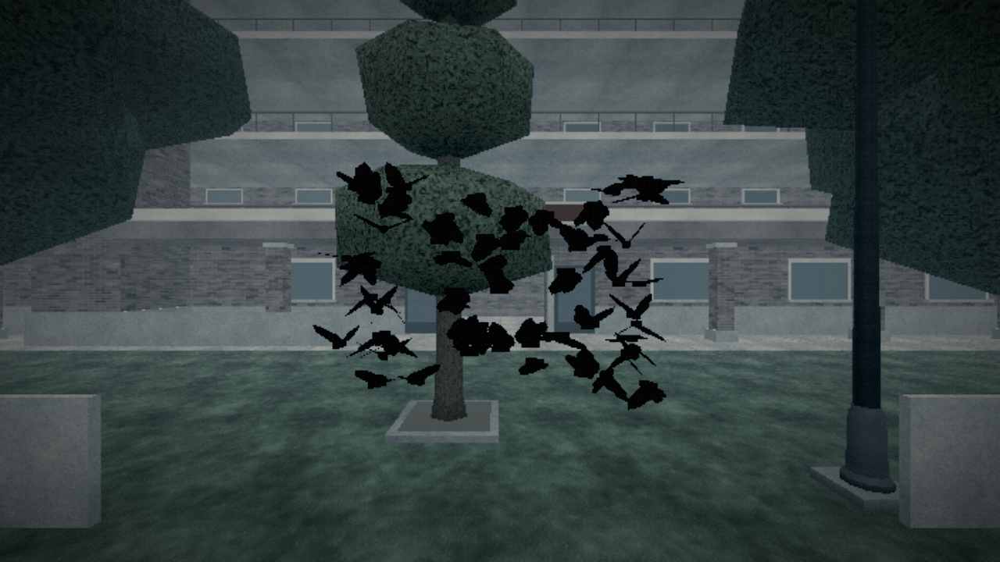
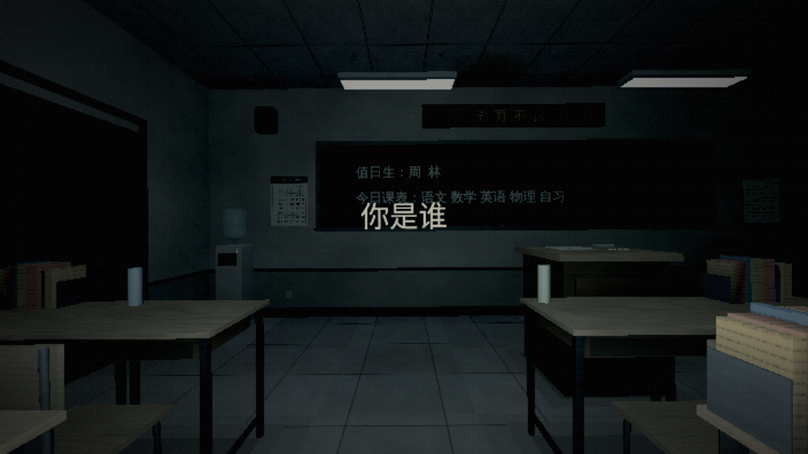
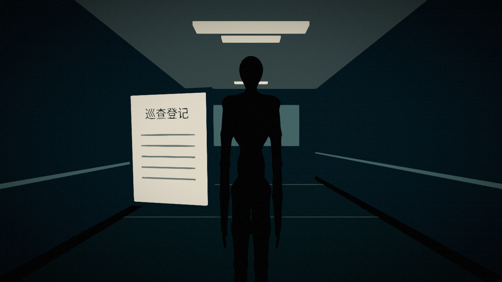
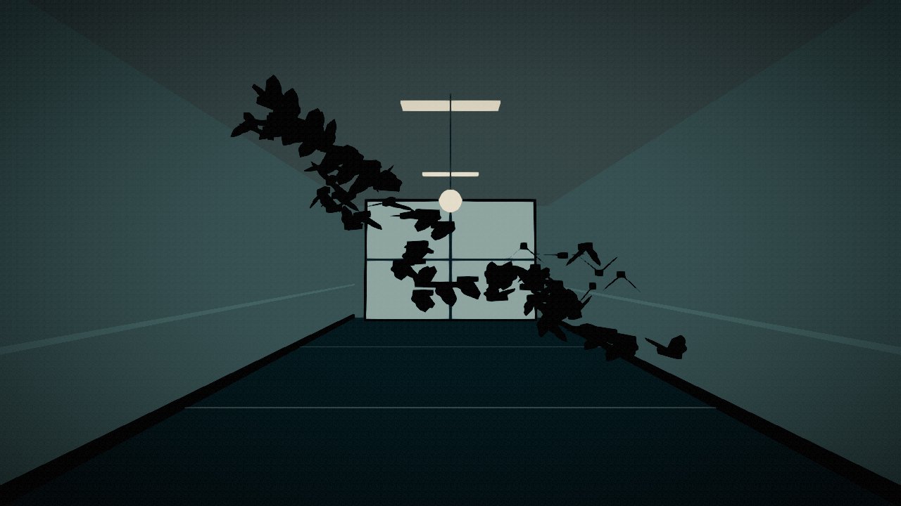
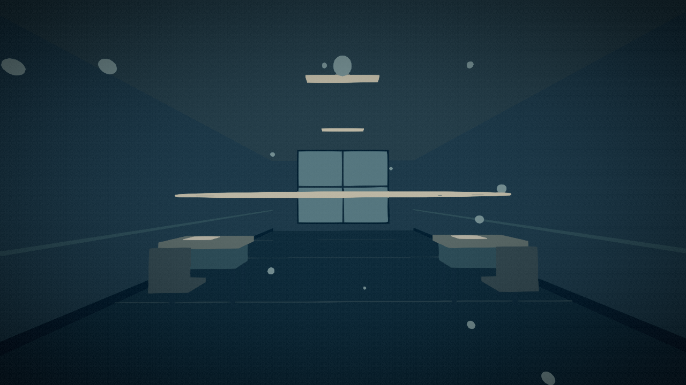
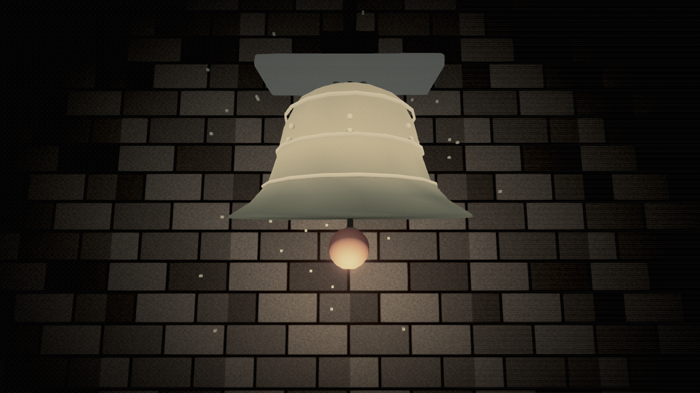
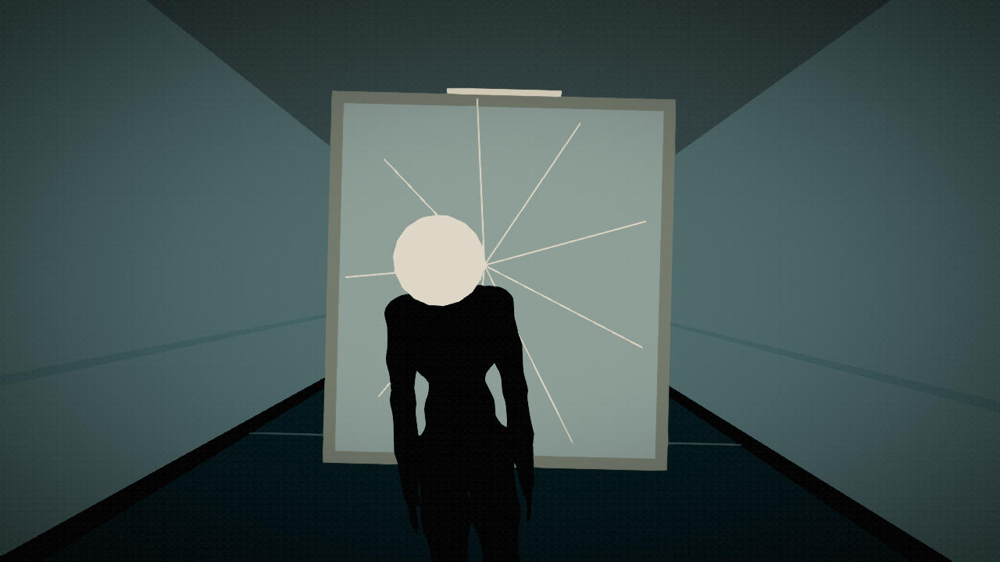
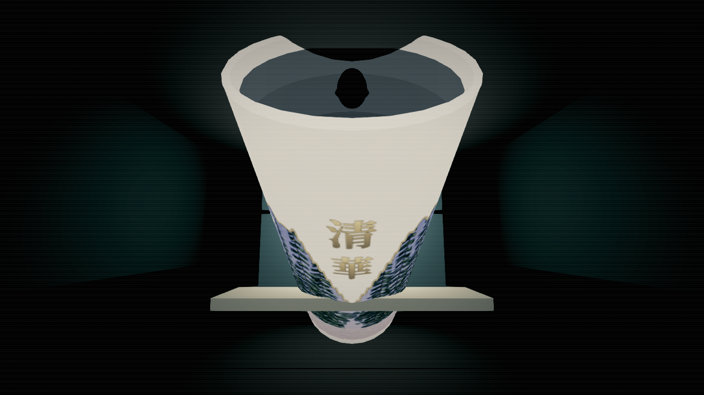

# 死亡 CG

当前真实死亡按死因在玩家所在场景演出，保留原校园几何、灯光、人物和死亡时的视角。独立布景只用于档案／调试预览，以及满员电梯、迷廊、深渊三种特殊空间死亡。旧版大量共用地下抓手的时间轴保留为测试参考。状态与验证摘要统一在本目录 [README](README.md) 维护。

## 演出原则

- 每段依次建立前兆、发生异常、失去控制、收束；多数时长 4.4–5.4 秒，满员电梯及迷宫保留各自节奏。
- 普通真实死亡不隐藏原场景，不搭建替代房间、地板、天空和照明。临时道具以死亡时的视线为原点，附近墙体和课桌限制道具的深度与尺寸；低头、坐姿、上层楼面和横屏比例均须覆盖。
- 巡察者与车库黑影优先复用现场对象，沿原位置靠近，遇真实墙体停止；同学和窗外人影使用现场实例。结束、取消与销毁时还原借用对象的可见性和变换。
- 不再使用通用地下抓手。名册、水杯、纸页、裂纹等临时道具解释死因；上车死亡保留从后座搭肩这一符合来源的单独动作，不新增血腥表现。
- 镜头只在表现层变化，不改玩家实体位置及存档的朝向／俯仰。减少特效开启时保留完整原视角；普通演出到最后收束才渐黑。
- 黑色蛾群保留扑翅与聚拢动作。人物沿用当前的人形素材。
- 结算、死亡保护、梦醒、档案记录 ID、成就和存档格式不变。演出时长属于表现层，由同一目录提供给有窗口运行和无窗口测试。

## 分镜覆盖

| 来源／效果 | 主要动作 |
| --- | --- |
| 巡察者 patrol；grip、names | 名册自行靠近，巡察者随后点名；不再从地板伸手 |
| 车库 garage；shadow | 现场黑影沿原车道逼近；没有可用现场对象时补充临时黑影 |
| 上车 car_entry；hand | 后视镜先出现多出的乘客，后座人影随后贴近 |
| 追车 car_chase；shatter | 保留实际驾驶道路和仪表盘，对向灯逼近，挡风玻璃裂开 |
| SAN 耗尽 san；vignette、chalk | 所在场景保留，现场同学逐渐消失，眼前浮现「你是谁」 |
| 同化 assimilation | 现场同学转向玩家，文字由「请回到座位」变为「已归队」 |
| stare、follow | 现场同学依次转头，原课桌与教室仍在 |
| neck | 头从围栏侧面越过横杆，在视线高度靠近 |
| twin | 两个身影错半拍，重合后留下另一个人 |
| drown、water | 窗光和课桌仍在，水位升至眼前，气泡上浮 |
| freeze | 霜纹从画面边缘合拢 |
| voice、misread | 红灯与通告逼近，文字发生变化 |
| bell | 声压波纹穿过当前空间，不另建钟楼 |
| deep | 盘子与黑色口形靠近，食堂仍留在原处 |
| floor（水杯） | 杯子扩大，杯口接管视野 |
| ring | 小型仪式符号向视线靠近 |
| loop、lamps、wall、squeeze；正门、围墙陷阱 | 出口文字消退；挤压类增加边缘收拢，不替换实际走廊和墙体 |
| laugh、face、gaze、window_gaze；问路人 | 笑脸、回头和玻璃呼吸；窗外人影始终在玻璃另一侧 |
| mirror | 面孔逼近，镜面裂纹扩散 |
| paper_sender、slit | 纸飞机飞回，纸页围拢，纸缝另一侧露出眼睛 |
| campus_fall | 保留死亡处实际建筑，风和碎屑表现失重 |
| trash | 在原垃圾房合拢桶盖，不切换到替代桶内空间 |
| liftdoor、rules_knock | 门缝被打开，门后的人进来；寝室有三次敲门节拍 |
| swarm | 64 只黑蛾在原场景聚拢并扑向视线 |
| crowd、void、abyss | 保留已有独立的满员电梯、迷廊、深渊演出 |

共有 48 个表现身份：39 个原效果与 9 个来源专属身份，真实死亡中 45 个使用现场演出、3 个使用特殊空间。它们不代表新增 48 个死亡条件；相关死因可以共享表现家族。档案与调试预览保留原独立布景，便于在没有对应校园场景时完整查看，和真实死亡共用来源、标题及演出时长。

## 接入与维护

- `DeathSceneCatalog`：来源与效果的统一解析、中文标题和时长。真实死亡与档案回放都调用 `DeathCG.resolve(source, effect)`，避免只按通用 `grip` 选场景。
- `DeathStage`：视线坐标、几何工具、一次性声音节拍、相机和世界可见性所有权。取消、跳过、重开、离开节点时还原相机完整 Transform、FOV、近裁剪和进入前的场景可见性。
- `DeathInPlace`：普通真实死亡的现场时间轴、碰撞限深、现场人物借用与归还，不拥有替代世界。
- `DeathShots`：档案和调试预览的独立布景与时间轴。两种模式的动作都由时间直接求值，不依赖累计位移。
- `DeathCG`：`begin_live()` 用于真实死亡，`begin()` 保留隔离回放；实例重复使用时重新选择模式。真实死亡提供 0.6 秒后显示、48 像素高的触屏跳过按钮。键盘原有跳过继续可用；预览与档案不叠加这个按钮。
- `CrowdDeath`／`MazeDeath`：保留已经独立设计的三个演出。
- `tests/support/death_reference.gd`：旧版逐帧参考，仅用于不可变的迁移样本。运行时代码不引用它。

减少特效设置关闭新分镜的镜头抖动、倾斜、FOV 脉冲与闪光；仍保留明确的物体运动与死因。调试预览继续使用独立相机与声音，退出后不污染玩家。

## 验证入口

- `tests/suites/death_in_place.gd`：48 个身份的现场／特殊空间分流、原几何可见性、站立／楼上坐姿与下视角、墙体限深、重复采样、节拍去重、相机和玩家状态恢复、现场人物复用及还原。
- `tests/suites/death_redesign.gd`：来源解析、隔离布景、横屏构图、重启／销毁、真实死亡／复活和触屏跳过。
- `death_timelines.gd`、`death_models.gd` 和 `rules_dlc.gd` 的旧动画精确样本继续验证测试参考；`crowd_props.gd` 和 `maze_death.gd` 仍验证生产中保留的独立动画。
- `debug_tools.gd` 与 `archive.gd` 继续验证隔离预览、切场景、档案重播与存档边界。
- `tools/capture/capture_death_onsite.gd` 在真实教室、车库与室外捕获演出前及 25%／58%／78% 三个时刻，保存到 `build/previews/death-onsite/`。`capture_death.gd` 可在开局位置批量捕获指定身份；它调用的也是真实死亡入口。
- `tools/ci/export_smoke.gd` 同时验证导出包的独立预览与六种现场死亡，防止开发目录可用但发布包遗漏新脚本。

实际音响听感、手机实体 GPU 的性能与完整自然游玩仍需要真机体验；无窗口测试和软件 Vulkan 截图不能代替这些验证。

## 实际运行画面

以下为游戏内 Vulkan 窗口的现场演出关键帧；档案与 F2 预览使用的独立布景展示在后表。

| 现场点名 | 现场洪水 |
| --- | --- |
|  |  |

| 室外黑蛾 | SAN 耗尽 |
| --- | --- |
|  |  |

独立预览的既有画面：

| 点名与洪水 | 蛾群与钟声 |
| --- | --- |
|  |  |
|  |  |

| 镜面 | 原水杯素材 |
| --- | --- |
|  |  |
