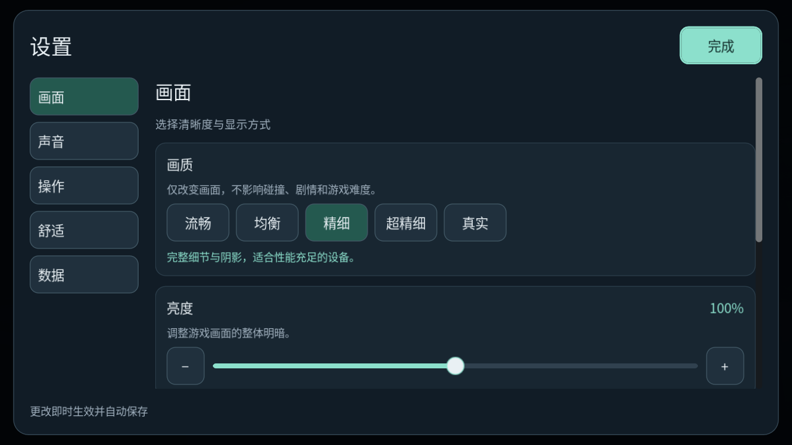
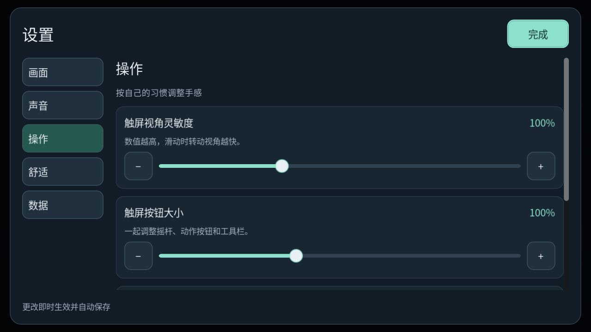
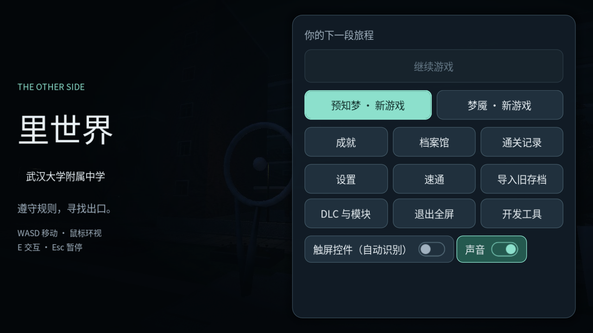
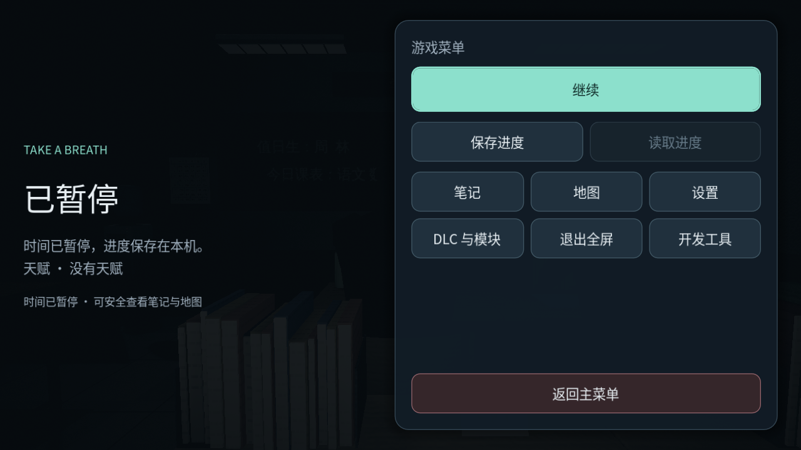

# 设置

显示方向按当前项目范围维护：**横屏优先，竖屏不受维护**。Android 从启动 Activity 起声明横屏；默认全屏，保留用户显式保存的窗口模式。横屏自动旋转只决定左右翻转，关闭后仍固定横屏。

玩家设置，**照旧版**（`wd-fz/wd-fz.github.io@0bf508a` 的 `settings.js`、`quality.js`）：只改表现与舒适度，不改规则、碰撞与课表。设置存在自己的文件 `user://settings.json`（版本 1），不进每局存档。规则在 `game/infrastructure/settings/game_settings.gd`（规范化、限值、读写），界面由 `game/presentation/ui/settings_panel.gd` 独立负责，经 `game_ui.gd` 的 `show_settings` 接入，生效在 `game/app/game_app.gd` 的 `_apply_settings`。入口：主菜单与暂停页的「设置」按钮。

## 待办与进度

| 项 | 状态 | 说明 |
| --- | --- | --- |
| 音量、环境声、声音字幕三档 | 已完成 | 音量 0–100（默认 70）→ `AudioFx.volume`；环境声开关 → `AudioFx.ambience`；字幕「自动／开／关」（默认开）→ `SoundCaptions.mode` |
| 提示文字大小 | 已完成 | 小／中／大 = 0.6／1.0／1.6 倍（旧版 `SUB_MULT`），作用于提示与字幕行 |
| 视野扭曲、减少闪光 | 已完成 | 关／减弱／完整（35 % 与 100 %）进感官画面；减少闪光让灯管不再频闪、黑闪减半 |
| 亮度、胶片颗粒 | 已完成 | 亮度 50–150 % → 环境的亮度调整；颗粒是盖在画面上的淡噪点（旧版 `Engine.grain`），默认开 |
| 五档画质 | 已完成（档位表现有差异） | 流畅／均衡／精细／超精细／真实：渲染比例 0.55／0.70／1／1／1，超精细起 4×、8× 抗锯齿，精细起太阳阴影；默认「精细」，因为导入的模型是旧版第 2 档，这样画面和此前一致；触屏设备第一次打开默认「流畅」。切换档位立即重建当前建筑和相邻预览，保留物理体、门状态与运行中的玩法；雨点及蛾群数量按旧版五档配置 |
| 灵敏度、文字大小、触屏按钮大小 | 已完成 | 鼠标与触屏灵敏度 25–250 %，文字 85–150 %（界面主题字号），触屏按钮 85–125 %；「恢复操作与文字默认」 |
| 启动横屏、默认全屏 | 已完成 | 项目启动方向为 `SCREEN_SENSOR_LANDSCAPE`，导出检查 APK Launcher 的 `userLandscape`；默认全屏，旧的窗口偏好保留。自动旋转关闭后用 `SCREEN_LANDSCAPE` |
| 触屏外壳（mobile.js） | 已完成（浏览器专属部分不适用） | 主菜单与暂停页的「全屏」按钮（与设置里的全屏同一项）；竖屏持触屏时提示「请横屏游玩。竖屏不受维护」；横屏声明从应用启动生效；旧版的 iOS「添加到主屏幕」说明、安卓外壳的本机服务不适用 |
| 图形模式（WebGL／WebGPU） | 不适用 | Godot 统一使用 Vulkan；桌面 Forward+、Android Mobile 按平台选定，不提供 WebGL／WebGPU 切换 |
| 镜头晃动 | 已接入 | 关闭步行、跑步的镜头起伏；坐下视高与奔跑视野仍平滑变化。表现层不写入存档视角，读档重置镜头过渡 |
| 可拖动的触屏布局 | 已接入 | 设置中拖动摇杆、动作按钮与工具栏；保存归一化坐标，横竖屏重排、边界约束与控件避让。取消不落盘，恢复舒适默认清除布局；安全区域与真机待验 |

## 验收

2026-11-08 的补齐与独立旧版对照见[迁移一致性验证](../迁移一致性验证.md)。下面的断言数是原阶段记录。

无窗口模式 **1010 项断言，0 失败**：默认值与旧版一致；越界值被限制、无效值回到默认、未知键丢弃；读写、第一次在触屏设备上默认「流畅」；恢复舒适默认不动声音；面板打开；音量、环境声、字幕、灵敏度、减少闪光、亮度、画质都生效；关闭视野扭曲后仍保留静态收窄；改动即存。截图 `pictures/设置/`（`tools/capture/capture_settings.gd`）。**未验证**：真机触屏的横屏锁定与全屏；各画质档在真实 GPU 上的帧时间。

## 成就、CG 与积分检查（CLAUDE.md）

只是设置界面，没有新增事件、结局或死法，不需要新的成就、CG 或积分事实。无彩蛋内容。

## 分类设置界面与移动端操作

设置按「画面、声音、操作、舒适、数据」分为五页，保留原有全部设置键及独立存储格式。横屏下使用左侧分类、右侧卡片列表，页头的「完成」与底部保存状态固定可见。连续数值提供大滑杆、百分比和加减微调，二选一项使用开关，多档选项明确显示当前选中值；画质附设备负载说明，舒适页有文字预览。

修改设置不会重建控件，避免拖动滑杆中断或滚动位置跳走。只有数据写入成功才显示「已保存」；恢复操作与文字默认保留声音、画质和游戏进度。清除上一局痕迹须再次点按确认，换页或关闭会取消待确认操作。触屏布局编辑从操作页进入，取消后仍回到设置，Esc 逐层关闭。

奔跑改为明确的走／跑开关，摇杆推满不再暗中自动奔跑；动作按钮直接处理每根手指，移动、转向、交互可以并行。体力与伤势限制仍按现有规则生效，并显示「暂不能跑」。暂停与菜单切换同步清除摇杆和奔跑开关。座位与躲藏的交互提示统一由应用层选择，避免附近翻找或座位提示覆盖「站起来／出来」。

## 全界面统一与横屏布局

这一轮范围覆盖主菜单、暂停页、HUD 控件、选择弹窗、背包、笔记、地图、成就／档案、通关记录／结算、设置、旧存档导入、终端、广播话筒、手机、小游戏和开发窗口。世界内的地图绘图、结算美术和演出保持各自的信息含义。

- `content/ui/theme.tres` 与 `ui_skin.gd` 共享颜色、圆角、边框、控件状态和焦点样式；设置不再另造整套按钮主题。
- `menu_screen.gd` 给主菜单和暂停页提供同一套双栏结构；新档突出新游戏，有存档时突出继续。主要按钮在滚动区外，次级功能分组，150% 大字体下调整列数。
- 背包物品、档案条目和笔记记录按卡片分隔，使用／丢弃区分颜色；记录按路线、积分用时、日期分行。
- 手机左侧应用导航与右侧内容分别滚动，收起始终可见；贪吃蛇的棋盘与操作区横向排列。开发窗口保留拖动、紧凑模式与悬浮球。
- 横屏下验证 16:9、16:10、超宽比例与 100%／150% 文字；所有菜单入口用实际合成触摸测试，检查功能信号只发出一次。

实际渲染截图由 `tools/capture/capture_interface.gd` 生成，使用隔离配置；记录与物品是截图示例。原生窗口验证不能代替 Android 真机。

[背包](../../pictures/界面/背包.png) · [手机](../../pictures/界面/手机.png) · [设置](../../pictures/界面/设置.png) · [通关记录](../../pictures/界面/通关记录.png)
