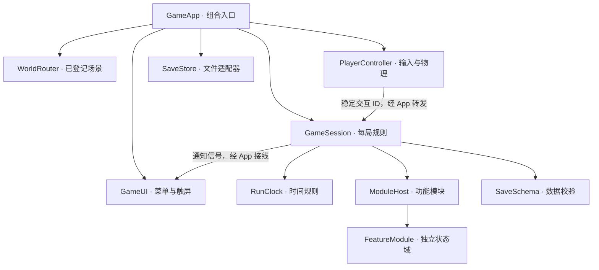

# 架构与模块接口

## 1. 入口与依赖方向

`project.godot` 的主场景为 `scenes/app.tscn`。`GameApp` 在此创建会话、连接输入与 UI、调用存储并切换世界。没有全局状态 Autoload，也不要求导入旧版 JavaScript 或 Three.js。



| 目录 | 所有权与边界 |
| --- | --- |
| `core/domain/` | 可无场景运行的时间和存档规则；只接收值数据 |
| `core/session/` | 一局的创建、推进、快照和恢复；不轮询设备或操作画面 |
| `core/modules/` | 功能协议、注册顺序、交互路由与模块存档聚合 |
| `core/persistence/` | 文件读写；不决定游戏规则，也不销毁当前会话 |
| `features/<id>/` | 每个独立玩法；示例为 `features/demo/`，正式校园规则为 `features/campus/` |
| `actors/` | 角色物理、输入适配和交互目标 |
| `world/`、`content/worlds/` | 场景资源注册、加载和配置；`world/campus/` 是正式校园的场景与数据适配器 |
| `scenes/`、`ui/` | 可编辑场景、画面与界面；不拥有通关进度 |
| `app/` | 应用组合与跨层操作；新增模块的接线入口 |

`GameSession` 与模块为 `RefCounted`。持久数据由规则对象持有，快照返回副本。角色节点只持有当前物理姿态，保存时由组合层显式采样。`class_name` 提供类型名，不意味着全局单例或全局状态。

## 2. 功能模块协议

模块继承 `FeatureModule`，必须实现：

| 方法 | 契约 |
| --- | --- |
| `module_id()` | 稳定且唯一的命名空间，如 `demo.notice_board` |
| `reset()` | 创建干净的新局状态，不发奖励、不写文件 |
| `capture()` | 返回该模块的 JSON 值数据；宿主会深复制 |
| `validate(data)` | 无副作用；成功返回空字符串，失败返回原因 |
| `validate_snapshot(modules)` | 各模块字段校验通过后，检查跨模块一致性；无副作用 |
| `restore(data)` | 仅赋值已校验的状态，不重新执行交互或奖励 |
| `state_version()` | 该模块自己的协议版本，缺省为 1 |
| `interaction_ids()` / `interact(id)` | 可选交互路由；一个 ID 只能有一个所有者 |
| `advance(delta)` | 可选固定模拟步，不能自行读取真实时间 |
| `stop()` | 可选退出清理；不得再推进旧会话 |

`ModuleHost.register()` 拒绝空 ID、重复模块 ID 和重复交互 ID。模块按注册顺序推进。当前仅通过 `GameApp._make_session()` 显式注册，不做反射扫描、动态加载任意脚本或隐藏的依赖解析。

有依赖的功能使用明确的构造参数或专用接口。目前 `InvestigationModule` 在构造时取得 `InventoryModule`，通过 `try_add()`、`has()`、`owns()` 处理钥匙；不会修改背包内部数组。`ModuleHost.feature(id)` 供组合入口取得已注册的能力，规则不通过它搜索任意全局服务。未来需要复杂事件流时，再定义具体信号与事实类型。

规则模块不创建 Node、不启动跨局 Timer、不轮询 `Input`、不读写存档。模型、声音和演出放在场景适配器中，由信号触发；适配器随场景退出销毁。新增异步加载或任务时，需要实现取消和会话失效检查，目前没有通用异步任务框架。

## 3. 会话与场景切换

新游戏创建新的 `GameSession` 和模块实例。返回菜单停止旧会话、移除世界、释放触屏所有权与鼠标捕获，并解除场景树暂停。

`WorldDefinition` 是受信任的内容资源，登记 `world_id`、`PackedScene`、出生姿态、是否推进日历和 `properties`（实例化后、加入场景树前写到场景根上的受信任配置，例如 `CampusWorld.scene_id`）。`WorldRouter` 只加载显式登记的 ID，拒绝不存在和重复 ID，不按存档提供的路径执行 `load()`。场景必须以 `Node3D` 为根。

新场景实例成功创建后才移除旧场景。`_ready()` 中的玩法初始化必须保持可控，不能写入上一局状态；Godot 本身不能事务式回滚任意场景脚本的运行错误，所以场景仍须通过导入和实际启动测试。

玩家位于 `app.tscn` 的 `World` 分支，世界几何由路由器单独替换。场景内切换由 `GameApp.travel(world_id, pose, seamless)` 完成：规则模块只返回目标世界与姿态，组合层切场景、更新 `session.world_id`、放置玩家并把规则状态（开着的门）同步给新场景；无缝切换（连续校园门槛）保留按住的输入。以后跨区要暂停模拟或等待演出时，在这一命令上扩展，不让房门直接修改所有系统。

### 正式校园

旧版的 42 个室内场景与室外校园各登记为一个世界（`content/worlds/campus/`，由 `tools/export_scenes/gen_worlds.py` 生成），共用 `world/campus/campus_world.tscn`。`CampusWorld` 读取 `assets/campus/` 的导出结果：glb 模型、extras 里的实例（还原为 MultiMesh）、旧版碰撞矩形（BoxShape3D，层 1）和每扇房门的碰撞体与两态门扇。场景坐标与旧版 three.js 场景一致；旧版世界单位与米、朝向 `ang` 与 yaw 的换算集中在 `CampusGeometry`。

`CampusModule`（`campus.world`）持有开着的门，提供 `interact_at`、`hint`、`crossing`、`start_pose`、`default_spawn`。它从构造参数拿到布局字典，`CampusData` 负责读 JSON。

## 4. 时间与暂停

`GameApp._physics_process()` 在正常游玩时推进会话。菜单和暂停不累计；切出应用自动暂停，恢复焦点不会补算离线时间。表现帧不修改时钟。

`RunClock` 分开记录：

- `active_seconds`：有效模拟秒，供设备、威胁与任务使用。
- `calendar_seconds`：允许推进日历时的有效秒，可随世界配置冻结。

示例的四阶段预算为 360、360、360、120 秒，对应 07:20–12:50、12:50–17:50、17:50–22:20、22:20–次日 01:00；随后回到次日 07:20。完整自然日为 1200 秒。

这只是框架的日历映射与验证样本。正式首日 11:40 开局、特殊慢速窗口、跨日事件、校历跳时和持续升压尚未移植。未来修改日历时必须保持有效运行秒独立；RTA 另用单调时钟，不应复用这两个模拟量。

## 5. 输入与交互

输入动作在 `project.godot` 的 Input Map 中登记，键盘使用物理键码。`PlayerController` 处理角色运动、重力和相机；鼠标仅在捕获时旋转，实际触摸事件走独立的 `TouchStick`／`TouchLook` 分支。不会因为设备同时有触屏就把鼠标运动当成手指拖动。

触屏摇杆和视角区分别拥有一个手指 ID；另一个手指不会抢走视角。暂停、切换界面和窗口尺寸变化释放手指与奔跑状态。UI 只阻止自己的输入，键鼠点击场景可以重新捕获。左右滑动区与暂停、交互按钮分开，横竖屏调整画布基准。

保留 Godot 的 `emulate_mouse_from_touch`，让普通 Control 按钮响应手指点击；玩家控制器忽略引擎生成的 `device = -1` 鼠标事件，因此 UI 兼容事件不会捕获鼠标或重复旋转视角。`emulate_touch_from_mouse` 关闭，真实鼠标不会被伪装成触屏。

交互先走相机前方 3 米内的物理射线；射线没有命中 `WorldInteractable` 时，玩家发出 `free_interaction_requested`，由正式校园规则按旧版「附近格子、朝向优先、格子遮挡」挑选目标（门、出口、楼门）。提示文字同理：射线目标优先，否则每 0.1 秒向校园规则取一次。碰撞层约定：

| 层 | 用途 |
| --- | --- |
| 1 | 地面、墙体、普通障碍 |
| 2 | `WorldInteractable` 交互实体 |
| 3 | 玩家物理实体 |
| 4 | 保留（PR #2 的地面拾取物曾用此层，合并 PR #3 时随调查切片移除） |

射线同时查询层 1、2（掩码 3），因此先碰到墙时不会隔墙交互。目标提供 `interaction_id`、提示文字和可选的 `blocked_reason(player)` 物理保护，由控制器检查后再交给 `GameApp` 转发。正式校园的门、座位、设施等交互由 `CampusModule` 按旧版格子判定（见[移植接入指南](移植接入指南.md)），不依赖交互实体。

## 6. 存档边界

顶层格式为 `format: "wdfz-godot"`、`version: 1`，包含 `world_id`、`clock`、`player`、`modules`。模块域形如：

```json
{
  "demo.notice_board": {
    "version": 1,
    "data": { "read_count": 2 }
  }
}
```

JSON 数据只允许有限数字、字符串、布尔值、空值、数组和字符串键字典；嵌套深度最多 32，文件最大 1 MiB。位置转成三元素数组，视角转成弧度值，不保存 Node、Vector3、Resource 或 Callable。JSON 数值读回可能是浮点数，整数语义通过 `SaveSchema.is_integer()` 校验。

读取先解析文件，再验证顶层版本、时间、坐标范围、场景 ID 和所有已启用模块的数据。任何校验失败都保留原世界、会话和暂停状态。成功后只恢复状态，不重新发奖励、重新随机事件或重演交互。

已启用模块缺失时使用该模块的新局默认值；未知模块的合法 JSON 数据原样保留，便于可选功能暂时停用后再启用。已启用模块的未知版本拒绝加载。顶层额外字段没有保留承诺，新增持久功能应放在独立模块域。

写入先生成完整 JSON，再写 `.tmp`、flush、检查错误，复制旧档到 `.bak` 后以 rename 替换主档。备份失败则不覆盖主档；失败读取不会自动降级到旧版本或覆盖备份。恢复备份目前是手工操作，复制前应保留损坏文件供排查。

旧 Web 存档转换、可达位置修正、崩溃／断电文件系统的硬件耐久性、云存档和多槽 UI 不属于本轮交付。

## 7. M1 的接入实例（历史）

> 以下是 PR #2 调查切片当时的设计记录。合并 PR #3（正式校园移植）时，切片的 `InventoryModule`、`InvestigationModule`、`PlayerStateModule`、`InventoryPanel`、`ItemCatalog` 与演示场景已移除，由照旧版移植的 `features/items/InventoryModule`、`SchoolModule` 等取代；`validate_snapshot()`、`ModuleHost.feature()`、`blocked_reason()` 等框架接口保留。

当时组合入口注册告示牌、背包、玩家数值、调查四个模块。`ItemCatalog` 是编辑器资源，在应用层转为普通字典后注入背包；规则不在运行时自行读取 `.tres`。

背包拥有 8 格物品、两个快捷引用、选中位置和各世界的地面物品。调查模块拥有事实记录、钥匙来源和门状态；两者通过稳定物品 ID `roomkey` 协作。跨模块校验会拒绝「钥匙来源已领完，但背包与地面都没有钥匙」的坏档，并在替换当前会话前返回原因。

调查、背包或门状态发生改变时，应用层合并同一帧的自动保存请求。请求绑定当时的会话，切换会话时清空，并断开旧模块的应用回调。读档先恢复完整规则，再绑定场景适配器；不会因重建钥匙模型而重新发奖。

`InventoryPanel` 只呈现物品和记录，丢弃命令由应用层采集角色位置后提交。打开面板会暂停世界并释放输入，关闭后返回原来的游玩或暂停模式。Tab 和 Esc 在应用输入入口处理，避免被面板按钮的焦点导航吞掉。
