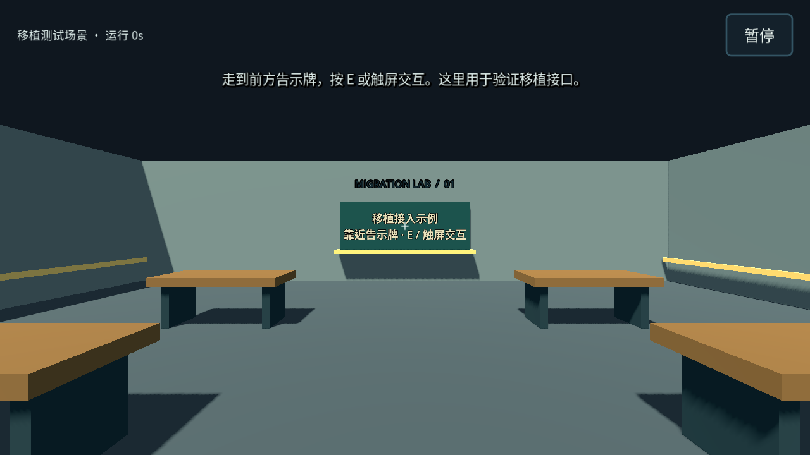
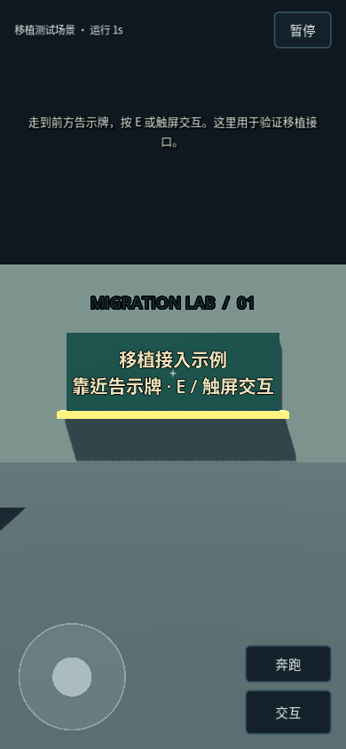

# 框架验证记录

2026-11-06，Godot **4.6.3.stable.official.7d41c59c4**，Linux。交付范围为移植框架与示例房间，正式玩法尚未迁移。

此页保留 M0 当时的范围与 81 项断言记录。PR #2 的调查切片记录见[首条调查流程迁移与验证](首条调查流程迁移与验证.md)（已被正式校园移植取代）；现行回归结果见[正式校园验证记录](正式校园验证记录.md)。

## 自动验证

`python tools/check.py` 使用真实 Godot 导入项目并运行 `tests/run_tests.gd`。本轮 81 项断言通过，覆盖：

- 四阶段 20 分钟日历、阶段边界、日历冻结与有效运行秒分离、停止会话。
- 模块注册、交互路由、快照隔离、独立模块版本、缺失模块默认值、未启用模块数据保留。
- 不支持的格式／未来版本、未知场景、无效坐标／视角、错误时钟、错误模块数据。
- JSON 保存与恢复、旧档备份、超限／非 JSON 写入拒绝、失败后保留旧档、损坏 JSON。
- 实际场景启动、CharacterBody3D 移动、射线交互、墙体遮挡、暂停、完整姿态与模块恢复、坏档不替换会话。
- 手指所有权、无捕获情况下触摸转视角、鼠标不进入触摸分支、暂停清理和重复新局；通过 `Input.parse_input_event()` 实际派发触摸，验证开始、暂停、继续和窗口尺寸改变后的按钮点击。
- 1280×720、390×844、844×390 的菜单布局边界。

同一套 81 项断言也在 X11 虚拟显示器、Compatibility / Mesa llvmpipe 软件渲染下通过。无窗口后端不能捕获鼠标，会明确验证这一限制；有窗口模式另外验证真实鼠标捕获时的相机分流。CI 通过 `xvfb-run -a python tools/check.py --windowed` 同时运行两种模式，不以无窗口验证替代鼠标捕获测试。这不是实体触屏或真实 GPU 的测试结果。

## 画面检查

使用 `tools/capture_preview.gd` 从实际 Godot 窗口捕获主菜单、测试房间、触屏竖屏与暂停页面，检查中文文字、按钮可达性、状态区、告示牌和碰撞测试用房间。

## 限制

未进行 Android 真机、Windows 导出、打包模板、真实 GPU、Vulkan 渲染器、完整校园、正式音效或自然通关验收。当前触屏断言通过模拟 Godot 输入事件验证行为；多设备触摸、系统手势和安全区域仍需真机测试。

文件保存验证了本地普通读写、替换与错误处理，没有模拟断电或底层文件系统故障。旧 Web 存档转换、异步任务跨局取消、地图变化后的可达坐标修正与完整玩法尚待对应阶段实施。
