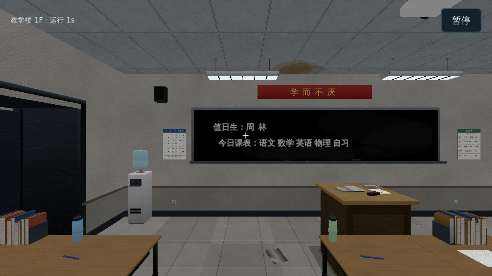
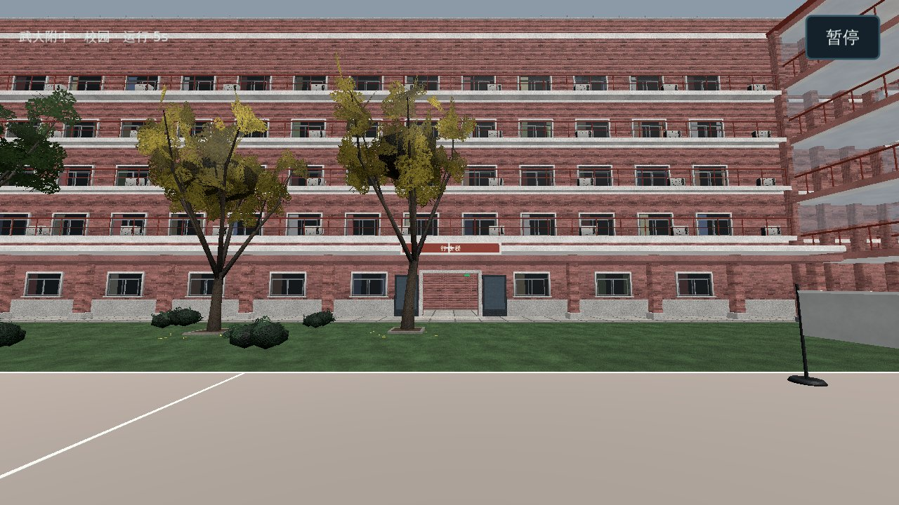

# 正式校园验证记录

2026-11-06，Godot **4.6.3.stable.official.7d41c59c4**，Linux。范围：[正式校园建筑与碰撞](plan/正式校园建筑与碰撞.md)。旧版参考 `wd-fz/wd-fz.github.io@0bf508a`。

## 自动验证

`python tools/check.py` 与 `xvfb-run -a python tools/check.py --windowed` 都通过：**160 项断言，0 失败**（框架原有 81 项照旧通过，框架用例显式使用 `migration_lab` 房间）。新增覆盖：

- 数据：42 个室内与室外均已导出；teach1 保持 63 × 22 格；开局房间是 teach1。
- 规则（无场景）：面向关着的教室门提示「开门」，按 E 打开、记入存档；站在门里不能关门（旧版「先让开门口」）；从走廊再关上；未知门键与错误格式被存档校验拒绝；实验楼三楼机房门保留旧版门锁与「机房钥匙」提示；teach1 南门门槛线前不切换、越线到室外、室外站在门外不回弹、走进门洞回到 teach1 且位置按室内外平移保持；室外在地下车库入口按 E 进 garage1；在连续出入口按 E 得到旧版「门开着，直接走进去就行」。
- 实际场景（CharacterBody3D 物理）：新局加载 teach1 的导出模型，实例家具还原为 MultiMesh，8 扇教室门都有碰撞体；开局位置等于旧版 `leaveSeat` 从本人座位起身的位置；向北走撞教室北墙时停在离墙一个身体半径（1/3 米）处；关着的门挡住走廊一侧，按 E（无射线目标时交给校园规则）开门后能走进教室；从南门走出去切换到室外场景，再走回门洞回到 teach1；存档保留场景与开着的门，读档恢复；42 个室内场景都能通过 `WorldRouter` 实例化。

## 画面检查

`tools/capture_campus.gd` 在 Xvfb + Compatibility（Mesa llvmpipe 软件渲染）下直接摆放机位截图，见 `pictures/正式校园建筑/`。对照旧版截图，教室、走廊、行政楼、食堂、宿舍、车库、钟楼的建筑与陈设一致。

## 与旧版的已知差异（未移植，不是改动）

- **灯光**：场景里是占位的环境光与一盏方向光，不是旧版的天色、室内灯、雾、阴影与后期；画面明暗不能当作旧版氛围。
- **门里门外互相看得见**、二到五层外廊看见校园：旧版把另一侧的模型挂进当前场景，属于表现层，尚未移植；站在南门门槛看出去是黑的。
- **楼梯格、楼梯井、钟楼旋梯、电梯**：楼梯格暂按实体处理，楼梯井的坡面碰撞和电梯门的动态碰撞未接，因而还不能上下楼、乘电梯。
- **交互**：只移植了房门、出口格、室外楼门与连续校园门槛；座位、设施、搜索、终端等其余分支按 E 时提示「尚未移植」。开门台词旧版随机挑一句，这里按顺序轮换。
- **体力**：奔跑暂不消耗体力（属于玩家数值移植）。
- **草地**：画质相关的表现层装饰，未导出。

## 未验证

真实 GPU、Android／Windows 导出、触屏真机、自然长时间游玩、各房间逐一的可达性扫描（穿模检查）。CI 首次导入 43 个 glb 的耗时以 Actions 实际运行为准。
