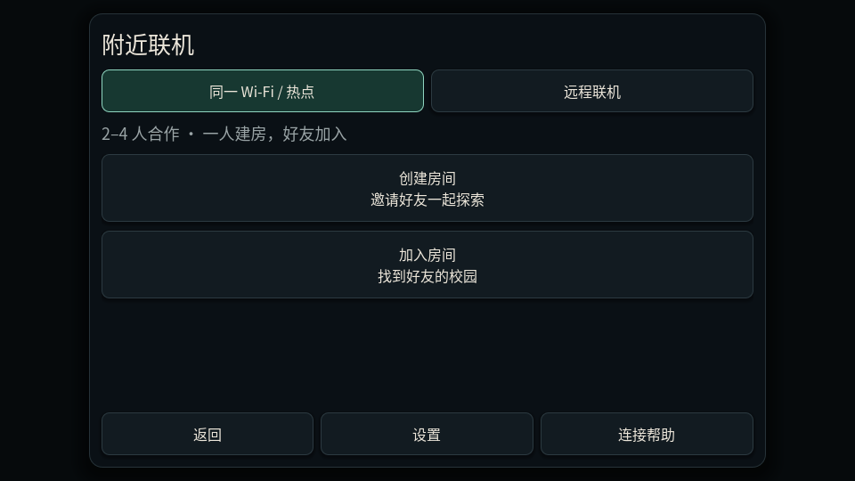
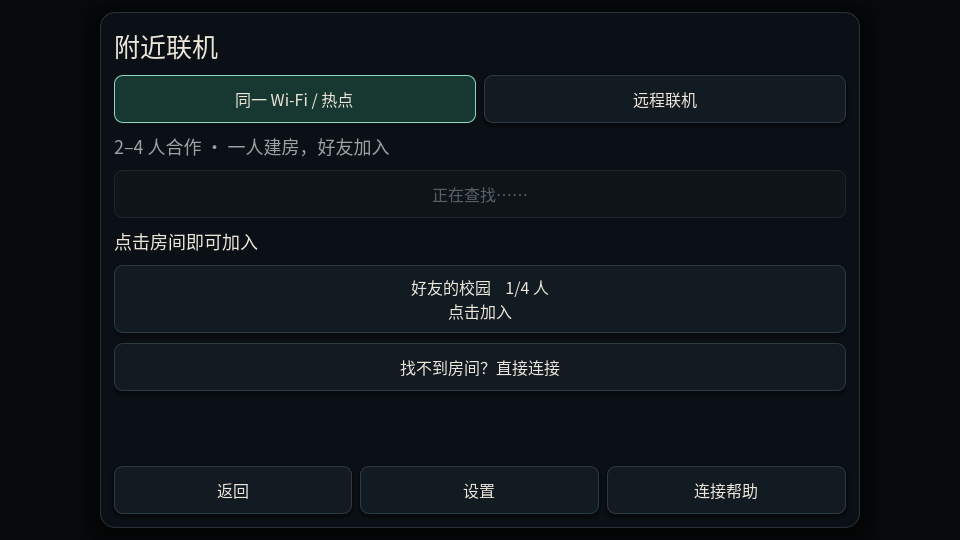
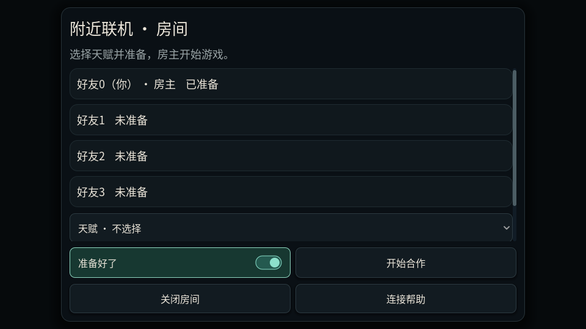

# 联机入口与连接排查

2026-11-15。针对「两台 Android 使用同一 Wi-Fi／热点，能发现房间但无法加入」排查，并重做联机入口。基线为 `e28e36f`。玩法、人数上限、权威模型、存档及 Terracotta 接入方式不变。

## 已复现的问题

旧 `LanPanel.found()` 每收到一条发现回复，都会销毁整张房间列表，再创建按钮。扫描期间多个广播目标会持续返回同一个房间，因此按钮可能在手指按下后、抬起前被移除，触摸释放无法触发原按钮。房主收不到这次操作，因为客户端没有提交加入。

用基线面板、Godot 4.6.3、Vulkan Mobile 与真实 `InputEventScreenTouch` 事件验证：按下房间按钮，插入一次发现刷新，再抬起，旧版地址栏仍为空；不插入刷新时，相同触摸能够填入地址。旧版点击房间本来也只填入地址，需要再点上方「加入」，增加了误解和操作步骤。

现在按房间 ID 保留按钮实例，广播仅更新名称、人数、地址和可用状态。只在房间确实消失时删除按钮。点房间直接发起加入；触摸滑动仍只滚动，不触发加入。版本不同、满员及进行中的房间在列表中说明原因。

这证明修复了一项能造成上述现象的客户端缺陷，不代表已经排除了用户现场的全部网络因素。

## 连接与握手

- ENet 房主显式监听 IPv4 `0.0.0.0`，与发现及直接地址入口一致，减少对 Android 双栈通配监听行为的依赖。
- 加入后进入独立等待状态，屏蔽重复点击和重复提交，保留固定的取消按钮。
- 连接状态区分「连接房主」「校验版本」「进入房间」。收到 `welcome` 后继续等待包含本人身份的大厅数据，完整收到才结束握手计时。
- 对重复 `hello` 重发该连接原有的 `welcome` 与大厅数据，不重复创建学生或凭据。旧实现对已登记连接直接返回，首次应答未成功排入发送队列时无法补发。
- 加入总预算为 20 秒。尚在连接的 ENet 保留原套接字，交给 ENet 重传；只有明确断开的传输，或恢复原角色时已连接但持续无应答的旧隧道才重建。重建不会延长总预算。
- 房主收到新连接时用实际单调时间建立验证截止时间，避免主线程曾阻塞或进入后台后使用上一帧时间，立即把新连接判为超时。
- 发现公告带内容指纹和容量，并验证新增字段。新版本之间可在加入前提示版本不兼容；旧公告没有指纹时仍由游戏握手校验。
- 发布前的四人弱网 CI 发现重连时 Godot 场景 RPC 节点缓存错误。协议 3 改用 `SceneMultiplayer.send_bytes()`／`peer_packet`，仍保留可靠控制／可靠快照分片／有序不可靠输入／有序不可靠运动四通道及原有权限、大小、速率限制，不再发送场景节点缓存 ID。双方需同时升级。

「连接帮助」可复制两端诊断：版本、平台、引擎版本、协议／规则／内容指纹、连接阶段、尝试次数、待验证人数、目标或监听地址、本地端口、本机 IPv4、ENet 状态、自动轮询开关，以及最近 24 条握手事件。底层 UDP 字节／包数包含连接握手，与游戏 JSON 收发字节分别记录；自动重试和超时关闭后保留累计值，新会话再清零。不包含邀请码和成员重连凭据；诊断包含用于核对链路的本地网络地址。

看到广播房间只说明发现端口可达，不等价于游戏端口已连接。超时文字按证据区分「没有记录到发包」「发出但没有回包」「有回包但握手未完成」「已连接但房间未确认」，不会直接把所有失败归因于路由器隔离。

## 界面

主菜单统一为「与好友联机 · 2–4 人」。在同一面板选择附近／远程模式，再选择创建／加入。

| 页面 | 默认操作 | 折叠或备用操作 |
| --- | --- | --- |
| 联机首页 | 创建房间、加入房间；有历史时显示重连 | 设置、连接帮助 |
| 创建 | 默认四人、普通难度，直接创建；有存档时显示继续合作 | 称呼、房间名、端口 |
| 附近加入 | 自动发现，点房间加入 | 找不到时展开直接地址与粘贴 |
| 远程加入 | 一个邀请码输入框，粘贴、加入 | 称呼、连接帮助；没有空的房主邀请码框 |
| 大厅 | 成员列表、天赋、固定的准备／开始按钮 | 管理成员、地址、诊断 |
| 游戏内队伍 | 成员状态、返回游戏 | 队伍操作、交付物品、暂停、保存、调试工具 |

房主的远程邀请码在大厅内展示并可复制。技术指标和调试操作默认折叠，主页面不展示协议编号、端口和网卡列表。滚动区域使用 `TouchScroll`，底部主要操作固定；弹出的键盘按窗口与画布缩放换算高度，显示／收起时重新布局。720×360、960×540 横屏布局均覆盖。

## 验证记录

- 基线丢失触摸复现：2 项对照检查通过。
- `tests/network/entry.gd`：30 项检查通过，包括按下后连续刷新四次再释放、只提交一次加入、滚动不加入、取消、版本提示、零表单创建、单输入框远程加入、横屏布局、重复握手、迟到应答不回退加入状态与凭据不外泄。无窗口和 Vulkan Mobile 均通过。
- `python tools/test_lan.py --rules`：44 项基础检查、90 项权威模拟检查、30 项入口检查通过。
- `python tools/test_lan.py --players 2 --ui --renderer mobile`：两个独立 Vulkan 游戏窗口，49 项通过。房主通过真实触摸创建，客户端等待真实 UDP 房间发现并通过触摸加入，然后验证加载、游戏状态及重连。
- `python tools/test_lan.py --players 2 --ui`：无窗口入口检查和两进程联机通过（该次入口 29 项、联机 43 项；随后入口补充了迟到应答回归，共 30 项）。
- `python tools/test_lan.py --players 4 --faults`：四个独立进程，31 项通过，含丢包／乱序／重复包条件。
- `python tools/test_remote.py --players 2`：官方 Terracotta／EasyTier／ENet 通道、游戏 UDP、突然断开后的重连及退出清理通过。
- `python tools/test_remote.py --unit`：100 项远程状态与协议检查通过。
- 静态结构、内容指纹及工具检查通过。入口触摸检查也加入了有窗口联机测试，后续 CI 会持续执行。

本地 Vulkan 使用 llvmpipe；以上是真实 Godot 窗口、触摸事件和独立网络进程，不是两台 Android 真机。两台手机仍需安装相同的新构建复测；Android 系统权限、热点设备隔离及不同厂商网络栈不由本地回环测试证明。继续失败时可对照两端诊断区分「没有提交操作」「ENet 未连通」「已连接但未通过房间握手」。

上面的四人弱网通过记录属于入口修复时的本地运行；后续提交 `1736c6e` 的 CI 暴露了 RPC 缓存与重连测试时序问题，不应据此认定该提交完整 CI 通过。协议 3 增加原始数据包的权限／畸形包／限流回归；进程测试也给房主保留足够时间，让丢失断开报文后等待 12 秒心跳超时的客户端完成原定游玩时长，不再提前退出房主。客户端的身份、快照、运动与超时断言均保留。正式发布以新提交的 CI 结果为准。

协议 3 本地复测：49 项基础检查、90 项权威模拟检查、30 项入口检查通过；四人弱网 31 项、两人弱网恢复存档 20 项通过；官方 Terracotta 四人通道、游戏数据、重连与退出清理通过。构建工具和结构检查通过。

## 2026-11-16：v0.4.1 发布后的连接超时排查

用户提供的实机截图为 `failed / 尝试 5 / 连接 0`，没有 `ENet peer connected`。这说明加入操作已提交，失败发生在房间认证之前。旧诊断的 `0 B / 0 B` 只统计游戏 JSON，而且每次重试会清零，不能据此认定底层没有发送 UDP。旧复制内容也没有地址、端口，无法完成两端对照。

以发布提交 `8ab18f8` 的传输逻辑做两项运行对照：

1. 用真实 `PacketPeerUDP` 转发真实 ENet 数据，只将每个新客户端套接字首次收到的房主回复延后至 5.1 秒。旧逻辑每 4 秒换一次套接字，延迟应答到达已经关闭的端口，得到与截图相同的 5 次尝试、20 秒超时；修正后约 5.1 秒进入大厅，只使用一次连接尝试。
2. Godot 4.6.3 的 [`ENetMultiplayerPeer.create_server()`](https://github.com/godotengine/godot/blob/4.6.3-stable/modules/enet/enet_multiplayer_peer.cpp) 将 `max_channels + SYSCH_MAX` 传入 `ENetConnection.create_host_bound()` 的入站带宽参数。本项目因此被配置为 7 B/s，而非预期的无限带宽。在健康回环连接上发送 150 条正常大小的输入，基线收到 61 条；建房后、首次轮询前显式执行 `peer.host.bandwidth_limit(0, 0)`，相同测试收到 150 条。这个缺陷影响已连接后的不可靠输入，不能单凭它解释截图中的全部握手失败。

两项修正均未更改游戏协议、人数、权限或压缩算法。延迟重传仍有 20 秒总上限；明确断开的连接仍可重试。失败界面将长说明放入滚动区域，自动展开诊断并回到顶部，底部返回与帮助按钮保持可用。

本地验证：

- `python tools/test_lan.py --rules`：基础 49、权威 90、入口 38、传输 24 项检查通过。新增传输套件也会随现有 LAN CI 执行。
- 传输套件覆盖延迟回包、不重置连接中的套接字、输入吞吐、无应答超时、明确失败后的重试、累计流量保留、地址与版本信息以及凭据不外泄。
- Vulkan Mobile 原生窗口：入口 38 项通过，包含 720×360 与 960×540 长错误说明、滚动、固定操作区域及诊断复制按钮可达性。
- 四进程弱网：31 项通过；远程状态与协议：100 项通过；官方 Terracotta 四人真实隧道、游戏 UDP、断线重连与清理通过。

CI 的首次无窗口入口测试因字体回退失败：没有 Noto CJK 时面板落在半像素上，而滚动偏移只能取整，复制按钮边缘相差 0.5 像素；同提交的三种原生窗口联机检查全部通过。用仅启用 DejaVu 的字体配置在本地复现后，将该几何断言的容差限定为一个栅格像素，仍检查整个按钮可见，并在失败时输出具体矩形。没有跳过检查或变更游戏布局。

这些是 Linux 上真实 UDP、真实 ENet 与原生 Vulkan 窗口验证，尚不是用户的两台 Android 设备复测。5.1 秒延迟是可控的回归条件，截图本身不能证明现场也有该延迟。如果新构建仍失败，应使用**同一个新构建的两台设备**重现，然后复制房主与客户端两端的完整诊断，核对游戏端口收发；不要再用旧的应用层 `0 B` 代替底层网络证据。
