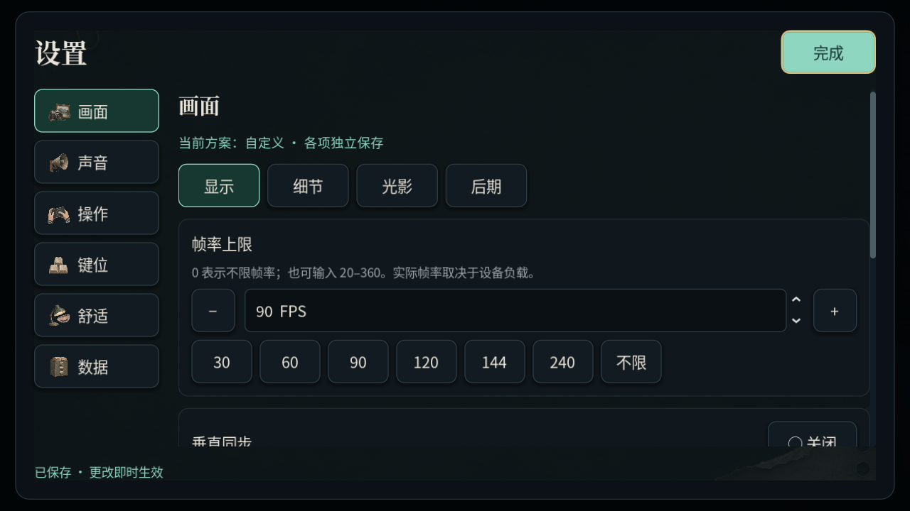
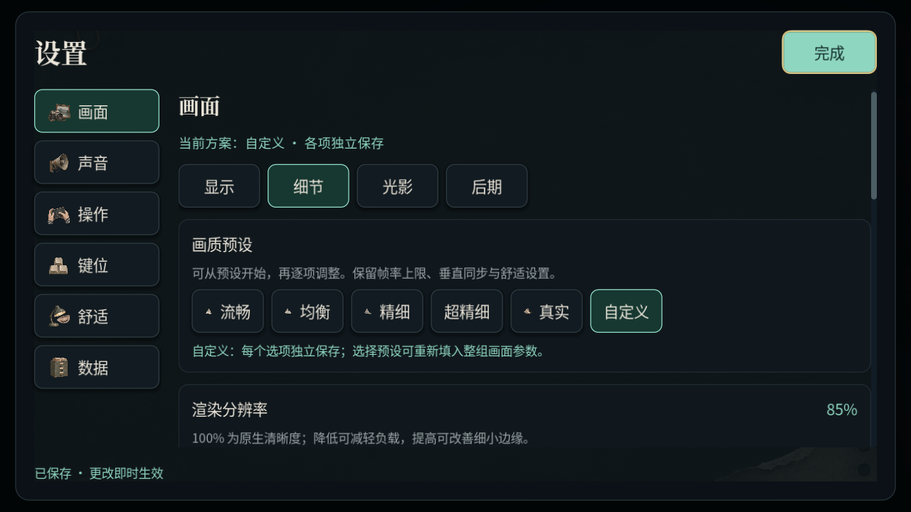
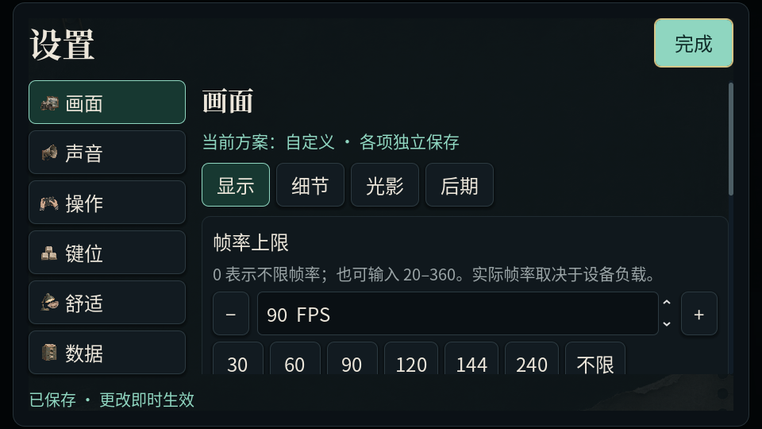

# 自定义画质与帧率

“设置 → 画面”现在分为显示、细节、光影、后期四组。默认打开显示组，帧率控制位于首屏；“完成”和保存状态位于滚动区外。模型、材质、粒子和投影预算可以独立选择。

## 显示与帧率

- 帧率上限可直接输入 **20–360 FPS**，**0 表示不限**；提供 30、60、90、120、144、240 和不限快捷按钮，以及大尺寸加减按钮。
- 垂直同步单独开关。开启后还会受屏幕刷新率限制；上限是输出限制，不能保证设备达到该帧数。
- 默认不限帧率、开启垂直同步，沿用此前的显示节奏。修改上限不会改变物理更新频率、时间倍率、课表或存档进度。
- Android 保持强制横屏全屏，不提供全屏切换；桌面保留窗口／全屏选择。

## 独立画面参数

| 分组 | 可调内容 |
| --- | --- |
| 细节 | 渲染分辨率 50–150%、低分辨率放大、五档模型细节、远处模型 LOD、五档异象／粒子细节、关闭／2×／4×／8× MSAA、FXAA |
| 光影 | 五档光照与材质、太阳／月光投影、太阳阴影精度、局部阴影关闭／1024／2048／4096、六档柔和度、投影灯 0–4 盏、窗户日光、投影窗光 0–4 扇、手电阴影 |
| 后期 | 环境光遮蔽关闭／四档精度、半分辨率遮蔽、高光泛光、体积雾、感官效果精简／完整、高光光晕 0–100%、胶片颗粒及强度 |

“细节”组保留流畅、均衡、精细、超精细、真实五个快捷预设；它们填入整组画面参数。修改任何一项预设参数后标为“自定义”。选择自定义保留当前值，重新选择预设恢复该组参数；帧率、垂直同步、亮度和舒适偏好保留。

原生分辨率以上使用更高分辨率绘制再缩小；FSR 1 仅在 Forward+ 且渲染比例低于 100% 时使用。MSAA 开启时暂停 FXAA，避免重复抗锯齿；关闭局部阴影后灯、窗光与手电的投影暂停，太阳阴影仍可独立开启。

Godot 4.6.3 的 Mobile 路径继续禁用不支持的 FSR／SSAO／体积雾，以及此前验证会触发回放编译停顿的 FXAA／高光泛光。对应选项注明原因并禁用，保留已存偏好。移动端低分辨率使用双线性放大；感官反馈和屏幕光晕仍可单独调节。

## 保存与迁移

设置仍写入独立的 `user://settings.json`，格式版本升为 2。版本 1 只保存画质档位的配置，会自动展开为对应参数；其他音量、键位、触屏布局和解锁标记保留。已有自定义参数逐项校验，非有限数值或非法枚举回到默认，连续值限制在支持范围内。首次触屏运行继续选择流畅预设。

帧率设置直接作用于 `Engine.max_fps` 与窗口同步模式。模型设置只替换渲染模型；其他参数不重建建筑、物理体、门或玩家。新房间与档案重播在构建前接收同一配置，粒子变化重建表现部分，游戏规则与模块随机状态不变。诊断面板分别显示方案、模型档、光照档、帧率上限及垂直同步状态。

界面控件不随保存重建，滑杆、数字输入与焦点得以保留；横屏 960×540、1280×800、2340×1080 和 150% 文字在自动检查范围内。

实现入口：`GraphicsProfile` 定义预设参数，`GameSettings` 负责迁移与持久化，`RenderQuality`／`CampusLighting`／`ScenePost` 应用表现参数，组合层通过 `WorldRouter.world_preparing` 在场景构建前注入配置。测试见 `tests/suites/custom_graphics.gd`，原设置、光影与档案回归继续保留。截图由 `tools/capture/capture_settings.gd` 原生生成，使用隔离配置和示例参数。

本地窗口验证使用软件 Vulkan，不能替代 Android、Windows 真机帧率、耗电与长局验收。渲染基准工具在采样前明确解除帧率和同步限制，避免把用户上限误判为 GPU 性能。

本轮完整无窗口回归 **18,549 项**通过。Forward+ 与 Mobile 窗口专项各 **217 项**通过，覆盖旧配置迁移、自定义读写、实际环境与帧率应用、场景转移、档案配置继承、原设置触摸操作、横屏布局及既有光影预算。帧率另用无固定步长的轻量 Vulkan 窗口对 30／60／120 FPS 做墙钟采样，实测平均约 29.9／60.0／120.3 FPS，验证了实际输出节奏。该窗口没有游戏场景，不作为游戏性能数据。Linux 正式模板导出、启动及 PCK 自定义参数／帧率／演出／开发工具烟测通过。
