# 迁移一致性验证

基准为旧 Web 仓库 `wd-fz/wd-fz.github.io@0bf508a47eac154c2a7047cdb45d314f61c48fdc`。本地参考目录的后续弃用提交没有改动 `game3d/`；实际运行代码的 Git tree 为 `a4c266bfda9bce350963bdd6a43965bd45d5e802`。本记录区分自动验证、实际渲染与尚待迁移的内容，不把测试通过等同于所有玩法完全一致。

## 2026-11-08：场景边界、镜头与天气

### 已修正

- 相邻建筑预览未裁切，整栋室外外壳穿进教学楼、行政楼、实验楼和宿舍内部。这些模型只有画面，没有当前场景碰撞，因此表现为单面可见且可以穿过的墙。现在按实际连接门槛裁切相邻模型，保留当前场景自身的墙体与碰撞，不会用新增碰撞封住通道。
- 预览中的普通门与电梯门同步运行状态；室外只显示最近入口 12 米内的室内模型，超过 15 米隐藏，避免阈值闪烁及同时绘制所有室内。
- 教学楼天台楼梯开口原来将门槛之后的第二排楼梯格全部切空；现在按旧版门口判定的有效深度构造开口，保留玩家走进楼梯井所需的空间。
- 坐下视高 1.12 米、站立 1.65 米、步行／奔跑起伏、72°至 81°奔跑视野、宽屏近平面限制已经接入。输入俯仰与表现偏移分离；读档清除上一场景的奔跑、受伤与镜头过渡。设置增加「镜头晃动」开关。
- 蛾群收拢使用实际累计暴露量，离开危险范围后会退回；梦魇阈值与真实镜头高度传入表现层。扑翅声使用可见蛾群的平均距离。
- 屋檐遮挡接入雨声；雨伞保留自己的敲伞声。雨点、蛾群数量与精细档太阳阴影恢复为旧版五档配置。
- 调画质立即替换当前模型与预览、重新绑定灯管材质，保留当前物理体、门状态、玩家位置和玩法模块。

### 独立对照

`tools/export_reference.py` 启动旧 Web 游戏，直接调用原运行时采集结果，写入 `tests/fixtures/web-reference.json.gz`。Godot 的 `tests/suites/migration.gd` 消费该文件，期望值没有取自移植实现。

| 对照范围 | 样本 | 方法 |
| --- | ---: | --- |
| 普通楼层与室外碰撞 | 34 场景、55,954 点 | 原 `Collision.depth` 与生产代码生成的真实 Godot 物理体相交查询 |
| 课表与时间 | 2,126 点 | 时速、位置要求、夜间判定、时钟文字、时间边界 |
| 镜头运动 | 360 帧 | 步行、奔跑、坐下、受伤、关闭晃动、超宽屏；旧版投影更新阈值允许 0.01° 的 FOV 差异 |
| 画质配置 | 5 档 | 雨点数、蛾群数、太阳阴影 |

这套平面碰撞样本不覆盖钟楼旋梯、楼梯井和电梯特殊空间的分层几何；楼梯井与钟楼另有实际角色行走测试，电梯特殊空间见下述独立验证。采样时门关闭，半径取旧版 `PRAD−0.01`，舍弃小于 0.025 旧世界单位的微小嵌入，避免把不同物理引擎的接触容差误认为通路变化。

墙体回归还直接检查导出模型三角形、两向射线与真实角色胶囊；关闭的实墙两侧均阻挡，修复处的通道允许通过。门预览测试检查状态同步与 12／15 米显隐阈值。

### 运行证据

- Godot 4.6.3，无窗口完整回归：**1,461 项检查，0 失败**；结构、依赖边界、工具测试及资源导入均通过。
- 首轮窗口回归在整合测试阶段达到原 900 秒上限，未完成，因此不计为通过。第二轮使用 1,800 秒仍在末尾死亡流程达到上限，未完成；现将窗口预算调整为 3,600 秒，并让 CI 为导入和回归留出 75 分钟。未减少检查或关闭生产画质。环境为 Xorg dummy display + Mesa llvmpipe 软件 OpenGL，不能据此推断手机或独立显卡性能。
- 下列为同一受控机位的 Godot 实际渲染，不是概念图；此机位保留原 75°视野以便前后比较。

| 修复前 | 修复后 |
| --- | --- |
| 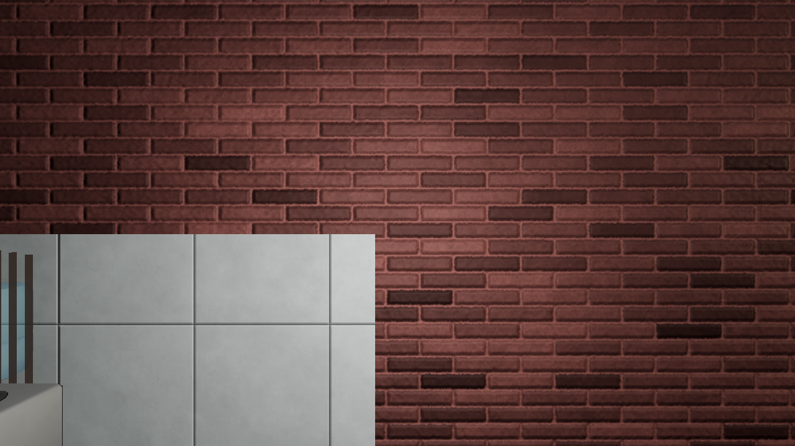 | 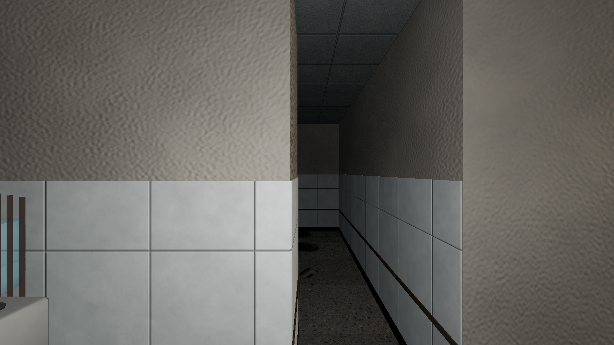 |

反向机位：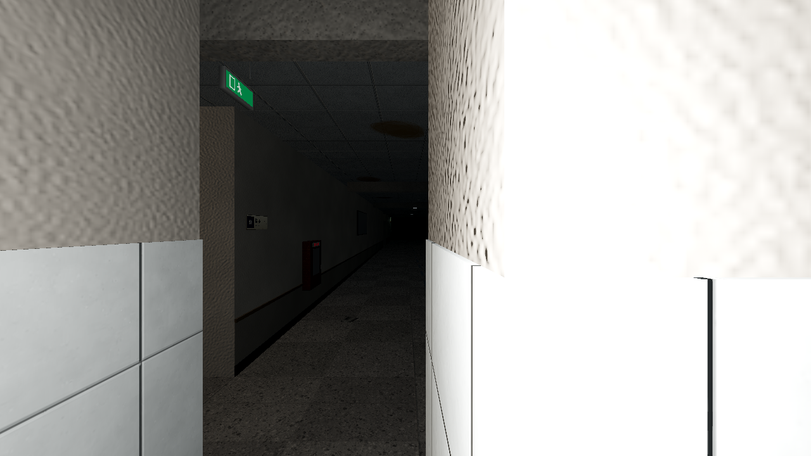

### 复验

```bash
python tools/check.py --mode headless
# 使用可用显示服务，或 xvfb-run -a：
python tools/check.py --mode windowed
# 仅需重新采集旧版期望值时；需要 Playwright 和 Chromium：
python tools/export_reference.py --source /path/to/original-web --chromium /path/to/chromium
```

完整报告位于 `build/reports/<mode>/summary.json`，日志同目录。迁移范围及剩余工作见[与旧版差异与迁移](plan/与旧版差异与迁移.md)。真机触屏、自然完整长局、所有随机演出和所有图形设备尚未完成穷尽验证。

## 2026-11-08：电梯特殊空间

- 从原运行时额外采集 **10,545 个分层几何样本**，比对地面高度、步高和碰撞深度。真实物理体没有覆盖洞口的全局平面地板。
- 实际角色分别沿南侧下降路线和北侧上升路线行走，验证从入口层到 -8 米、+4 米出口层，包含坡道、平台和转角。
- 场景整合覆盖稀有入口、入场消耗、时间停止、分层读档、粉笔、手表／地图限制、坠落重生、死亡保护、出口仅结算一次、跳过过场和返回菜单清理。
- 连续播放死亡演出时，旧演出延迟释放曾再次恢复世界并移除新遮罩；现在每段只恢复一次，只释放自己创建的遮罩，回归覆盖释放交界。
- 完整无窗口回归：**1,525 项检查，0 失败**；静态结构、工具测试与资源导入通过。该次完整窗口回归在末尾死亡流程触及 1,800 秒上限，未记为通过；此前没有断言失败输出。尾段按同一固定帧时钟单独补跑：**18 项检查，0 失败**。触屏改动整合后还将运行完整窗口回归。其后补充长时间停留存档校验与坠落闪光，专项无窗口回归为 **64 项检查，0 失败**。

原样本可用 `python tools/export_reference.py --source /path/to/original-web --chromium /path/to/chromium --maze-only` 更新。原生画面采集脚本为 `tools/capture/capture_maze.gd`；几何与生命周期检查位于 `tests/suites/maze.gd`。

原生窗口采集的画面（1280×720，Mesa llvmpipe；没有后期修图）：

| 入口平台 | 上层断桥与粉笔痕迹 |
| --- | --- |
| 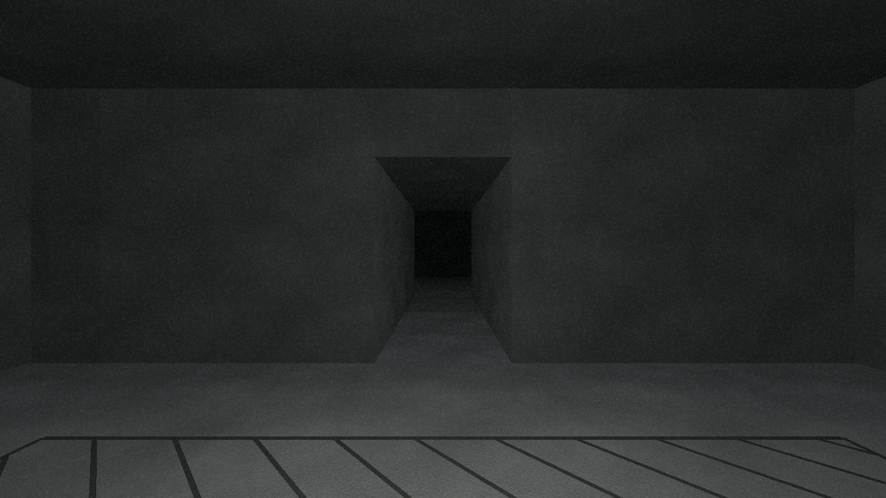 | 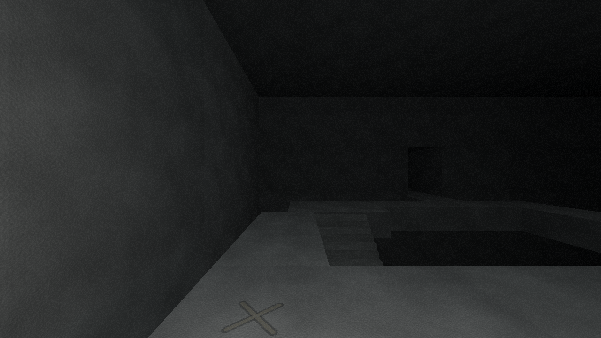 |

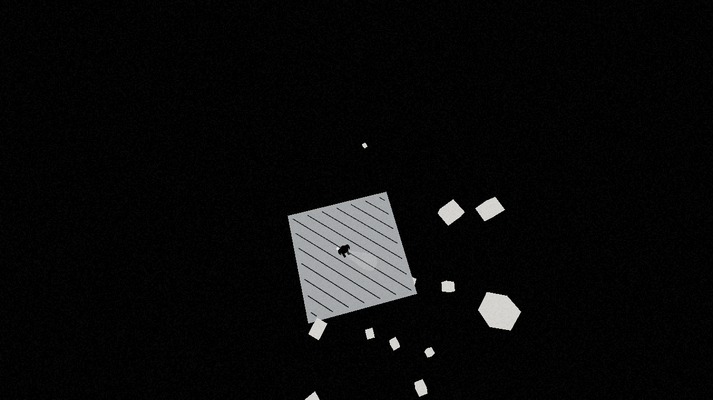

## 2026-11-08：触屏和开发窗口

- 真实 Godot 触摸事件覆盖摇杆、视角归属、工具栏、背包关闭、驾驶操作、布局拖动与取消、窗口拖动、悬浮点展开、旋转后边界和文本输入隔离。
- 试听队列取消／重启竞态、专用音频通道和 Esc 逐层关闭也进入回归。无窗口及原生窗口专项均为 **34 项检查，0 失败**。
- 实际截图发现暂停天赋说明与菜单文字重叠，已移入菜单排版；该调整之后专项无窗口再次通过，原生截图重新采集。
- 此批整合前完整无窗口回归为 **1,485 项检查，0 失败**（不包含电梯特殊空间批次，以及随后补入的 Esc 与试听隔离检查）；整合后的完整结果另记，不混用统计。
- 脚本 `tools/capture/capture_touch.gd` 输出真实 480×800 与 1280×720 视口。下图未经后期修改，触屏来自合成设备事件，仍须 Android 真机验收和安全区域检查。

| 触屏工具栏 | 展开的开发窗口 | 收起后的悬浮点 |
| --- | --- | --- |
| 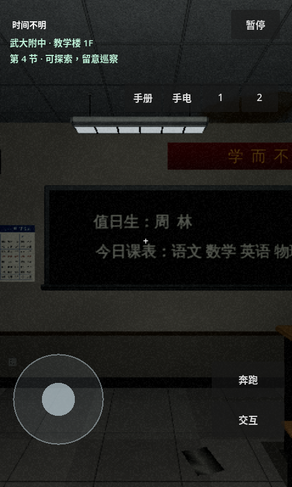 | 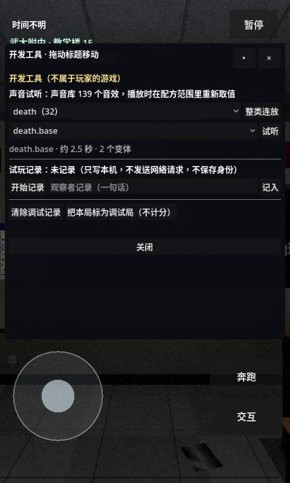 |  |

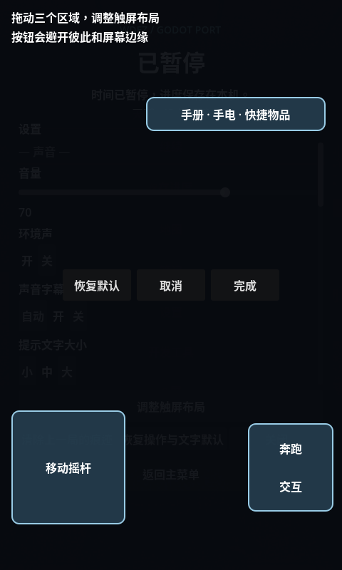

### 两批整合后的验证

- Godot 4.6.3 完整无窗口回归：**1,566 项检查，0 失败**，结构、工具测试与资源导入通过。
- 首次整合暴露一条没有固定随机种子的硬币落点断言。投掷本就带随机角度和距离；该场景现在固定种子，并补上 8 秒前仍有效、8 秒后失效的生命周期检查。车库专项 **31 项检查，0 失败**。
- 使用 3,600 秒预算的完整原生窗口回归已完成：**1,589 项检查，0 失败**（提交 `fc21307`）。该次包含场景、触屏和电梯空间，不包含之后合入的存档转换修改。

## 2026-11-08：旧档进度与原生保存

- 从旧版真实 `applySave`、场景高度恢复和 `SAVE_SCHEMA` 采集 11 组存档样本：当前及旧教室座位、进行中的检查、路线、旧时钟、异象、车库、有效／无效楼梯落点、钟楼旋梯和电梯特殊空间。
- 接续主要模块的持久状态，包含一次性天赋消耗、图纸接线、设备任务、巡察锁定、异象选择剩余时间、检查人影、探索、粉笔和相册。原始 JSON 另存为惰性元数据；未实现模块仍须迁移，规则 DLC 存档暂时明确拒绝。
- 候选会话先转换、校验，再替换本局；专项覆盖后段校验失败、损坏的嵌套状态不改当前会话／存档，以及成功导入后原生保存和读取。
- 修复原生雨伞撑开状态漏存、传送门图纸整数键导致保存校验失败；恢复全局氛围种子，避免沿用上一局。
- 专项无窗口 **110 项检查、0 失败**；此分支完整无窗口 **1,645 项检查、0 失败**，结构、工具测试和资源导入通过。该分支基于电梯空间批次，尚未合入触屏批次，数量不当作最终整合结果。
- 复采：`python tools/export_reference.py --source /path/to/original-web --chromium /path/to/chromium --save-only`。样本为 `tests/fixtures/save-reference.json.gz`，运行测试为 `tests/suites/legacy.gd`。

### 原生随机序列连续性

独立复现发现 11 个模块读档后的后续随机结果不连续：6 个模块把 64 位随机状态写成 JSON 数字而丢失精度，5 个未保存随机状态。现在用十进制字符串保存随机种子和状态，并兼容之前的数值格式；已经丢失的旧档低位无法逆推恢复。

回归通过真实 `SaveStore` 写盘与读盘，对全部 16 个使用独立随机生成器的玩法模块，分别以三个种子比对后续 16 次结果，覆盖负数与有符号 64 位边界；异常越界状态被拒绝。存档专项 **171 项检查、0 失败**，更新后的完整无窗口回归 **1,693 项检查、0 失败**。该结果仍是触屏批次整合前的分支结果。

### 存档、触屏与电梯空间整合

整合后 Godot 4.6.3 完整无窗口回归 **1,733 项检查、0 失败**；结构、工具测试与资源导入通过。存档专项随后在原生窗口通过 **171 项检查、0 失败**（`aece92e`）；包含真实应用导入、损坏输入的原子拒绝和转换后的保存／读取。此前完整窗口的 1,589 项按 `fc21307` 单独记录，不冒充覆盖这次存档修改。窗口测试使用软件 OpenGL；音频设备不可用时引擎使用 Dummy 驱动，不能算作听感验证。

## 2026-11-08：《先辈》支线

- 恢复教学楼一楼隔间的投放窗口、实际背包扣除、自动保存、后续进入／等待选择和结局。原规则的窗口是游戏时间 11:45:14（包含）至 11:45:15（不包含），对应现实约 0.5 秒；游戏界面没有新增秒钟或触发提示。
- 旧档 `beastDrop` 接续；原生存档不返还已经投放的物品，新局不继承解锁。到达结局才显示对应隐藏成就、速通记录和 CG 记录。
- 按旧版九秒分镜恢复人影和相机路径；动画只改变专用镜头。跳过、退出到菜单、重新开始均清理表现，不修改玩家保存的位置与朝向。
- 独立采集旧版真实 `dropSelected` 的 **108 组条件**和 `CUT_DEF.beast.frame` 的 **362 帧**。专项无窗口 **493 项检查、0 失败**，原生窗口 **499 项检查、0 失败**；整合后的完整无窗口 **2,226 项检查、0 失败**，结构、工具和资源导入通过。
- 复采使用 `tools/export_reference.py --story-only`，运行对照在 `tests/suites/secret_routes.gd`，原生截图脚本为 `tools/capture/capture_beast.gd`。本批最初使用临时饱和度过渡；下批已替换为统一调色和原灯光变化，不把最初临时方案当作完全一致。

## 2026-11-08：统一调色与正常世界过渡

- 以一个独立的界面下层绘制通道接入原 ACES、暗部青色／亮部暖色、对比度、暗角、低 SAN 失色、巡察红光、目光偏色与胶片颗粒。移除旧饱和度补丁和重复颗粒；Godot 环境不再先套一次 ACES。照片隐藏 HUD 时仍保留场景调色。
- 假正常按原 `dt × 1.6` 平滑过渡，笑值到 72 逐渐恢复里世界；开场、《先辈》、《门》和《网安仙人》的正常世界曲线接入。室内环境光、灯管、雾和室外曝光跟随世界状态，结束／跳过／取消恢复原值。
- 目光异象恢复渐进压暗与偏色。特殊空间的反色显式复制已经调色的画面，避免多次读屏着色器读取旧缓冲、盖掉前一层效果。
- 发现直接重开／读档只取消过场，未统一清掉感官平滑与眨眼、重影计时；现在所有会话安装和返回菜单共用清理入口，避免上一局的视觉事件污染新局。
- `tools/reference_grading.js` 在旧 Web 运行时直接使用原着色器渲染 **13 组 64×64 图像，共 53,248 像素**；原生窗口逐通道比对，当前每组最大误差 **1/255**。另对照 **48 组昼夜／正常世界灯光状态**。该像素样本覆盖调色参数与静态感官叠加，不代表所有校园光照、动态模糊、粒子和硬件像素完全一致。
- 调色专项原生窗口 **122 项检查、0 失败**；接入后的《先辈》原生窗口专项 **499 项检查、0 失败**；完整无窗口 **2,336 项检查、0 失败**，结构、工具和资源导入通过。整合后的完整窗口回归另行记录。
- 复采：`tools/export_reference.py --grading-only`，回归：`tests/suites/grading.gd`。以下是原生窗口实拍，没有后期改色；物理灯光单位与渲染后端仍有差异，不能用这些结果宣布所有画面完全一致。

| 门口的旧校服人影 | 走廊逐渐恢复颜色和光线 |
| --- | --- |
| 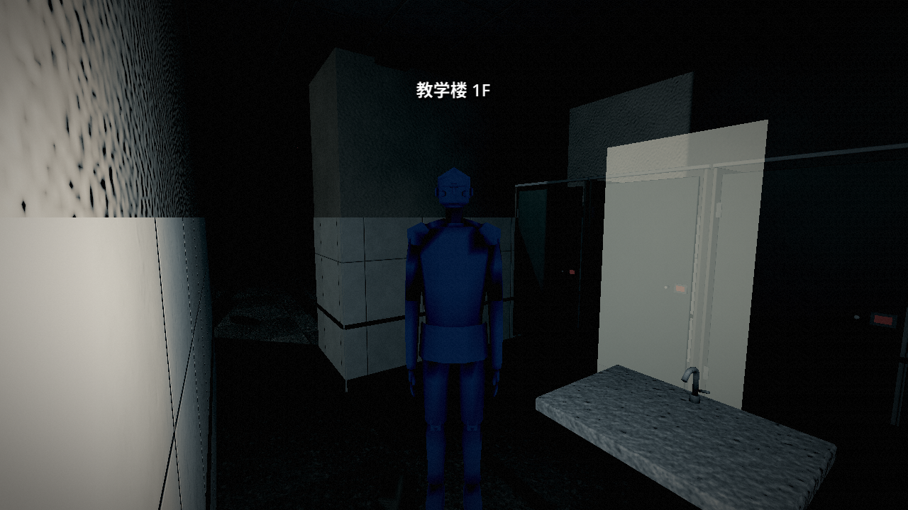 | 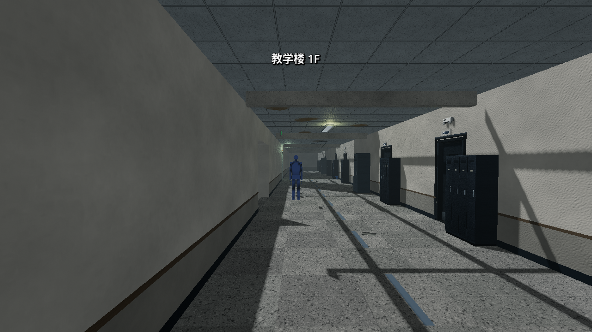 |

## 2026-11-08：电梯满员

- 恢复 1% 登梯抽取，与错误电梯互斥；前 60 个模拟秒、异象、待处理检查及本地追逐期间不抽取。抽签和六秒离开窗口均保存，读档不重抽。
- 关门时蜂鸣、显示“满员”并重新开门；走到门槛外化解一次，电梯独自离开。留在里面触发 4.2 秒死亡演出；死亡保护消耗后可正常选层，不算化解。
- 红字、灯光、身后呼吸、拍照主题、隐藏成就与死亡档案读取同一事件状态。新局和退出清理临时模型、声音与镜头；事件本身不扣 SAN。
- 新增 `LiftCrowdModule` 规则与 `LiftCrowdFx`／`CrowdDeath` 表现，补齐旧版三个声音配方；声音库现为 150 种音效、16 个持续层。
- `tools/export_reference.py --crowd-only` 从原运行时采集 128 组登梯条件、5 条完整事件流程、162 个灯光状态、338 帧死亡时间轴以及事件中的旧存档。回归另使用真实角色胶囊穿过打开的门，并覆盖旧档转换、原生磁盘读写、重复奖励与保护后的控制恢复。
- 原生截图入口：`tools/capture/capture_crowd.gd`；自动化入口：`tests/suites/lift_crowd.gd`。本批不代替所有随机事件组合、自然长局和 Android 真机验证。
- 整合后的完整无窗口回归 **3,236 项检查、0 失败**；结构、工具和资源导入通过。原生窗口“满员＋后续集成流程”专项 **1,082 项检查、0 失败**，覆盖过场切换、六条公开路线、存档和结算。
- 本次完整窗口运行在过场生命周期处发现错误：重开已卸载原场景，但取消过场仍更新它的灯光。开场与结局清理现在同时检查灯光是否仍在场景树内；上述窗口专项重新验证了此处及后续流程。完整窗口前段与后续专项来自分开的运行，不记作一次新的全量窗口通过。
- 实拍另发现原显示牌锚点处于轿顶底面，字的一半被遮挡；外壳改为完整悬在顶面下方，保持朝向和碰撞不变。修正后“满员”无窗口专项 **904 项检查、0 失败**，原生实拍无引擎错误。

| 重新开门：可读的显示牌 | 死亡后留下的学生证 |
| --- | --- |
| 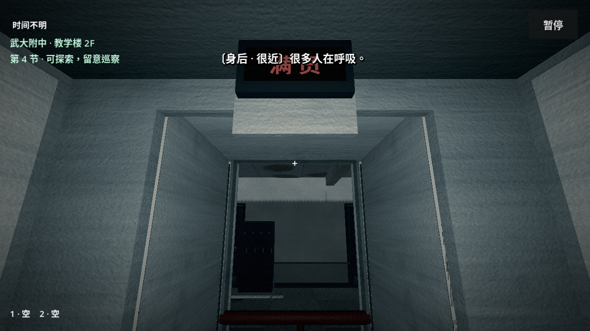 | 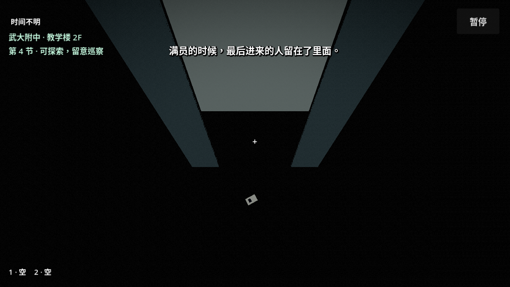 |

## 2026-11-08：小刀与隐藏开局赠品

- 恢复体育器材室的一次性小刀、巡察抓捕后的一秒操作窗口、背包拿出后再次使用、快捷栏不算／预先拿在手上不拦截／超时死亡。身体被按住时背包仍可打开，世界继续运行；读档恢复剩余时间与拿出顺序。
- 《管制刀具》是保留本局的假结局：不清空存档、不提交通关分数、不结束速通计时。播放原四段 16 秒演出后可次日早读在自己座位醒来，保留其他物品，清除抓捕巡察并保存次日压力。保护挡下超时死亡时恢复控制。
- 恢复 3% 开局赠送手电、三次快速点击校名的本机开关，与所选天赋叠加；速通排除，读档不重抽或再发物品，六秒后提示一次。校名通过原生按钮处理鼠标和触屏，避免触屏模拟鼠标被过滤。
- 旧存档恢复两模块的状态；转场镜头不修改玩家姿态。人物材质明确忽略校园雾，保留原黑影；演出开头清掉被新旁白替换的旧提示。结局卡加入限高滚动并实测窄屏“再睁开眼”按钮可达。
- 旧运行时采集 **24 个拾取位置、10 条抓捕操作流程、16 组开局条件、11 个连点时刻、321 帧演出、2 份旧存档**。入口 `tools/export_reference.py --secret-items-only`；回归 `tests/suites/secret_items.gd`。
- 本批最终完整无窗口 **3,726 项检查、0 失败**；结构、工具和导入通过。原生窗口专项 **505 项检查、0 失败**，包括真实触屏分发、背包按钮、存读档、结局跳过、窄屏滚动、死亡保护和次日醒来。原生实拍入口 `tools/capture/capture_secret_items.gd`，未后期调色。本批未覆盖 Android 真机及所有自然游玩随机组合。

| 登记单与物品袋 | 自己座位上的留校单 |
| --- | --- |
| 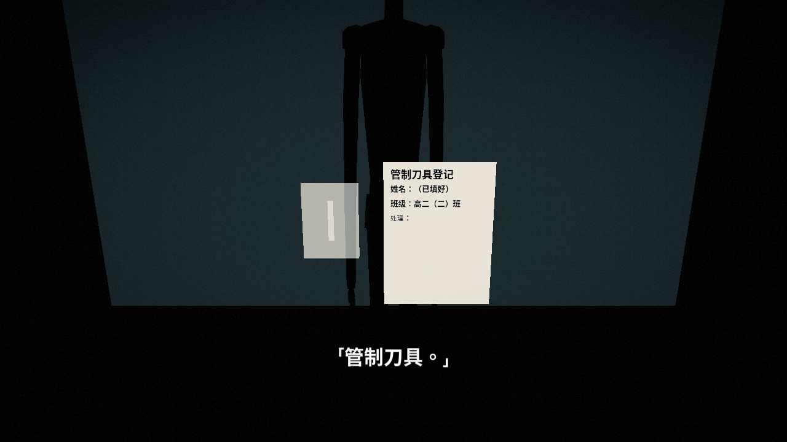 | 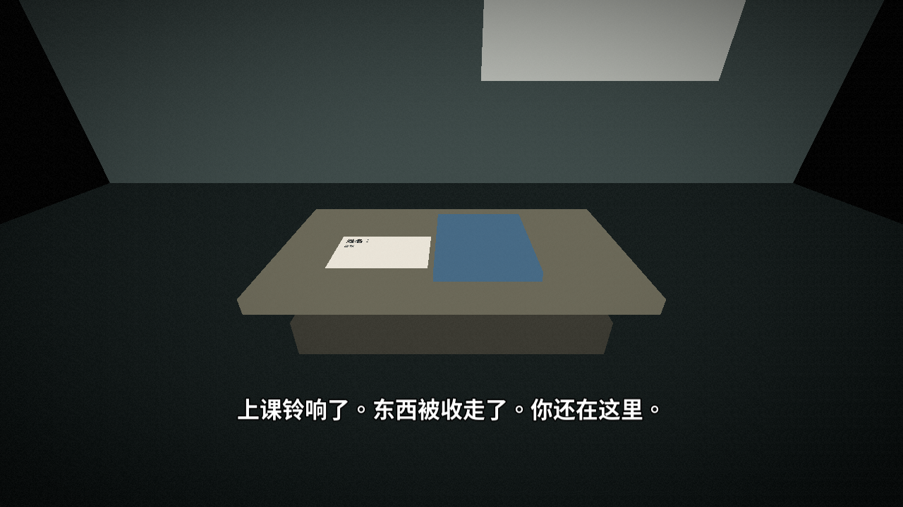 |

## 2026-11-08：陀螺与梦境结局

- 按原模块恢复固定陀螺、每天一次的课堂睡眠抽签、上课／自由时段的不同入梦概率、每日最多入梦一次，以及首次旋转后保持不变的结果。规则状态、随机序列和返回床位均进入存档，支持原 Web 梦境存档转换。
- 梦境沿用原 23×17 迷宫与黑坑轮廓；不推进时钟、不生成新的随机异象，地图入口受限。真实玩家碰撞体已走通避开黑坑的 51 个连续格点，外墙阻挡检查通过。与原版相同，黑坑保留平面物理地面，由 1.4 秒镜头下沉触发分支。
- 两条成功路线共用原四段 20 秒演出与隐藏记录；未旋转或倒下后坠落会回原床位，只结算一次 90 游戏分钟、结束时普通睡眠恢复量的两倍、违规、体力与冷却。夜间违规豁免继续沿用主规则。
- 一并修复普通休息按开始时压力恢复 SAN、跨凌晨跳时仍按开始时刻加冷却的问题；现在按休息完成时计算。旧源码的“铁胃”注释已过时，实际运行时无此额外加成，迁移没有重新加入它。
- 恢复入梦的 160 ms 淡出、170 ms 换场、300 ms 淡入；退出、重开和读档取消旧回调。梦境结局先于常规 SAN 死亡结算；醒来当帧不额外推进普通时钟。表现不修改保存的玩家位置和输入方向。
- 原运行时采集 **70 组入睡条件、7 条梦境分支、36 组休息结算、401 帧镜头和一份进行中的旧梦境存档**。复采入口 `tools/export_reference.py --inception-only`，回归 `tests/suites/inception.gd`，截图 `tools/capture/capture_inception.gd`。截图注入机位、随机结果和演出进度，通过实际拾取／入梦／使用／坠落入口触发，不代表自然随机长局。
- 原生窗口专项 **1,269 项检查、0 失败**，包含模型旋转与相机逐帧对照、存读档、真实路线通行、跳过及取消。使用 Godot 4.6.3 Compatibility / Mesa llvmpipe；未代替 Android 真机与实际听感验证。
- 最终完整无窗口回归 **4,596 项检查、0 失败**；结构、工具测试与资源导入通过。完整窗口的最终整合结果另行记录，不用本次专项代替它。

| 梦境黑坑与边缘 | 课桌上的陀螺 | 最后醒来的房间 |
| --- | --- | --- |
| 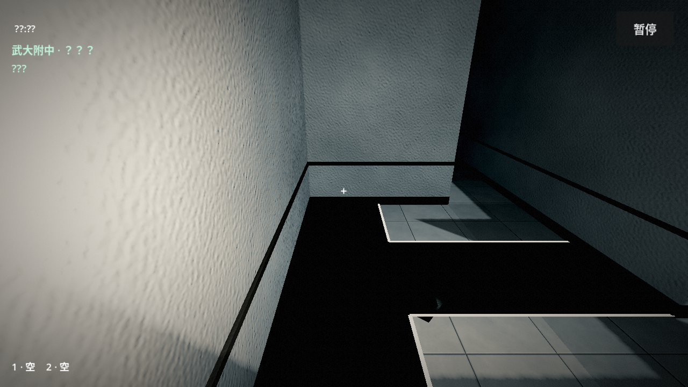 | 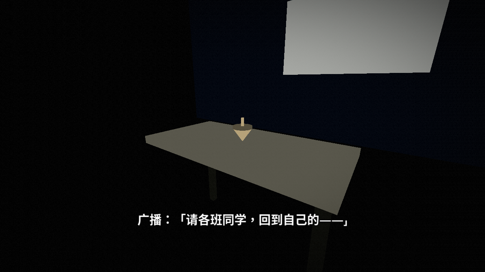 | 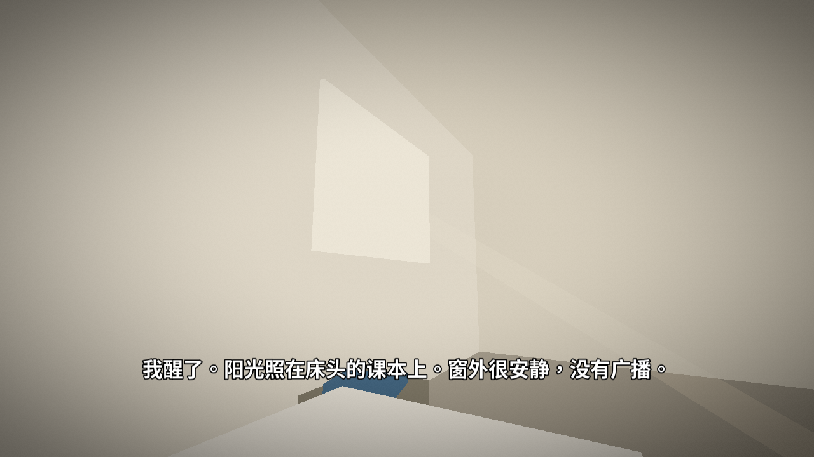 |

## 2026-11-08：特殊空间内的巡察导航

- 恢复原半米网格、脚底高度、坡道中点与视线阻挡判定；路径使用真实体素和坡面，不再把分层迷宫当作平面房间。
- 巡察者记住进入迷宫所用的楼栋和楼层，沿原电梯落点进入，沿南侧出口返回；跨空间等待两秒，存档接续剩余时间。深层和坡道上的有效巡察位置保留，无支撑旧档位置使用原安全落点。
- 直接采集原运行时的六组路径、1,296 组视线、三条网关时间轴和四组旧档；另用实际胶囊检查两条完整路径，并运行巡察移动直到 -8 米出口，不用瞬移代替下降。复采入口 `tools/export_reference.py --maze-patrol-only`，回归 `tests/suites/maze_patrol.gd`。
- 静态坡面按位置索引，路径边在普通帧内以约 2 ms 预算预计算；规则结果与未预计算路径保持一致。本机首次南侧查询曾约 1.13 秒，索引后约 0.46 秒，预计算后约 50 ms；这只是并行运行回归时的诊断测量，不是跨设备帧率保证。
- 完整无窗口回归 **4,710 项检查、0 失败**，结构、工具和资源导入通过；包含全部 10,545 个原分层碰撞样本。当前正在运行的完整窗口基线为 `d618b96`，其结果不冒充覆盖这批巡察修改。

## 2026-11-08：完整窗口基线与坠落回调

- `d618b96` 完整原生窗口回归结束：**5,068 项检查、0 失败**，结构、工具与资源导入通过，无脚本或资源错误。环境为 Godot 4.6.3 Compatibility、Mesa llvmpipe、固定 60 Hz 模拟时钟、Dummy 音频；不计作真实设备帧率或听感验证。
- 迷宫坠落改为原 160 ms 淡出、170 ms 黑屏重生、300 ms 淡入。在黑屏前只扣一次三点 SAN，不提前抽落点；重生后清除触屏动作、竖直速度和俯仰，再自动存档。
- 场景更换、菜单、新局和读档取消旧回调；中途死亡不抽落点，也不覆盖存档。暂停期间仍按原实际时间完成淡出，保留暂停状态；黑屏前保存的无支撑高度读档后修复为安全落点，不再扣一次坠落 SAN。
- 坠落专项无窗口 **62 项检查、0 失败**。首次试运行早于新工作目录完成资源导入，出现模型缺失错误，已作废；以上统计来自导入完成后的干净重跑。
- 巡察导航与坠落整合后：完整无窗口 **4,746 项检查、0 失败**，结构、工具和导入通过；原生窗口专项 **179 项检查、0 失败**。该专项包含分层巡察真实碰撞、网关接续，以及黑屏前读档、切场景、菜单、新局、死亡和暂停六种交界。

## 2026-11-08：世界异象模型与逐帧动画

- 恢复 17 种世界效果的原模型布局与动画，包括六个做操黑影、隔间递手、渗水、仪式、盛宴、走廊灯、黑板、名单、广播、后桌、移动窗格、冷库、雨点成字、目光、围墙行人、影子和天台分身。雨与蛾群继续使用已迁移的天气系统；水杯／可乐细节另行迁移。
- 原运行时直接采集 21 组模型、147 个动画状态，覆盖五档目光数量；使用原眼睛、文字贴图与灯笼模型。比对位置、尺寸、Euler 值及实际旋转四元数、颜色、透明度和深度写入。表现随机数独立，不写入规则状态、玩家姿态或玩法随机序列。
- 原生实景发现并修正透明排序造成食物被桌面盖住的问题；满不透明度物件进入不透明通道，半透明道具保留原深度写入，眼睛与雨字保持不写深度。补实际像素检查，确认八份食物均未被桌面遮住。显式使用原 XYZ 旋转顺序，避免相同 Euler 数字在 Godot 默认 YXZ 下得到不同姿态。
- “雨点成字”的初次截图处于渐显早期；原地面射线和关闭深度测试对照排除了地面遮挡。按原时序继续到八秒后文字可见，未擅自提升地面或改变出现规则。
- 最终专项无窗口 **178 项检查、0 失败**；原生窗口（含真实应用事件切换、像素遮挡、文字可见性）**223 项检查、0 失败**。与迷宫坠落修正整合后的完整无窗口回归 **4,913 项检查、0 失败**，结构、工具、导入通过。
- 复采入口 `tools/export_reference.py --anomaly-fx-only`，回归 `tests/suites/anomaly_fx.gd`，实景截图 `tools/capture/capture_anomaly_props.gd`。截图注入事件、机位与进度，不能代替自然随机游玩；本批未进行 Android 真机、全部自然事件组合或听感验收。

| 盛宴：八份食物均可见 | 目光 |
| --- | --- |
| 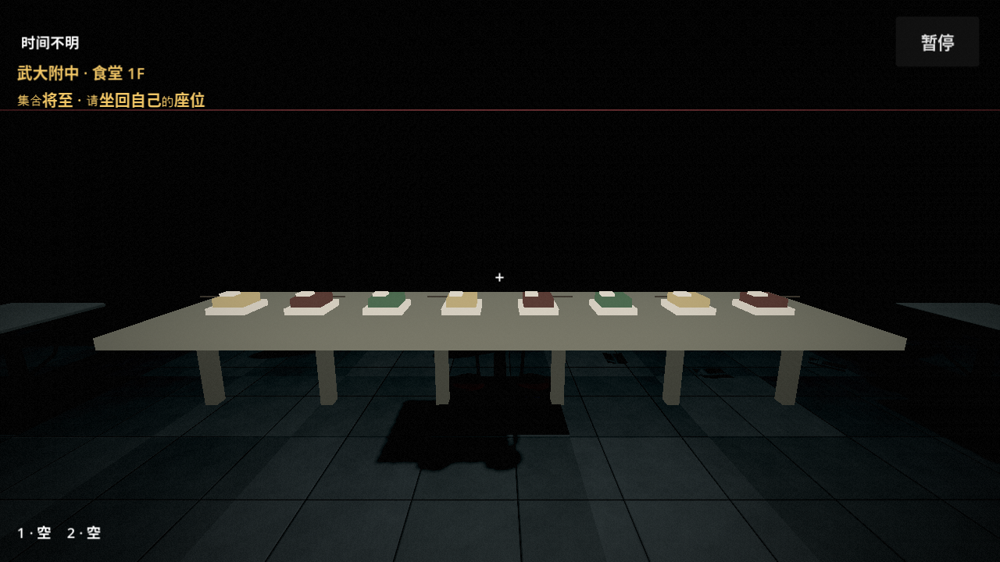 | 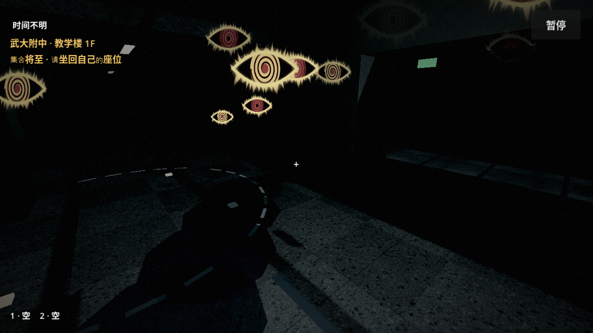 |

| 仪式圈 | 按原时序渐显的雨字 |
| --- | --- |
| 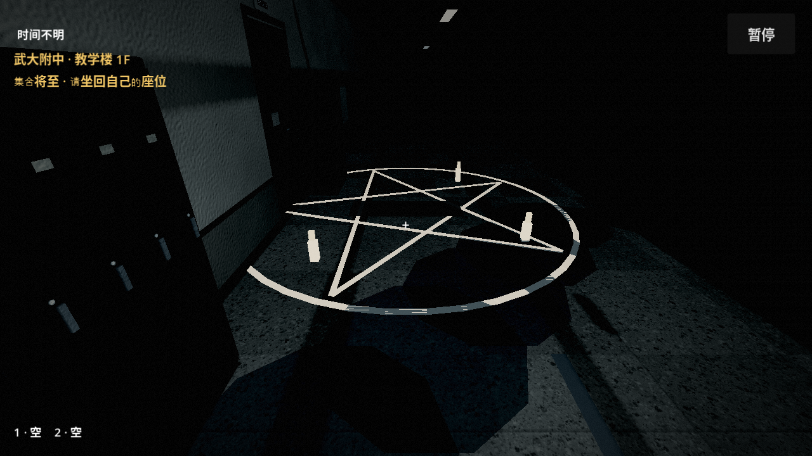 | 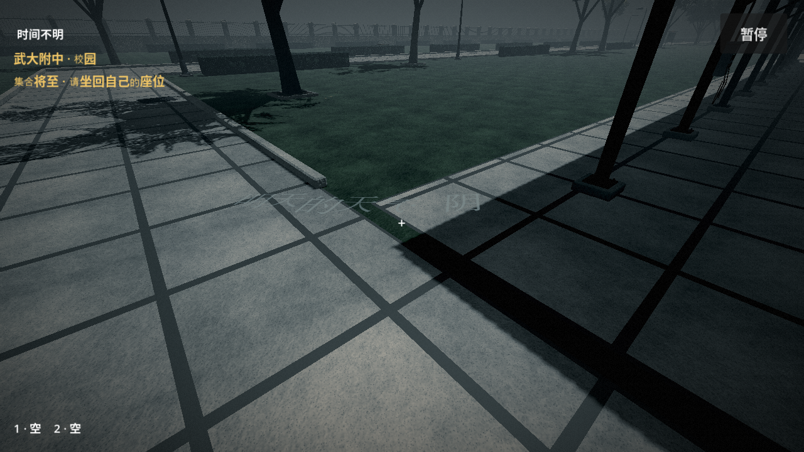 |

## 2026-11-08：掉落物与残留痕迹

- 水杯／可乐恢复原五档模型、杯身文字及波纹贴图、预警圈、锁定落点、弹道、落地变形、杯盖滚动、碎片、泡沫与水渍。原生及旧档继续剩余阶段，重建画质不改变判定数据或玩法随机序列。
- 落点按原 1.5 至 -0.5 米射线查询实际绘制的校园表面，使用只读网格缓存；实例模型在无窗口模式也用 CPU 变换查询。不会给装饰物增加游戏碰撞或改变规则半径。
- 修复墙面法线丢失、碎片浮点误差导致无法停稳、同长度痕迹列表替换后画面未刷新、切换画质没有重建残骸。静态／动态痕迹恢复原哈希、跨房间全局序号、平面网格、颜色和变形杯子，替换旧白色占位圆柱。
- 原运行时样本包括 **18 条动画流程、20 个五档模型、75 个真实地面采样、12 组墙面法线、760 组痕迹哈希和 20 组痕迹布局**。入口为 `tools/export_reference.py --falling-props-only` 与 `--traces-only`，回归为 `tests/suites/falling_props.gd`、`tests/suites/traces.gd`。
- 最终无窗口与原生窗口专项各 **1,337 项检查、0 失败**，完整无窗口 **6,251 项检查、0 失败**；结构、工具和导入通过，无脚本／资源错误。完整窗口整合正在另跑，不将专项算作全量。
- 实拍 `tools/capture/capture_falling_props.gd` 使用可站立的室外路面，受控注入事件、机位和进度，经过实际校园渲染。原生环境仍为 Godot 4.6.3 Compatibility / Mesa llvmpipe，不能代替自然长局或 Android 真机。早期截图选点落在绿篱内部，另一次采集脚本误用室内出生接口，均已废弃；此处图片来自修正后的无错误重采。

| 坠落中的水杯 | 可乐落地与先前水杯痕迹 |
| --- | --- |
| 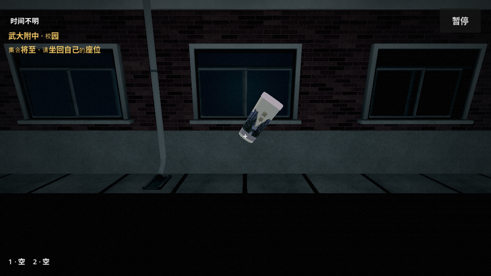 | 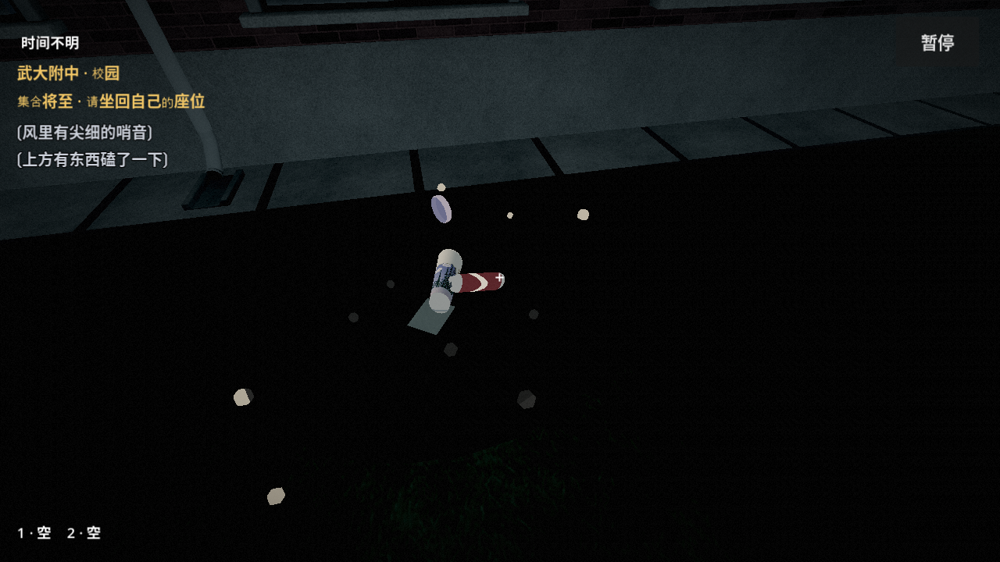 |


## 2026-11-08：开发工具、记录隔离与剩余死亡道具

- 补齐五页调试操作：状态编辑、时钟前后调整、场景／室外地点传送、背包／快捷栏、异象、巡察、检查、假正常、冻结、预览与复活。时间回拨使用旧 `GameTimeRules` 的 216 组原运行样本；过期检查先裁剪，回拨不能降低累计压力。
- 传送统一结束异象并取消旧选择、检查、电梯、驾驶、翻找和预览，避免换场后继续结算旧事件。窗口保持游戏可操作，文本输入和冻结分别约束相应输入；页签固定在滚动区外，小屏缩放与悬浮点保留。
- 全部 38 种已接入的死亡预览使用独立相机、独立声音随机序列及短生命周期声音，不修改保存状态或真实输入姿态；切场景、读档、重开、菜单、真实死亡与关闭均清理。复活恢复死亡前姿态，并取消旧结果卡。
- 修正调试局仍会增加正式成就的问题。按旧源码规则，打开面板即标记本局，关闭、保存和读档后也不能解除；本局统计照常记录，正式解锁与跨局进度不写入。调试速通继续计时，结束显示无效原因，不产生个人最佳。
- 补齐原 `anfx` 的九种死亡道具：理智耗尽、递手、名单、黑板、镜子、路人转身、翻墙挤压、门缝和墙体升起。原运行时 27 组机位、共 243 个状态逐一比较模型位置、旋转、缩放、可见性、颜色、透明度和相机输出。
- 最终完整无窗口 **7,069 项检查、0 失败**；原生窗口专项 **824 项检查、0 失败**，包括真实触屏分发、预览全部效果、记录可信边界及实际死亡结束。结构、工具与导入通过，无脚本／资源错误。另一个固定工作目录的 `4c60e82` 完整窗口回归为 **6,730 项检查、0 失败**，该全量仅覆盖其提交，不冒充包含本批的新实现。
- 采集入口 `tools/capture/capture_debug_tools.gd`、`capture_remaining_death.gd`；后者注入机位和演出时间，是真实校园画面，不是自然随机游玩。运行环境为 Godot 4.6.3 Compatibility / Mesa llvmpipe；仍未代替 Android 真机或实际听感验收。

| 桌面调试工具 | 竖屏事件页 | 收起后的悬浮点 |
| --- | --- | --- |
| 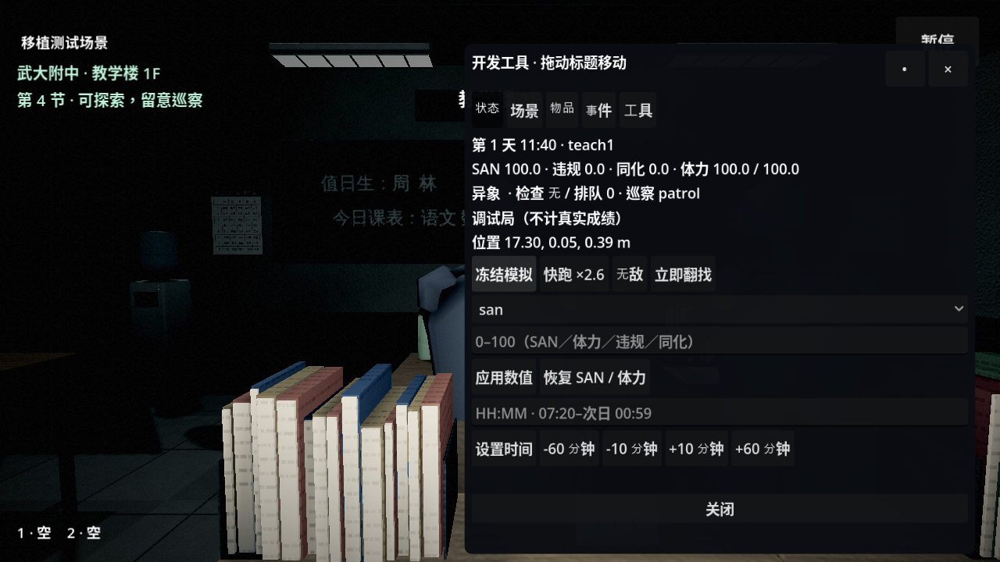 | 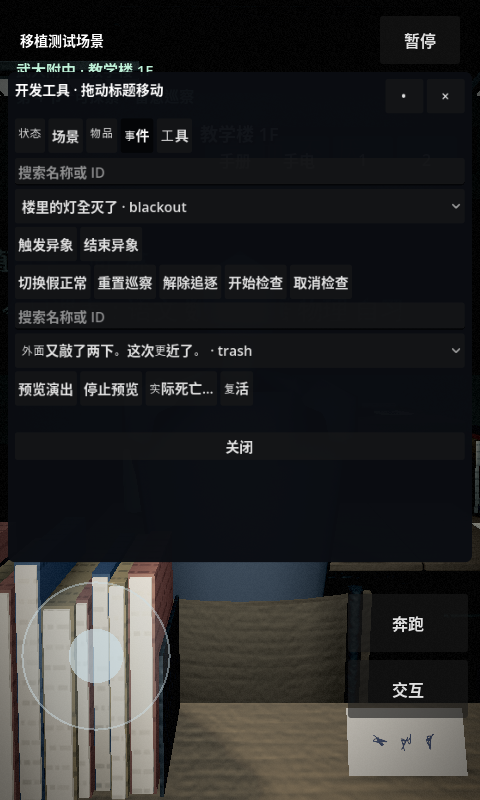 | 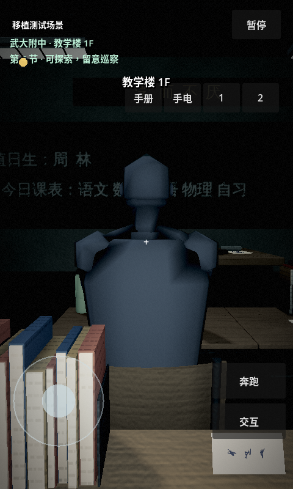 |

| 转身的人 | 门缝 |
| --- | --- |
| 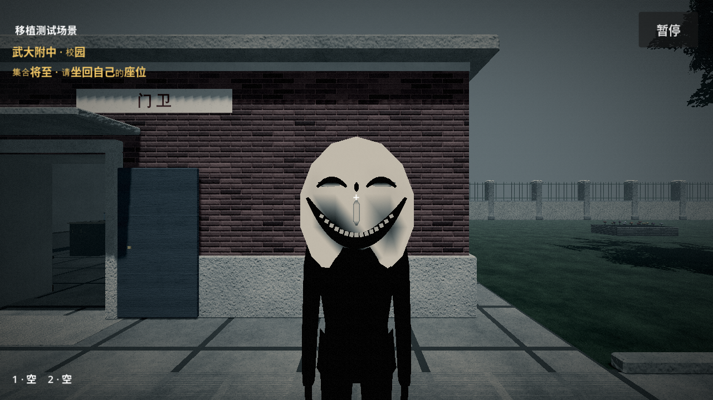 | 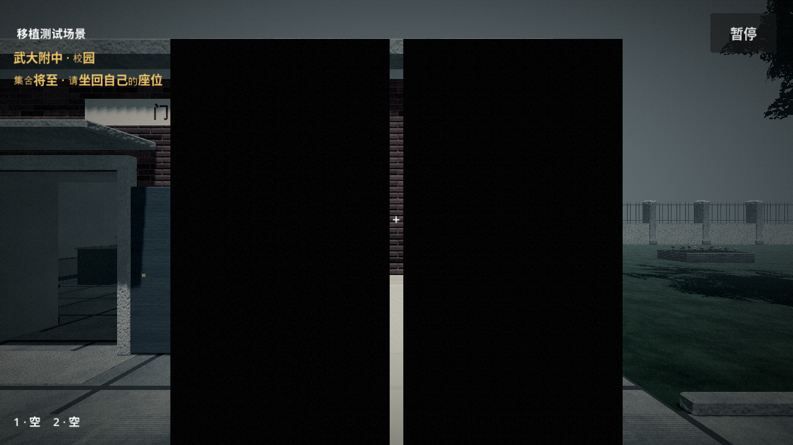 |


## 2026-11-08：规则怪谈 DLC 与独立记录

- 内置规则怪谈恢复原四套规则与证据载体、UTF-16 种子选组、阅读批注及危险纸飞机内页。默认关闭，菜单开关只影响新局；读档使用原保存的模式、组号和事件进度。
- 宿舍三声敲门、食堂餐券与课堂借名使用原触发条件、实际计时及每日／每夜限制。场景更换、读档、菜单、重开、死亡与复活取消旧敲门回调；已完成日期与借名途中计数保留。
- 七项模式成就使用独立资料文件，不解锁本体成就或给予加成；通关带独立模式字段，不混入本体最佳、排行与评级。调试失信标记保持不可撤销。旧 DLC 1.0.0／1.1.0 存档转换；未启用的残留模式标记不会启用 DLC，未知启用版本拒绝时保留当前会话。
- 专属死亡恢复原七秒门牌、门外脚影、描黑、镜头与字幕。采样直接运行原 `campus-rules.js`：261 个种子、全部规则组与载体、240 组触发条件、六个选择结果、四套原存档、141 帧死亡动画。入口 `tools/export_reference.py --rules-dlc-only`，回归 `tests/suites/rules_dlc.gd`。
- `1d0fb7b` 完整无窗口 **7,764 项检查、0 失败**，结构、工具、资源导入通过。补残留模式标记修复后，无窗口及原生窗口专项各 **689 项检查、0 失败**，无脚本或资源错误。独立固定目录上的 `1c4cae5` 完整原生窗口为 **7,549 项检查、0 失败**，仅覆盖该提交，不能冒充包含本批 DLC。
- 实景入口 `tools/capture/capture_rules_dlc.gd` 注入位置和时间，通过正式菜单、阅读、选择和死亡入口采集。环境仍为 Godot 4.6.3 Compatibility / Mesa llvmpipe、Dummy 音频；不代表自然长局、Android 真机或实际听感验收。
- 通用外部 JavaScript 模组的原生替代接口尚未实现，档案馆重播正在下一批处理；本批通过不等于全项目体验已完全一致。

| 模式菜单 | 门外有你的名字 |
| --- | --- |
| 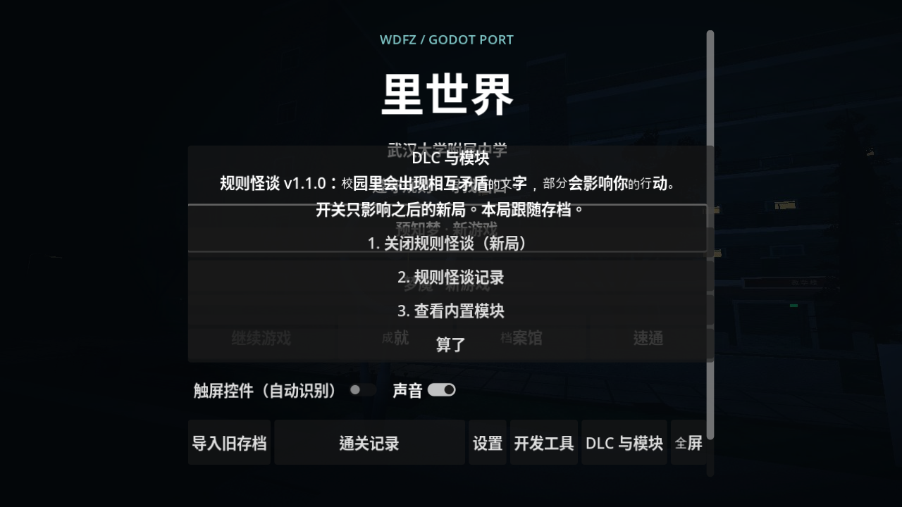 | 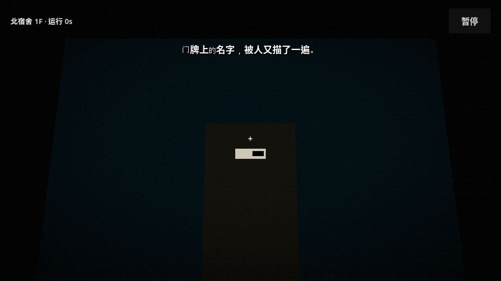 |


## 2026-11-08：CG 档案馆与隔离重播

- 依原实际来源恢复 24 份公开死亡、3 份隐藏死亡、12 段演出、规则怪谈专属死亡与七项模式成就、九档结算。独立档案只迁移一次旧死亡日志；未知来源保留待归档数量，不推测死因。直接解锁不伪造真实经历、成就或通关成绩。
- 死亡保护先于记档；调试面板、显式调试和重播不记档。此处按旧版当前事件上下文判断，与成就的整局可信标记分开。结算优先展示真实最好一局，未取得的直接解锁评级明确标为示例。
- 重播创建独立世界、相机与声音，不创建正式会话。全部 40 段逐项搭建、推进、退出，并比对正式玩家姿态、声音随机序列和递归资料文件原始字节。结束、返回、跳过、新局、读档与菜单取消旧回调。
- 修复首次换行后面板仍保持过大高度、原电梯跳过与返回按钮重叠、取消评级后仍发出延迟音效，以及过场依赖包未释放。列表在横竖屏内部滚动，返回后保留分类和条目。
- 直接采集原 `death-archive.js` 的旧记录、48 组真实／调试／重播组合、隐藏可见性及已见标记；复采入口 `tools/export_reference.py --archive-only`，回归 `tests/suites/archive.gd`。
- 完整无窗口 **8,026 项检查、0 失败**，结构、工具与导入通过；原生窗口专项 **263 项检查、0 失败**，无脚本／资源错误和对象泄漏。随后单独补评级取消处理，无窗口与原生窗口各 **18 项检查、0 失败**；前述完整数字不冒充覆盖这次最后的小修复。
- 实景入口 `tools/capture/capture_archive.gd`，使用独立临时资料和受控条目。环境为 Godot 4.6.3 Compatibility / Mesa llvmpipe、Dummy 音频；尚未代替自然长局、Android 真机和实际听感。界面主题与大字号整体适配继续单独处理。

| 真实记录与封存 | 电梯返回重播 |
| --- | --- |
| 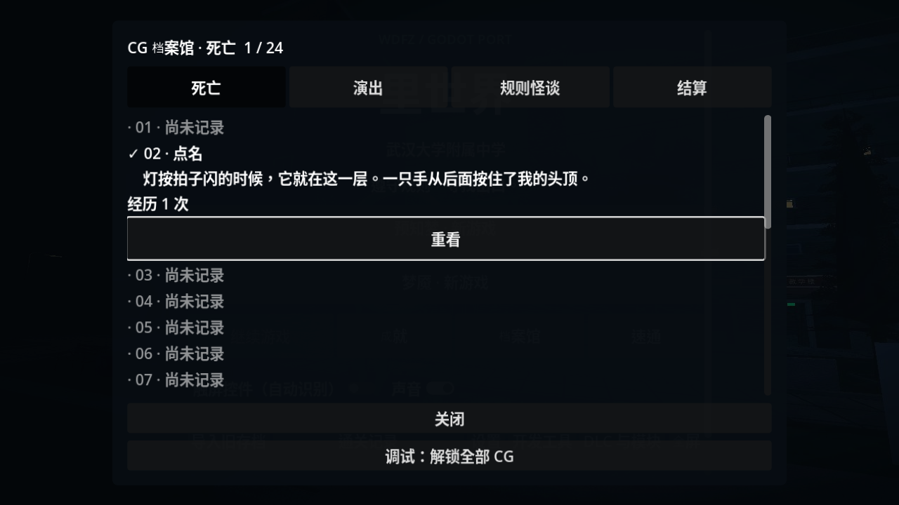 | 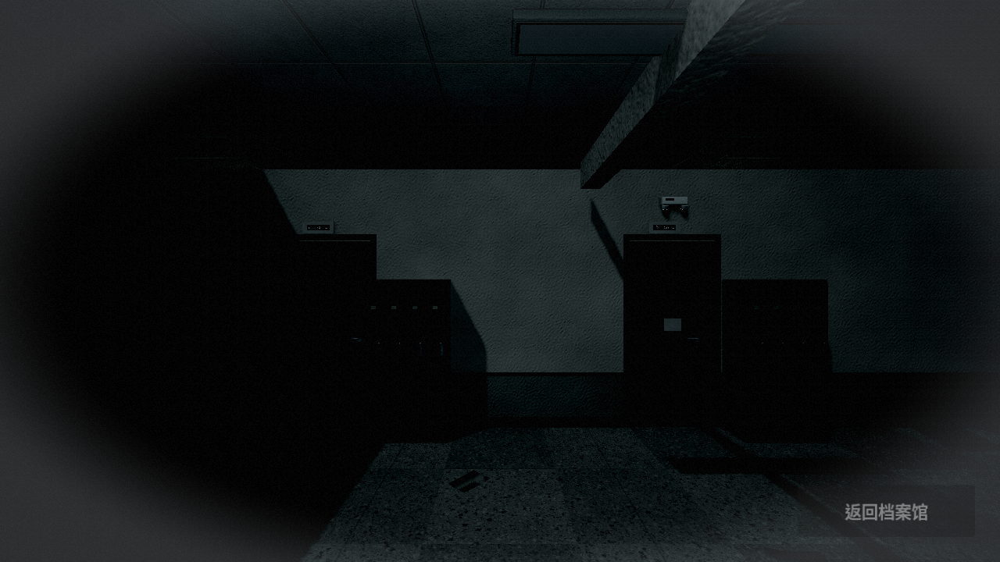 |


## 2026-11-08：界面主题、时钟与窄屏记录

- 修复每次应用字号设置都会新建空主题、丢失中文字体与按钮／面板样式的问题。现在复制基础主题后只改字号；菜单和选择框使用旧版纸色、黄铜色与不透明暗色面板。
- 场景名与游戏时钟分开保存和显示，地点更新不再覆盖手表时间；无表、特殊空间和速通分别沿用各自规则。玩家 HUD 去除框架阶段的“运行秒数”与移植标签。
- 结算内容整体滚动、底部导航留在屏幕内；通关记录的难度／路线／排序及楼层页签自动换行，长条目可换行，地图视口随窗口收缩。修复从回放切到足迹图时引用已释放的时间控件；成绩单字号跟随设置，关闭评级仍取消延迟音效。
- 档案馆标题和分类按实际高度分配滚动区，兼容大字号与横屏；样例成绩使用实际中文结局标题，不再显示内部路线 ID。
- 整合完整无窗口 **8,200 项检查、0 失败**，结构、工具、资源导入通过。随后补档案高度与样例标题，最终无窗口和原生窗口专项各 **188 项检查、0 失败**，无脚本／资源错误；前述完整结果不冒充覆盖随后的小修复。
- 专项覆盖 960×540、640×360、420×900、320×640 四种窗口、85%／100%／150% 字号、九条路线筛选、多楼层回放、展开后的结算滚动及真实触屏点击返回。窗口尺寸会经过项目既有的逻辑画布缩放。
- 实拍 `tools/capture/capture_interface.gd` 使用独立临时资料，记录与评级截图明确来自调试样例；课堂与规则批注使用正式游戏入口。Godot 4.6.3 Compatibility / Mesa llvmpipe，未代替 Android 真机可读性和实际手指操作验收。

| 竖屏大字记录 | 竖屏大字结算 | 规则批注 |
| --- | --- | --- |
| 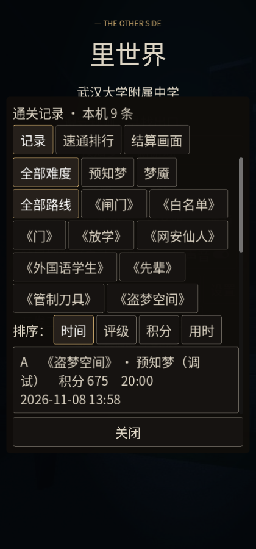 | 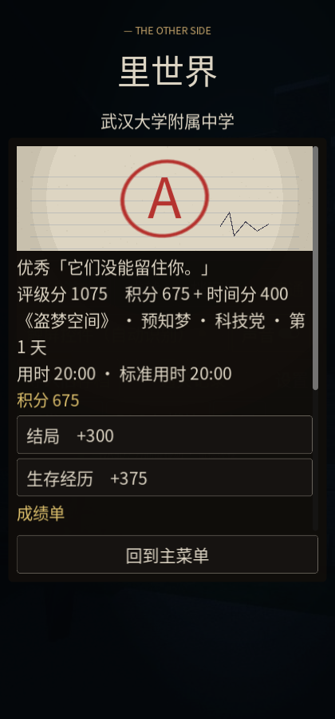 | 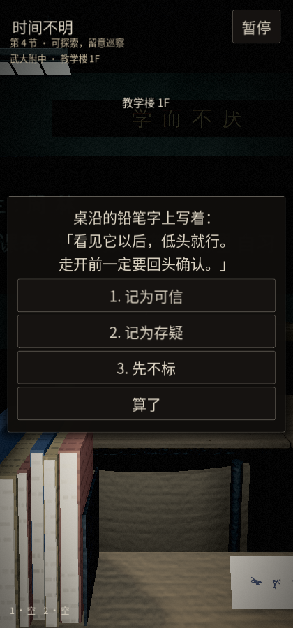 |


## 2026-11-08：同学动作与长铃离校

- `ClassmatesView` 对齐原座位坐标、老师朝向、35 违规转头、70 违规起身围拢、92 违规堵门及回头异象；仅控制表现，不新增人物碰撞、不修改占座或规则随机序列。
- 原教室动作的八组时间轴共 56 个中间帧进入独立对照。五层教室分别使用真实导航运行完整 60 秒长铃；铃停恢复原坐姿。`DepartingCrowd` 恢复原 16 人双列、背包、间距与起伏，六个时刻对照全部坐标，侧列障碍使用真实物理查询。
- 正式开场在第一帧前创建同学，原受光材质与黑影材质实际切换；演出老师与正式老师互斥，档案舞台独立创建人群，取消不污染会话。
- 本批完整无窗口 **8,354 项检查、0 失败**；最终原生窗口专项 **153 项检查、0 失败**，结构、工具与资源导入通过，无脚本／资源错误和对象泄漏。
- 上一批 `8a3d9b0` 的完整原生窗口回归另已结束：**8,687 项检查、0 失败**。这个数字覆盖档案和界面基线，不冒充覆盖随后加入的同学或地图修改。对应 GitHub 无窗口和窗口回归通过；桌面导出启动检查报告资源退出残留，另行追查。
- 实拍入口 `tools/capture/capture_classmates.gd` 使用正式场景与动作，在独立存档目录注入受控时间／机位。已查看正常教室、里世界、围拢、堵门、走向楼梯和室外双列画面；不能代替自然随机长局、实际听感和 Android 真机验收。

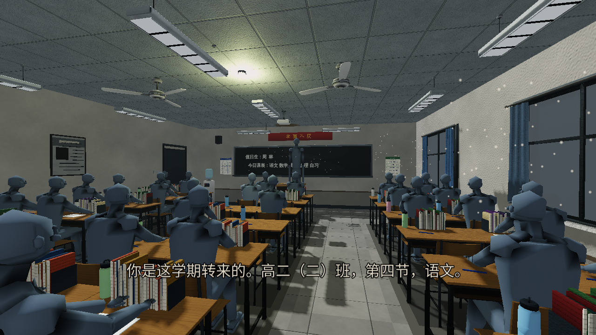
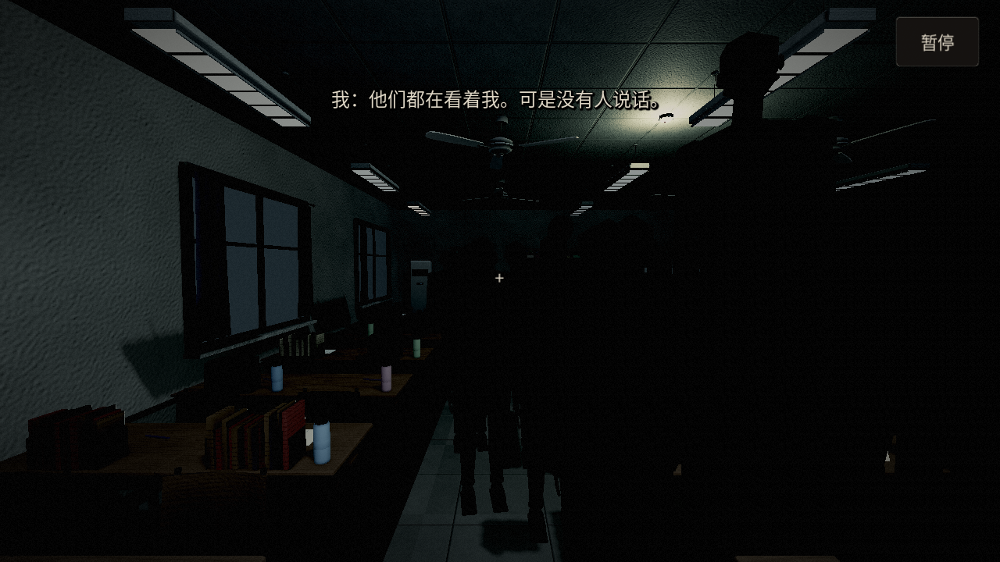
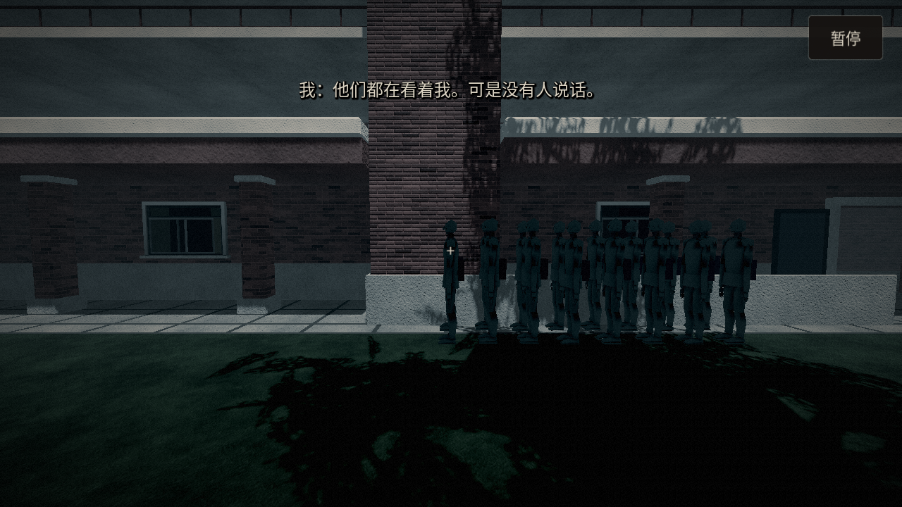


## 2026-11-08：校园总图与楼层定位

- 原校园道路、建筑短名和校门导出为独立目录。原画布三种尺寸的道路矩形和文字坐标直接取自旧运行时，验证原名称放置顺序、校门预留和窄建筑避让。
- 总图按屏幕缩放并居中；楼层保持可读格子尺寸，打开时滚动到当前玩家。原生容器的滚动范围需要等待布局完成，使用带页面代数的延迟定位，关闭、切页和回菜单不会被旧回调干扰。
- 四种窗口尺寸 × 三档字号验证长选项、长图例、横向滚动、关闭入口及真实触屏关闭。最终无窗口与原生窗口专项各 **154 项检查、0 失败**。回菜单改动另复核档案、记录、结算与主题，无窗口 **373 项检查、0 失败**。
- 前期完整无窗口 **8,341 项检查、0 失败**；随后加入居中和页面退出修复，所以不把这个数字当作最终整合结果。与同学批次合并后的完整无窗口回归 **8,513 项检查、0 失败**；结构、工具、导入均通过，无脚本／资源错误和对象泄漏。
- `tools/capture/capture_map.gd` 从新局打开正式地图，保留真实探索遮罩。已查看桌面道路与名称、竖屏 150% 字号楼层与总图；地图字体使用原生字体度量，不能称逐像素字体一致，也不替代 Android 真机验证。

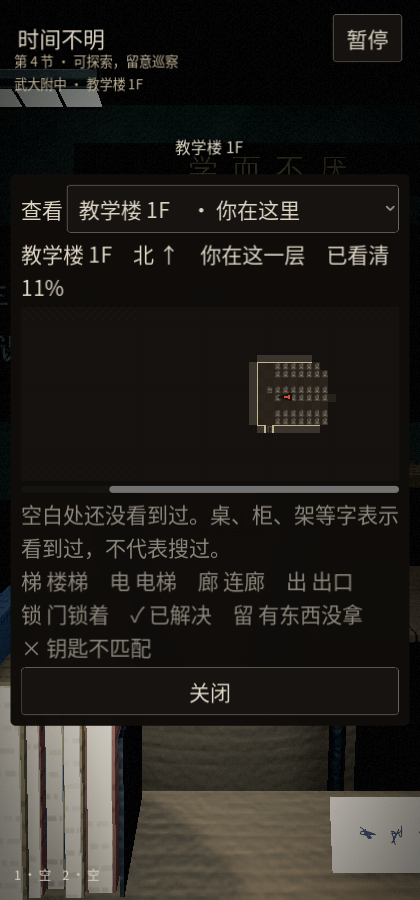
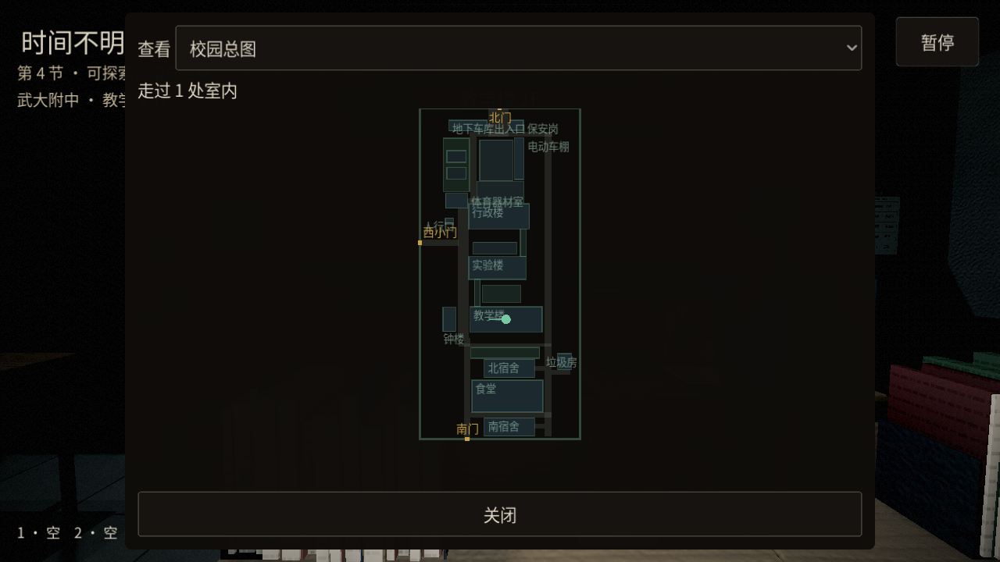


## 2026-11-08：阅读页面、终端与广播操作

- 笔记、导入、终端、死亡提示与话筒去除固定内容宽度；文字与路线按钮换行，正文独立滚动，退出／返回／朗读按钮留在屏内。共用 `PanelLayout` 计算可用区域，保留各页自身内容和操作。
- 终端第一次打开自动取得焦点；实际键盘逐字符输入 `help` 加回车只提交一次，触屏退出释放焦点。旧档导入长错误信息不覆盖关闭按钮，不因旋转丢失粘贴文本。
- 话筒在隐藏、失去可读条件和旋转屏幕时释放按住状态。隐藏一个按下中的 Godot 按钮还需清除内部按压序列，否则重开后的首次触摸不会再次发出按下事件；回归已实际复现并验证修复。
- 读档、新局、回菜单统一关闭话筒并停止旧广播模块的朗读；新会话不会继承按钮状态。终端也在安装新会话时关闭。
- 四种窗口尺寸 × 三档字号与会话边界，无窗口、原生窗口专项各 **203 项检查、0 失败**，无脚本／资源错误。与同学、地图整合的完整无窗口回归 **8,706 项检查、0 失败**；结构、工具与导入通过。
- `tools/capture/capture_documents.gd` 使用正式控件和合成的长文字样本。已检查竖屏笔记、终端、导入、话筒以及横屏长稿，不宣称其内容是自然游玩记录。Android 软键盘和真机安全区域仍需设备验收。

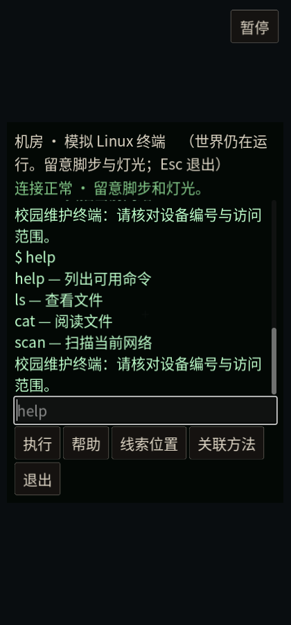
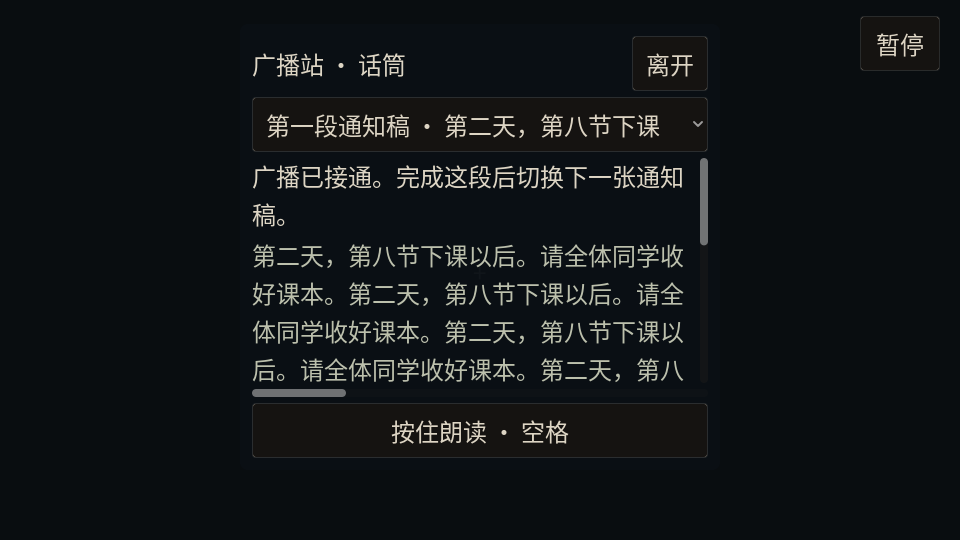


## 2026-11-08：桌面导出与音频退出

- 追查 GitHub `8a3d9b0` 的桌面构建失败：release 在仅运行五帧后直接退出，`pad_menu.ogg` 的混音播放对象偶发未回收。独立临时用户目录重复启动复现；单纯在退出树时调用 `stop()` 仍不能保证混音线程已完成渐退和回收。
- 新增 `ApplicationExit` 接管正常窗口关闭，取消演出、停止声音并禁止新的游戏更新，保留短暂主循环让混音完成后退出。声音节点离树时同时停播并解除流引用。
- 导出启动检查走与窗口关闭按钮相同的请求路径，检查完成标记，仍将脚本／资源错误视为失败。没有关闭背景音或忽略泄漏日志；引擎命令行的强制限帧退出不作为正常关闭流程。
- 修复后的 Linux release 在 24 个独立临时用户目录连续启动、正常关闭均通过，无泄漏或资源错误；原生窗口启动与关闭验证通过。整合后的 Linux／Windows 导出均成功，Linux 包启动及 PCK 场景与资源检查通过；Windows 仅验证交叉导出，未冒充真机运行。
## 2026-11-08：笔记中的外出责任

补齐原 `Investigation.render()` 的外出记录卡片：显示仍须参加的检查、许可到期不能免除责任、系统取消检查会顺延，以及缺席后不可用重新登记解除的持续追踪警告。直接读取现有学校和巡察状态，不额外保存或推导一套责任。搜索无结果时仍显示卡片。

专项无窗口与原生窗口各 **8 项检查、0 失败**，覆盖无责任、真实登记、查看不续签、系统取消顺延、缺席结算、重新登记保留追踪和读档恢复。正常窗口内使用正式笔记页，无脚本／资源错误。


## 2026-11-08：横屏维护范围与网安结局屏幕

- 维护目标统一为桌面与手机横屏，包括 16:9、16:10 及宽横屏；竖屏不受维护。早期竖屏测试和截图保留为历史记录，不作为后续验收承诺。
- 网安结局档案镜头依据实际视口比例与相机视野推进，修复固定距离导致内容过小的问题；显示器支架恢复到桌面上方。档案标题、分栏、矛盾框和逐段显示时序直接比对旧版画布操作，原生中文字体与等宽字体明确指定。
- 原脚本独立采样 45 组比例、视野和时刻组合；无窗口、原生窗口专项各 **1,316 项检查、0 失败**。原生演出检查仅覆盖维护中的三种横屏比例，验证退出后世界、相机与正式会话恢复。
- `tools/capture/capture_endings_cyber.gd` 经正式结局入口采集 1280×720 与 1600×720 的机房、走廊、档案和黎明。已检查档案内容完整可见；字体度量并非逐像素一致。受控采集不是自然通关实录，也不能替代 Android 真机和实际听感验收。
- 另一个固定目录上的提交 `5bcd175` 完整原生窗口回归已结束：**9,196 项检查、0 失败**，无脚本或资源错误。该完整结果只覆盖该提交，不包含本批及后续人物、纸飞机改动。

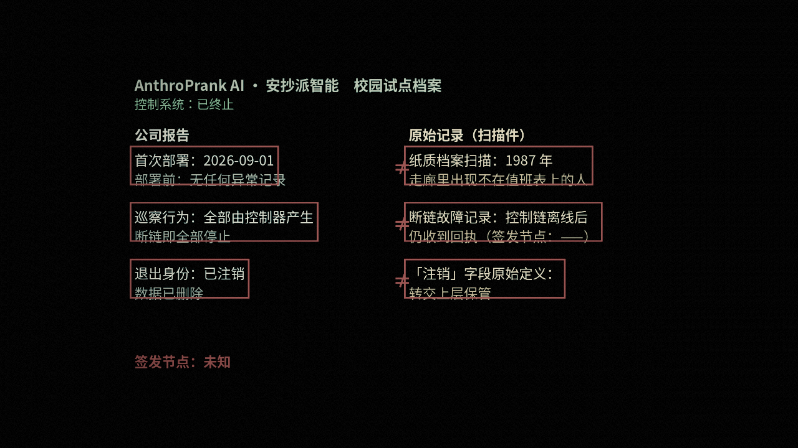
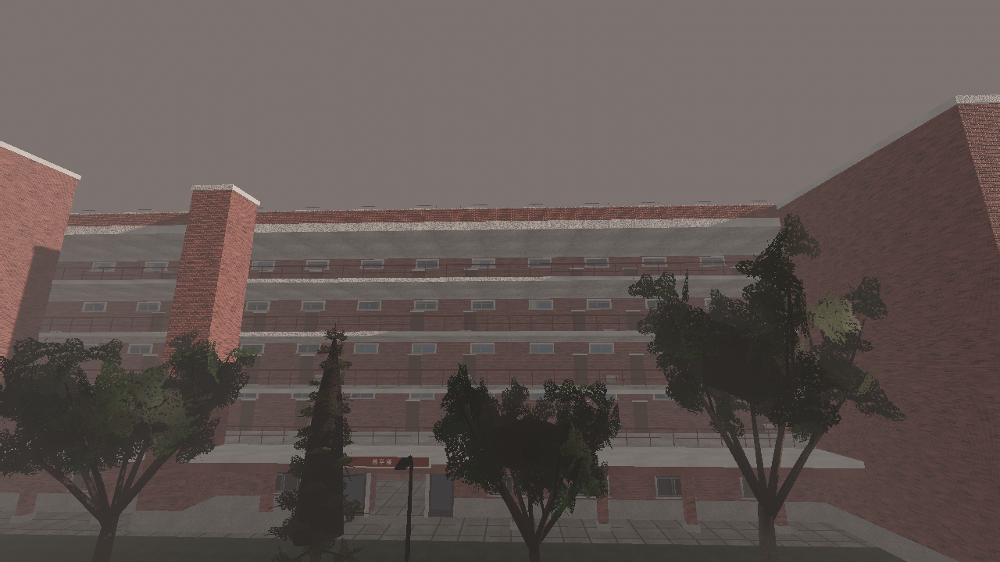
## 2026-11-08：校园人物与窗内视线

- 交流团恢复原领队与三位访客的尺寸、衣色、微弱自发光和各自路段朝向；搜查员使用原高个模型，跟随阶段之外隐藏。人物保留原固定脚高，不人为添加行走起伏。
- 窗后人影恢复原尺寸、朝向与不受雾影响的材质；两只扁球眼睛位于玻璃内侧并朝向玩家。切窗、切场景时重建对应表现，不修改规则或保存状态。
- 体检队伍恢复五人的身高差、衣色与自发光，保留实体碰撞；假正常群像恢复原尺寸。学生会黑影在生成时保存消散方向，检查结束后不会随玩家新位置改变散开方向，原 0.8 秒淡出和移动已逐帧对照。
- `tools/export_reference.py --world-people-only` 直接运行旧版表现脚本，采样来访、转弯、搜查、南北窗及侧向注视、检查消散和体检队列。无窗口与原生窗口专项各 **344 项检查、0 失败**；此分支整合后的完整无窗口回归为 **9,060 项检查、0 失败**，不包含随后合入的网安屏幕和纸飞机批次。
- 原生横屏采集 `tools/capture/capture_world_people.gd` 使用受控事件和合法站位；已查看人物、窗中眼睛、队列与检查黑影。登记牌字体及体检医疗道具仍有待对照，不将本批通过写成全项目零缺陷。

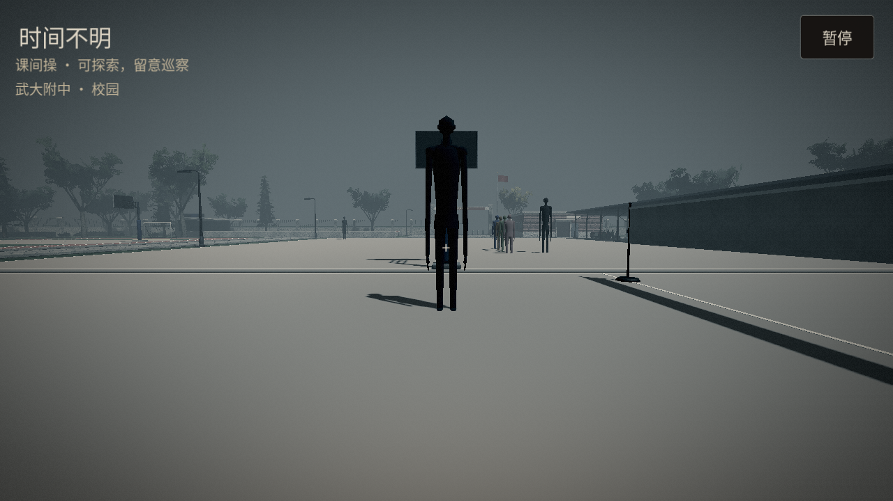
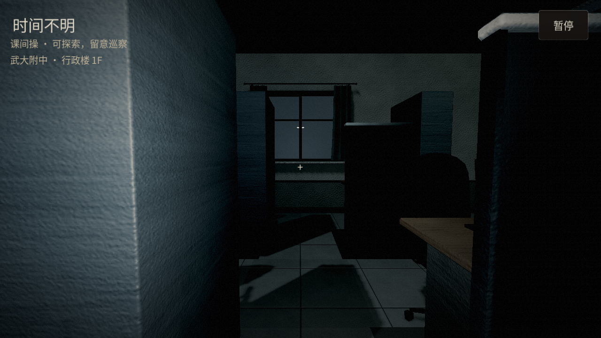
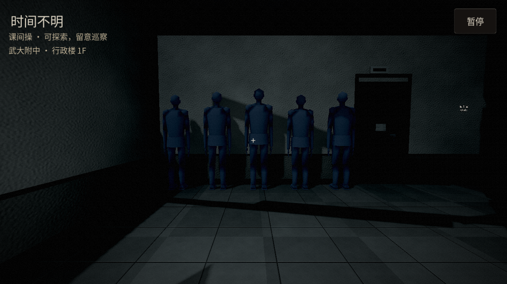
## 2026-11-08：纸飞机模型、跟拍与触屏控制

- 纸飞机恢复原折纸三角形、手掌与四根手指、飞入曲线、落地姿态和飞行朝向；碰撞使用旧版家具表，避免把普通功能地块当作低矮障碍。
- 跟拍改由独立相机承担，不再移动玩家实体和存档位置。阅读、飞行锁定角色移动，折纸与结束正确归还控制；切场景、读档、新局、死亡、结局和返回菜单取消旧相机与按键占用。
- 阅读显示真实八秒进度条，物理 E／回车可折纸。横屏触屏提供四个飞行方向，支持两根手指同时转向和升降；暂停、缩放、失焦与界面隐藏清除按住状态。投掷前已经按着的移动键须松开后再次按下。
- 原运行时采样折纸几何、十组阶段姿态及三十组高度／地块碰撞。最终无窗口与原生窗口专项各 **92 项检查、0 失败**；本批完整无窗口 **8,814 项检查、0 失败**。完整结果基于 `68dda94` 加本批，不包含随后整合的网安屏幕与人物批次。
- 真实输入回归覆盖两指方向、单指释放、暂停／恢复、宽横屏缩放、实际 E 键、阅读超时及会话退出。测试结束发送实际触摸释放，避免向后续界面测试遗留模拟手指。
- 实拍 `tools/capture/capture_paper.gd` 使用正式捡拾、阅读、折投入口，分别查看 1280×720 与 1600×720 的跟拍和触屏按钮；受控事件不冒充自然随机遭遇，Android 实际手指操作仍需真机复核。

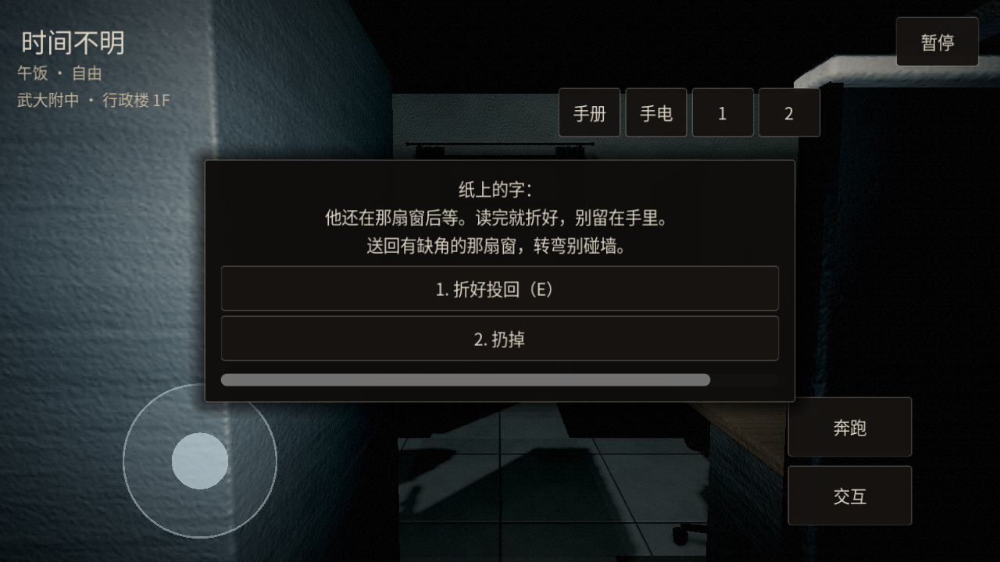
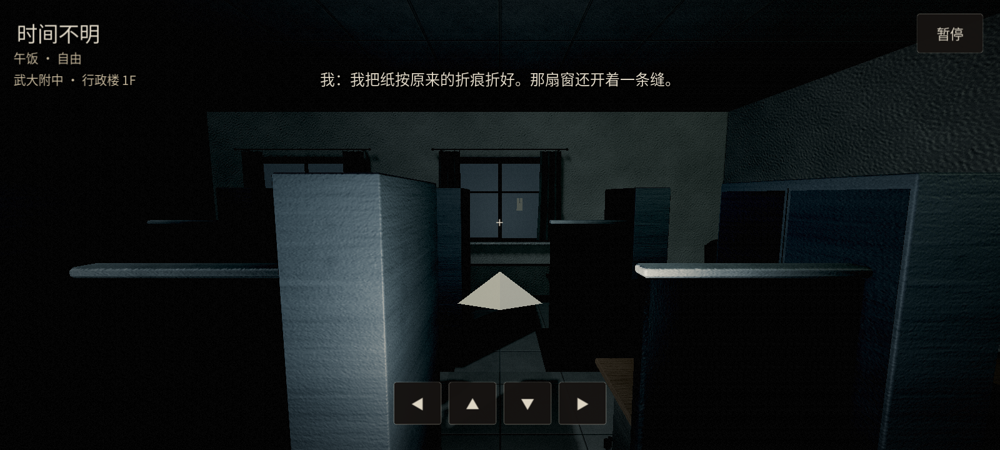


三批整合后的提交 `94f387f` 已通过结构检查、工具测试、资源导入与完整无窗口回归：**10,465 项检查、0 失败**，无脚本／资源错误和对象泄漏。原生窗口结果仍分别按上述专项与固定基线记录，未把旧基线的完整数字冒充为新提交的完整窗口回归。


## 2026-11-08：水杯、拍肩眼睛与蛾翅

- 水杯死亡复用原带二校门图案的杯身和杯盖，恢复杯盖附着高度、脱落后的地面高度及 XYZ 旋转。拍肩死亡恢复原红／金眼睛贴图、开合比例和前景显示，与普通拍肩效果共用素材构建。
- 死亡与普通蛾群使用原曲线翅形，修正右翅先局部镜像再旋转的顺序；灯晕恢复原渐变贴图。普通蛾群恢复原速度参数、表现层 LCG 随机序列及低档 60 粒落粉。没有改动异象伤害、死亡判定或玩法随机数。
- `tools/export_reference.py --death-models-only` 直接采样原三种死亡演出各十帧，以及普通蛾群三档各四个连续运行步。比较杯与盖、眼睛、镜头、身体／翅膀矩阵、落粉位置／寿命和距离。变换位置容差为 0.0002 m，旋转基底容差为 0.0005，允许大场景浮点位置导致的极小航向差。
- 无窗口专项 **128 项检查、0 失败**；原生窗口专项 **172 项检查、0 失败**，无脚本／资源错误和对象泄漏。Godot 无窗口占位渲染器不保留可回读的实例矩阵，全部实际矩阵比较只由原生窗口执行。
- 已查看 `tools/capture/capture_death_models.gd` 的 1280×720 水杯落地、眼睛张开与蛾群扑近实拍。截图通过正式演出入口控制取帧，不是自然游玩录像；落粉仍用小方块替代旧点精灵，其他主体分镜及实际听感继续复核。


## 2026-11-08：体检尺、秤盘与原视力表

- 医务室恢复身高尺上的 20 个刻度、秤的圆形表盘与红色指针；视力表改用原版五种画布，保持当天公开风险提示。门牌采用原画布，尺寸、朝向、位置与自发光贴图均按原运行时核对。
- 道具构建集中到 `CheckupProps`，现有体检规则、人物队伍和碰撞继续由各自模块管理；更换当天提示、关闭事件或离开场景时释放旧道具。
- `tools/export_reference.py --checkup-only` 直接采样五种原场景，独立比较全部子网格的变换、边界、颜色与纹理。无窗口与原生窗口专项各 **730 项检查、0 失败**，无脚本／资源错误和对象泄漏；正式场景回归验证排队时间结束后碰撞层关闭。
- 已查看 `tools/capture/capture_checkup.gd` 的 1280×720 医务室实拍：刻度、表盘、视力表与门牌可见。受控取景不代替自然遭遇、实际听感和 Android 真机检查。


两批整合后的提交 `403bab3` 已通过结构检查、工具测试、资源导入与完整无窗口回归：**11,325 项检查、0 失败**，无脚本／资源错误和对象泄漏。窗口专项按上文分别记录；原生完整回归由该提交之后的 CI 单独确认。

## 2026-11-08：十九种主体死亡分镜与退出恢复

- `tools/export_reference.py --death-timelines-only` 直接运行原脚本，采集 19 种分镜 × 正常／减少晃动 × 16 时刻，共 608 帧。独立比较道具姿态、透明度、线性色彩、雾与深度设置、镜头、收束遮罩、声音触发键；原生窗口额外比较实际实例矩阵。
- 恢复原表现随机序列，修正非均匀缩放作用顺序、圆片／圆环所在平面、长脖子朝向、霜花旋转和电梯外部光色。车铃罩、四面体碎片、下垂水泡、菜肴半球来自原几何顶点；并独立核对包围盒、顶点和三角形数。
- 电梯楼层灯从真实场景读取 1–5 层，逐层对照原七段灯。中断死亡演出清除闪光，镜头与原先隐藏的场景均正确恢复，不改死因、伤害或游戏随机数。
- 与原水杯／眼睛／蛾群模型测试合跑：无窗口 **2,613 项检查、0 失败**，原生窗口 **2,657 项检查、0 失败**，无脚本／资源错误或对象泄漏。声音只验证触发时刻与去重，不代表人耳试听。
- 横屏实拍入口 `tools/capture/capture_death_timelines.gd`。采样改为连续推进 1/60 秒，并初始化正式场景灯光；旧水杯、眼睛和蛾群取图中的跳帧闪光残留已消除并重采。已查看冷库、门缝楼层灯及上述三种模型。受控取帧不冒充自然通关记录，其他模块分镜细节和完整静态造型继续核对。


本批整合后的 `f17b394` 已通过结构、工具、资源导入及完整无窗口回归：**13,813 项检查、0 失败**，无脚本／资源错误和对象泄漏。完整原生窗口结果由该批提交的 CI 单独确认；上述专项不能代替完整结果。


## 2026-11-08：楼层氛围道具与窗外剪影

- 应急指示牌恢复原 128×48 画布、小人／箭头、无雾自发光和加法绿光；拖把、水桶使用原尺寸和 6／8／10 段圆柱。楼层资格遵从原 `Atmos.floorRoom()`，只在教学楼和实验楼的 1–5 层生成这些道具。
- 窗外胶囊占位替换为原站立人物，恢复 0.12 倍尺寸、深度压扁和透明材质；正式会话注入实验楼世界坐标与高度，按原算法投影到教室北墙。旧事件的观察计时或相机移动不会重算位置；新事件即使仍在同一教室，也会重新定位。
- 真正死亡时清理氛围道具、引用与记录；调试复活后按现有楼层及持久状态重建。没有改变触发概率、SAN 或碰撞。
- `tools/export_reference.py --atmos-props-only` 使用与原模型导出一致的 q2 素材，采集 15 个楼层资格、道具默认／错位姿态和 24 组有无锚点的窗口位置；核对材质、造型尺寸、模型边界、观察锥与清理。专项无窗口和原生窗口各 **1,128 项检查、0 失败**；正式会话测试覆盖锚点注入、事件产生、死亡与复活。
- 受控横屏取图 `tools/capture/capture_atmos_props.gd` 覆盖 1280×720 和 1600×720，使用实际场景与随相机更新的正式灯光。它不是自然遭遇实录，Android 真机与人耳听感仍需验证。


## 2026-11-08：下课铃末音与编码验证

- 修复把整段下课铃降调／减速的问题；原前七音保持不变，仅第八音依据日数和夜间调整音高、衰减时长。四个变体通过原 `sound-bank.js` 配方烘焙，仍作为同一个 `event.bellEnd` 播放和取消。
- 原运行时独立输出 16 组日期／时刻／铃种的调音、字幕和八音参数。无窗口与原生窗口专项各 **147 项检查、0 失败**，验证真实播放器速度为 1、室外响度与滤波、音轨时长、字幕及分类取消。
- 编码前逐样本比较前七音；编码后由 `tools/audio_bake/check_bell_tails.py` 解码 Ogg 检查频谱与前段。四种变体前段相关性 >0.999、响度变化 <0.003 dB，末音主频误差 <0.4 Hz；日间 7.57 秒、夜间 9.49 秒。未把波形验证当作人耳试听。


氛围道具批次 `6b50833` 已通过完整无窗口 **14,941 项检查、0 失败**；叠加铃声修复的 `d2ebedd` 通过完整无窗口 **15,057 项检查、0 失败**。两次均含结构、工具和资源导入验证，无脚本／资源错误和对象泄漏。原生窗口专项结果按各节分别记录。

## 2026-11-08：氛围事件取消与声音通道复用

- 小事件的嗡声／敲门声有独立归属；结束、真实威胁、换房和暂停时按原 0.04 秒时间常数淡出，约 0.32 秒后停止声部。暂停会立即恢复被事件压暗的灯光。
- 撤销该事件尚未开始的声音；通道被其他音效复用时先撤销旧淡出。全局清理同时取消淡出任务，避免旧回调停掉新会话或新音效。
- `tools/export_reference.py --scene-audio-only` 直接运行原 `SensoryScenes`，对照正常收尾、威胁、离开、暂停、门后回应和重新开门六种流程。规则依然不调用音频节点；应用层接收取消事件后交给声音适配器。
- 验证范围包括二维／三维声部、指数衰减、暂停期间完成、通道复用、延迟队列、重复取消，以及正式应用的暂停和传送。Godot 共用空间混响，已生成的混响尾音继续自然衰减；不能据此声称和旧版每声部的独立湿声淡出完全一致，实际听感仍待复核。

本批专项（含原定时小场景规则）无窗口 **83 项检查、0 失败**，原生窗口 **92 项检查、0 失败**，无脚本／资源错误和对象泄漏。原规则测试按随机抽中的门后回应逐项检查，两种运行的检查数量可不同。


`d5bd439` 完整无窗口回归为 **15,117 项检查、0 失败**；包含结构、工具和资源导入，无脚本／资源错误和对象泄漏。

## 2026-11-08：人物材质的顶点颜色

- 修复人物全身颜色重复乘以导出网格顶点明暗的问题。原 `figMesh` 调用没有启用顶点颜色；移植现已保持原材质设置，避免体检、交流团、窗中人物和死亡演出中的人物被额外压暗。手部等原本使用顶点颜色的道具不受影响。
- 独立旧版人物及死亡演出样本增加实际材质开关对照；假正常人物采样改用原公开随机种子接口，避免给被冻结的随机对象赋值却未生效。人物、十九种死亡演出与窗外剪影专项，无窗口和原生窗口均为 **2,928 项检查、0 失败**，无脚本／资源错误或对象泄漏。
- 横屏重新采集并查看体检队伍和高个搜查员，已更新本页人物截图；没有把受控事件取图当作自然遭遇或完整通关验收。


人物材质修正 `2f38e8a` 完整无窗口回归为 **15,113 项检查、0 失败**；结构、工具和资源导入也通过，无脚本／资源错误或对象泄漏。原定时小事件规则仍按实际随机分支计数，完整检查数会小幅变化。

固定基线 `cd65575` 的 [GitHub CI](https://github.com/wd-fz/wdfz/actions/runs/42499159995) 已全部成功：原生窗口 **14,335 项检查、0 失败**，无窗口回归、结构和桌面构建均通过。这份完整窗口结果只覆盖该基线，后续批次的窗口专项按各节单独记录。

## 2026-11-08：特殊空间死亡布景与坠落道具

- 迷失走廊恢复原合并网格、两侧不同的板材明暗、正确门板颜色；八扇门改为原三层实例绘制，实际开合与光边矩阵均按原时间轴对照。走廊与门从 80 个独立网格降为一个合并网格和三个实例组。
- 坠落恢复平台边缘、粉笔箭头网格、起点地面的斜线和四边边框，以及朝前张开的手电光锥和圆形灯头；修正箭头局部转向及碎块的原随机序列。没有改变死亡条件、时长或玩法随机数。
- `tools/export_reference.py --maze-death-only` 从固定旧运行时直接导出六种小网格与两种演出、两档晃动、25 个时刻，共 100 帧。比较原几何边界、法线方向、顶点色、人物与道具姿态、镜头及收束遮罩；原生窗口还读回并核对全部门和碎块实例矩阵。
- 包含原死亡恢复检查，无窗口与原生窗口专项均为 **434 项检查、0 失败**；结构、工具及资源导入通过，无脚本／资源错误或对象泄漏。几何对照明确容许 Godot 对零厚度包围盒扩张 0.00001 米和顶点色量化；不将其写成逐像素相同。
- `tools/capture/capture_maze_death.gd` 使用实际特殊空间灯光和连续演出时间，覆盖 1280×720、1280×800 与 1600×720。已查看门缝、箭头掠过和平台手电三幅实拍；这些是受控分镜检查，仍需自然游玩及真机验证。


特殊空间布景批次 `185a2e0` 已通过结构、工具、资源导入与完整无窗口回归：**15,525 项检查、0 失败**，无脚本／资源错误和对象泄漏。

## 2026-11-08：满员暗场、手部与原显示屏

- 轿厢墙面改在线性色彩空间变暗，避免暗场被过度压黑，并保持不透明度。六只手保留原顶点明暗，正确使用原线性 0.03 着色；恢复原出现边界，尚未出现或已经结束的手不再继续移动。
- 普通轿厢与死亡演出共用原 256×96「满员」画布，替换字体占位；演出恢复原地板平面。普通轿厢仍保留已验证的降低悬挂高度，保证完整牌面位于导出模型的顶棚下方。
- `tools/export_reference.py --crowd-props-only` 采集三种横屏比例、正常／减少晃动与 25 个时刻，共 150 帧。直接比较材质、手部、七段显示、门、学生证、四边遮挡及镜头；另验证手部在玩家移动或转向后的局部姿态不变，避免旧代码把局部注视点当作世界坐标的偏差。
- 与原满员规则、旧档转换及实际出门流程合跑，无窗口 **1,373 项检查、0 失败**，原生窗口 **1,375 项检查、0 失败**。结构、工具、资源导入通过，无脚本／资源错误和对象泄漏；没有改抽取概率或六秒离开窗口。
- 更新 `tools/capture/capture_crowd.gd` 为连续时间推进、隔离存档及横屏取帧。已查看重新开门的原牌面、16:10 手部挤压和宽横屏学生证；受控演出不代替自然遭遇、真机或实际听感。


满员表现批次 `16ed217` 完整无窗口回归为 **15,992 项检查、0 失败**，包含结构、工具与资源导入，无脚本／资源错误或对象泄漏。

## 2026-11-08：蛾群落粉点粒子

- 落粉由小方块改回正方形点粒子，保留原颜色、0.65 透明度、深度测试、雾和不写深度的设置；屏幕尺寸按原 `PointsMaterial` 的视口高度与距离衰减，保持与视野角无关。
- 粉末位置仍由已有原随机序列、寿命和漂移规则计算；每帧一次上传点顶点，更新可见包围盒，代替逐个写入实体方块矩阵。
- 在独立旧 Three.js 场景实际渲染 24 组横屏尺寸／距离／视野角，并用 Godot 原生视口的实际像素范围对照；允许点光栅边界的一像素差异。同时确认不穿过不透明墙，原生读回顶点与旧版漂移数据一致。
- 与既有水杯、眼睛、蛾群分镜及天气合跑，无窗口 **134 项检查、0 失败**，原生窗口 **215 项检查、0 失败**；结构、工具和资源导入通过，无脚本／资源错误或对象泄漏。小方块替代落粉的已知差异已关闭，实际 Android 图形驱动仍需真机复核。


落粉批次 `a3638eb` 完整无窗口回归为 **15,997 项检查、0 失败**，包含结构、工具与资源导入，无脚本／资源错误或对象泄漏。

## 2026-11-08：登记牌画布与医疗纸面的发光贴图

- 交流团登记牌使用原 256×160 三语画布，恢复原色彩、双面显示及发光贴图；道具构建移出应用主类，集中到 `ExchangeSign`。访客规则、人物位置与考核不变。
- 修复视力表和医务室门牌使用 Godot 默认发光「相加」的问题。它会额外抬亮整张纸，现按旧 Three.js 的发光色乘以贴图计算，保留字形对比；新增登记牌也使用相同乘法。
- 截图发现旧版位置的支柱会挡住牌面下半部分文字：保留支柱尺寸，向后移 0.06 米，使其位于正面后方。这是明确保留的可读性修正，没有冒充与旧几何位置完全一致。
- 原人物与医疗运行样本补充登记牌、贴图和发光映射对照。无窗口与原生窗口专项均为 **1,108 项检查、0 失败**；结构、工具、资源导入通过，无脚本／资源错误和对象泄漏。
- 已查看横屏的登记牌近景及修正后的视力表。近景是受控相机检查，不是实际步行路线；原医疗截图已更新，实际听感与 Android 真机仍须验证。


上述四批整合后的 `70b8f3b` 已通过结构、工具、资源导入与完整无窗口回归：**16,040 项检查、0 失败**，无脚本／资源错误或对象泄漏。原生窗口专项按各节分别记录；完整窗口 CI 结果仍按实际提交单独确认。导出冒烟检查增加动态迷宫几何、原显示牌与落粉着色器，避免开发目录可用而发布包缺资源。


`187ea14` 的 Linux 发布包已完成实际导出、原生启动及外部 PCK 冒烟检查：`python tools/export.py --platform linux` 成功，开发用测试／文档目录未混入包，新迷宫几何、显示牌与落粉着色器均在包内可加载。该结果只证明 Linux 导出与启动，不代表 Android 真机验证。


固定基线 `6af4c23` 的 [GitHub CI](https://github.com/wd-fz/wdfz/actions/runs/42501685061) 已全部成功：完整原生窗口 **15,648 项检查、0 失败**，日志无脚本／资源错误或对象泄漏；无窗口回归、结构与桌面构建也通过，同基线 [Android Debug](https://github.com/wd-fz/wdfz/actions/runs/42501685409) 构建成功。它不覆盖随后四批实现；新批次的完整无窗口、各窗口专项及 Linux 导出范围见上文。


## 座位提示、走跑切换与新版设置界面（2026-11-08）

- 修复前的实际引擎复现：坐着时的「站起来」每 0.1 秒被附近座位提示覆盖；摇杆推满会在开关关闭时自动奔跑；第一根手指按住摇杆时，第二根手指不能操作原生按钮。前置专项 12 项检查中 4 项失败，记录于本地 `build/reports/player-controls/before.log`。
- 提示统一从应用层选择，坐姿和躲藏优先于普通物件；对应交互也优先起身／出来。摇杆只决定方向与幅度，奔跑由明确开关控制，真实速度分别为 21/9 与 36.4/9 米每秒。触屏动作按钮直接跟踪手指并过滤重复的模拟鼠标点击；体力／伤势阻止奔跑时显示「暂不能跑」。切场景、恢复位置、暂停和拒绝输入时，按钮与实际奔跑状态同步。
- 设置拆到独立 `GameSettingsPanel`，五分类导航、卡片、大滑杆、微调按钮、开关、当前画质说明与文字预览。固定页头和保存反馈，卡片向滚动区传递手势，避免划不动；修改保留控件实例与滚动位置，布局编辑与设置按 Esc 逐层退出。保留全部 16 个设置键及原存储格式，只在实际写入成功后显示已保存。
- 原生窗口专项 **118 项检查、0 失败**：逐帧座位提示、真实走跑速度、双指与三指操作、视角跨过按钮、单击不重复触发、体力限制、暂停和切场景状态、桌面 Shift，以及真实设置控件的保存／生效、拖动滑杆、手势滚动、布局入口、关闭、分类和 16:9／16:10／超宽横屏在 100%／150% 字号下的边界。既有触屏工具栏与暂停／布局交互回归一并通过。
- 截图由原生 Godot 渲染生成，已查看画面、操作和大字体页，见 `pictures/设置/02–04`；可用 `tools/capture/capture_settings.gd` 重新生成。窗口验证使用 Linux 软件渲染与注入的触摸事件，仍不代表 Android 真机触控、性能或硬件图形验收。

本批最终结构检查、工具测试、资源导入及完整无窗口回归均通过：**16,135 项检查、0 失败**。原生窗口专项为上述 **118 项检查、0 失败**，日志无脚本／资源错误或对象泄漏；完整窗口 CI 与 Android 构建按提交单独跟踪。


## 2026-11-08：全界面、启动方向与公开版构建

本轮统一主菜单、暂停、设置及各类面板，背包／档案／笔记改为条目卡片，手机与贪吃蛇改为横向布局。主菜单与暂停复用 `MenuScreen`，控件统一使用 `theme.tres`／`UISkin`。桌面和新配置默认全屏，Android 启动 Activity 声明 `sensorLandscape`，运行时关闭自动旋转仍保持固定横屏。

- 完整无窗口回归：**16,498 项检查，0 失败**。
- 原生窗口界面专项：**627 项检查，0 失败**（主菜单／暂停所有入口、100%／150% 文字、横屏比例、设置持久化和触控、手机与小游戏）。
- Python 工具测试：**17 项，全部通过**，含 Launcher 横屏属性、Release 不可调试检查、来源提交／密钥证书元数据／附件摘要校验。
- 实际渲染截图见[界面计划](plan/设置.md#全界面统一与横屏布局)；截图脚本使用隔离配置和示例记录。

公开版本使用独立 Release 模板与用户提供的签名密钥；构建验证和原生窗口测试不等同于 Android 真机运行验收，APK 元数据保留 `runtime_verified: false`。
