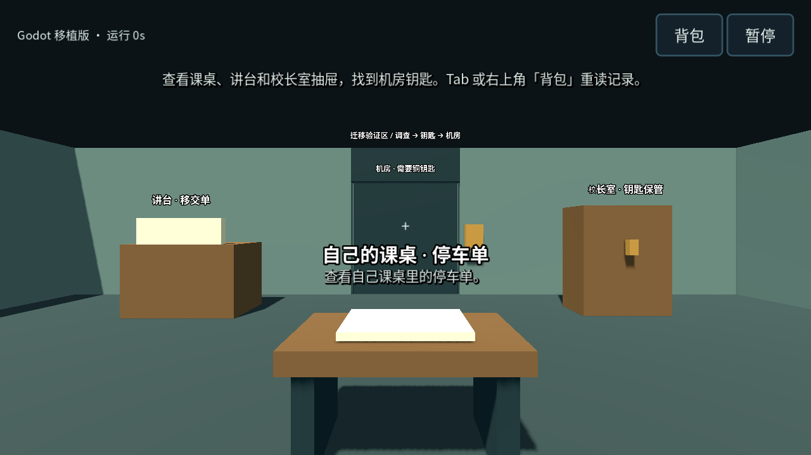
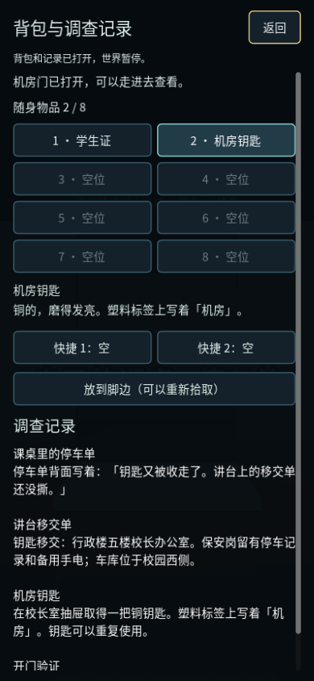
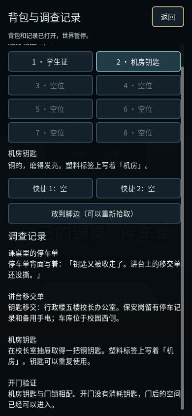

# 首条调查流程迁移与验证

2026-11-07，在 M0 框架 main `1ff6a5c` 上交付 M1。Godot 4.6.3 标准版，GDScript，Compatibility 渲染器。旧版参考仍为 `wd-fz/wd-fz.github.io @ 0bf508a`。

## 可运行流程

主菜单点「开始调查」，在缩略验证区查看自己的课桌停车单、讲台移交单、校长室抽屉，取得机房钥匙，再操作门旁铜色门锁，走进机房。也可以先调查门锁、直接找到钥匙或重复查看线索，流程没有强制按顺序解锁交互。

按 Tab 或右上角「背包」打开物品与调查记录。8 格背包不叠放同类物品，两个快捷栏可指向已持有物品；当前快捷键只查看描述，正式使用效果待接入。放下的物品落在脚边，读档后仍可拾回。

调查、取得／放下／拾回物品、开关门和背包选择变化会自动保存；同帧的多个变化合并为一次写入。暂停页仍可手动保存。打开背包暂停世界，关闭后回到原来的游玩或暂停状态。

## 移植的旧版规则

| 旧版来源 | 本轮迁移 |
| --- | --- |
| `domain/inventory.js` | 容量 8、物品唯一、两个快捷引用、选中位置，移除物品时清除快捷引用 |
| `core.js` 的物品表 | 保留 `card`、`roomkey`、`chalk`、`pen`、`notebook`、`torch`、`key`、`coin`、`map` 九个 ID、名称和描述 |
| `domain/player-stats.js`、`state.js` | SAN 100、违规 0、同化 0、体力 100 的初值；数值范围、违规豁免与检查例外、`40 + 0.6 × SAN` 体力上限 |
| `investigation.js` | 课桌停车单、讲台移交单的线索内容；事实只在实际交互后记录，可以重读 |
| `items.js`、`interact.js` | 机房需要 `roomkey`，开门不消耗钥匙；满包时不占用容器、不丢失钥匙；开门和重建表现分开 |

玩家数值目前是持久模型和受限写入接口，没有接入伤害、体力消耗／恢复、同化死亡或感官表现；这些属于后续生存系统。正式校长室有随机掉落与保底，本轮固定钥匙用于验收，没有迁移那套掉落规则。

## 模块与数据边界

| 模块 ID／资源 | 职责 |
| --- | --- |
| `player.inventory` | 物品、快捷栏、选中位置、各世界的地面物品 |
| `player.vitals` | 玩家数值与保存校验 |
| `story.first_investigation` | 调查条目、钥匙来源领取状态、机房门状态 |
| `content/items/base_items.tres` | 编辑器物品目录，由组合入口转换为普通数据注入规则 |
| `investigation_slice` | 缩略验证区的稳定世界 ID |

物品放下时从背包移除，将世界 ID 与位置写入同一个库存域；地面拾取实体由 `GroundItemView` 重建，不能把 Node 放进存档。层 4 的拾取物不阻挡玩家，交互射线仍会被墙遮挡。

`InvestigationView` 根据规则投影钥匙是否可见、门是否可通过。门口的物理保护在适配器处理，防止玩家站在门洞中关门。读档先通过字段和跨模块校验，再替换当前会话；「钥匙已领走但背包／地面都没有」的坏档被拒绝。

顶层格式仍为 Godot v1，每个新模块自己的状态版本为 1。旧 M0 存档缺失新模块时按默认值创建，原 `migration_lab` 仍可加载；不提供 Web 存档转换。更换会话会清理未写入的旧局自动保存请求，并断开旧模块的应用回调。

## 验收

本地执行 `python tools/check.py --windowed`，真实导入项目、规则层边界检查通过；无窗口与 X11 / Mesa llvmpipe 窗口模式各 **186 项断言通过**。包含原 M0 回归和新增 M1：

- 背包满格、重复物品、未持有快捷引用、无效 ID／位置、地面与背包去重、失败操作保持原值。
- 满包翻抽屉后钥匙仍在，空出位置后可取得一次；钥匙可重复开门，丢到地上后不会从抽屉重新生成。
- 玩家数值初值、边界、SAN 体力上限、违规豁免和检查例外，恢复不重放效果。
- 通过移动输入和 CharacterBody3D 在验证区实际行走，派发交互输入查看线索、取钥匙、开门并走进机房；没有用传送代替这段行走。
- 未开门时物理阻挡、人在门洞中拒绝关门，读档后门碰撞与钥匙外观一致。
- 经触屏按钮选择物品、分配快捷栏、放下钥匙；保存加载后再实际走过去，射线拾回钥匙。
- Tab 连按、Esc 返回、背包冻结模拟、从暂停进入背包再返回、横竖屏滚动与关闭按钮可达。
- 不一致存档不销毁当前世界；旧局待保存请求与旧模块的晚到信号不能写进新局。

窗口模式使用软件渲染，不代表 Android 真机、系统手势、真实 GPU、Vulkan 性能或完整游戏平衡已验收。

## 画面证据

由 `tools/capture_preview.gd` 从实际 Godot 窗口捕获。界面预览通过已有交互命令准备记录；它用于检查界面，不代替上面的行走与交互测试。

## 下一阶段

本轮场景将课桌、讲台、校长室抽屉和机房放在一处便于验收，尚不是正式校园的楼层关系。M2 继续迁移教学楼／行政楼／实验楼的真实布局、连续路径、楼梯和时间事件。

课表、正式 11:40 开局、特殊时间窗口、检查、跨日压力、笔记本与笔的跨日记忆规则、完整背包物品效果、巡察者、音效和结局均保留后续待办。没有把当前验证区算作游戏通关，也没有以数值模型代替完整生存系统。
